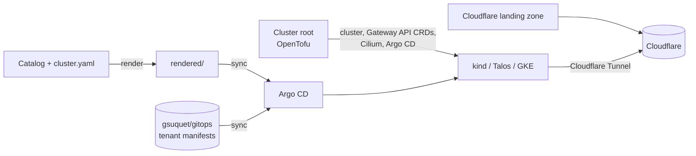

# infra

OpenTofu and GitOps for the platform: Kubernetes clusters on developer machines (kind), Raspberry Pis and local
servers (Talos) and Google Cloud (GKE), each run by its own Argo CD, plus the Cloudflare account that fronts them.
It is the greenfield successor of `gsuquet/homelab`, which stays frozen and keeps running the production k3s
cluster until a Talos cluster from this repository replaces it.



*IaC builds and bootstraps each cluster; Argo CD runs everything else from rendered manifests.*

> Which IaC binary the commands run today: [IaC tool](docs/reference/terraform-modules.md#iac-tool).

## Quick start

Prerequisites: [mise](https://mise.jdx.dev/) 2026.10.24 or later (tested version; `lockfile = true` needs a
recent release). Every other tool, `pre-commit` 4.7.0 included, is pinned in `.mise/config.toml` and
`.mise/mise.lock`.

```sh
mise install
pre-commit install --install-hooks
pre-commit install --hook-type commit-msg
mise run manifests:check
```

`[INFO] The rendered manifests are up to date`.

## Usage

Render manifests after a change to a component, a `cluster.yaml` or a tenant file
([how-to](docs/how-to/render-manifests.md)):

```sh
mise run manifests:render
```

Plan the Cloudflare landing zone with the read-only token
([credentials and first-apply bootstrap](landing-zone/cloudflare/README.md)):

```sh
mise run tf:read plan -lock=false
```

Create, plan or destroy a cluster: planned as `mise run cluster:up|plan|down <name>`; the tasks do not exist yet
([cluster lifecycle](docs/concepts/cluster-lifecycle.md)).

## Development

The same checks CI runs on every pull request; `plan` stays local and a kind end-to-end job is deferred.

```sh
pre-commit run --all-files
mise run lint:shell
mise run lint:actions
mise run schemas:check
mise run policy:test
mise run manifests:check
mise run manifests:validate
mise run policy:check
```

## Docs

- Start here: [`docs/README.md`](docs/README.md), the map of every page.
- Concepts: [platform overview](docs/concepts/platform-overview.md),
  [repository layout](docs/concepts/repository-layout.md).
- Reference: [mise tasks](docs/reference/mise-tasks.md), [GitOps files](docs/reference/gitops-files.md).
- Proposals: [`docs/rfc/`](docs/rfc/). Accepted decisions: [`docs/adr/`](docs/adr/README.md).

## Owners

`gsuquet`, through issues and pull requests on this repository. License: [LICENSE](LICENSE).
