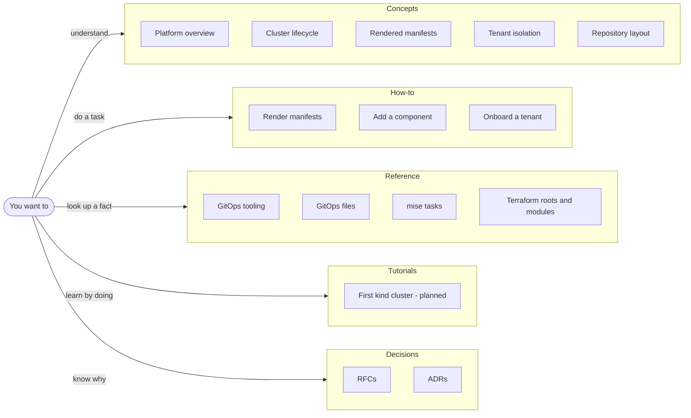

# Docs

The documentation of `infra`, by reader need ([Diataxis](https://diataxis.fr/)): pick the box that matches what
you want to do.

*Each box is one folder of `docs/`; each node is one page below.*

| Type | Page | Read it to |
| --- | --- | --- |
| Concept | [Platform overview](concepts/platform-overview.md) | see every part of the platform and how they connect |
| Concept | [Cluster lifecycle](concepts/cluster-lifecycle.md) | follow a cluster from `cluster:up` to `cluster:down` |
| Concept | [Rendered manifests](concepts/rendered-manifests.md) | understand the path from a chart to the cluster, and sync waves |
| Concept | [Tenant isolation](concepts/tenant-isolation.md) | understand what a tenant can and cannot do |
| Concept | [Repository layout](concepts/repository-layout.md) | find where each kind of file lives |
| How-to | [Render manifests](how-to/render-manifests.md) | update `rendered/` after a source change |
| How-to | [Add a component](how-to/add-a-component.md) | add a chart to the catalog and enable it |
| How-to | [Onboard a tenant](how-to/onboard-a-tenant.md) | give a tenant namespaces on a cluster |
| Reference | [GitOps tooling](reference/gitops-tooling.md) | look up what render, validate, policies and schema checks do |
| Reference | [GitOps files](reference/gitops-files.md) | look up every field of `cluster.yaml`, `component.yaml` and tenant files |
| Reference | [mise tasks](reference/mise-tasks.md) | look up every task, existing and planned |
| Reference | [Terraform roots and modules](reference/terraform-modules.md) | look up every root, module, state key and status |
| Tutorial | [Run your first kind cluster](tutorials/first-kind-cluster.md) | (planned) build a local cluster end to end |
| RFC | [`rfc/`](rfc/) | propose a one-way or wide change |
| ADR | [`adr/`](adr/README.md) | read an accepted decision, generated from its RFC |

Which IaC binary the commands run today: [IaC tool](reference/terraform-modules.md#iac-tool).
