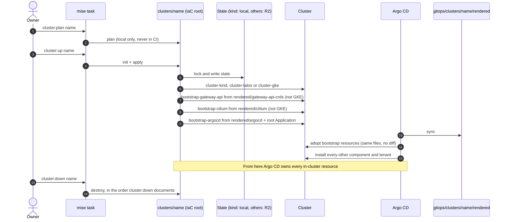

# Cluster lifecycle

A cluster is created and destroyed by one IaC root, then run by its own Argo CD. Understand the hand-over between
the two to know what a `plan` can change and what only a pull request to `rendered/` can.

## How it works

The lifecycle tasks (`mise run cluster:up|plan|down <name>`) are planned; the flow below is the target.

*IaC installs four things from the same rendered files Argo CD later adopts; Argo CD owns everything after.*

| Phase | Owner | Source |
| --- | --- | --- |
| Cluster | IaC root, `cluster-*` module | module inputs |
| Gateway API CRDs (kind, Talos) | IaC once, then Argo CD | `rendered/gateway-api-crds/` |
| Cilium (kind, Talos) | IaC once, then Argo CD | `rendered/cilium/` |
| Argo CD and its root `Application` | IaC once, then Argo CD itself | `rendered/argocd/` |
| Everything else | Argo CD | `rendered/<component>/`, tenant folders in `gsuquet/gitops` |

| Target | Cluster module | State |
| --- | --- | --- |
| kind | `cluster-kind` | local, no remote backend |
| Talos | `cluster-talos` | R2 |
| GKE | `cluster-gke` | R2 |

*Module inputs, bucket, state keys and locking: [Terraform roots and modules](../reference/terraform-modules.md).*

## Why it works this way

| Constraint | Consequence | Decision |
| --- | --- | --- |
| A kind or Talos node stays `NotReady` until Cilium runs, and Cilium's Gateway API support needs the CRDs at start | CRDs, then Cilium, then Argo CD | [ADR-0011](../adr/0011-cilium-cni-and-gke-dataplane-v2.md), [ADR-0015](../adr/0015-bootstrap-boundary.md) |
| One set of values per component | bootstrap applies the reviewed `rendered/` files, not a second copy | [ADR-0015](../adr/0015-bootstrap-boundary.md) |
| IaC and Argo CD briefly both know the bootstrap resources | bootstrap modules apply once or ignore changes after creation, so they never revert Argo CD | [ADR-0015](../adr/0015-bootstrap-boundary.md) |
| `destroy` must not depend on what Argo CD created (cloud load balancers) | `cluster:down` documents the order | [ADR-0015](../adr/0015-bootstrap-boundary.md) |
| A broken Argo CD self-update cannot repair itself | re-apply `rendered/argocd/` by hand (the bootstrap module applies the same files) | [ADR-0004](../adr/0004-self-managed-argo-cd-per-cluster.md) |
| kind must work offline and without secrets | kind state is local and lost with the machine | [ADR-0018](../adr/0018-terraform-state-backends.md) |
| One backend for all long-lived state | R2; it has no object versioning, so a corrupted state cannot be restored from the bucket; GKE state lives outside Google Cloud | [ADR-0018](../adr/0018-terraform-state-backends.md) |
| CI must hold no secret and touch no state | `plan` stays local: the author pastes the relevant output in the pull request | [ADR-0019](../adr/0019-lifecycle-tasks-and-ci-scope.md) |

Deferred: a kind end-to-end CI job (create, bootstrap, wait for Argo CD healthy).

## Related

- [mise tasks](../reference/mise-tasks.md), [Terraform roots and modules](../reference/terraform-modules.md)
- [Rendered manifests](rendered-manifests.md)
