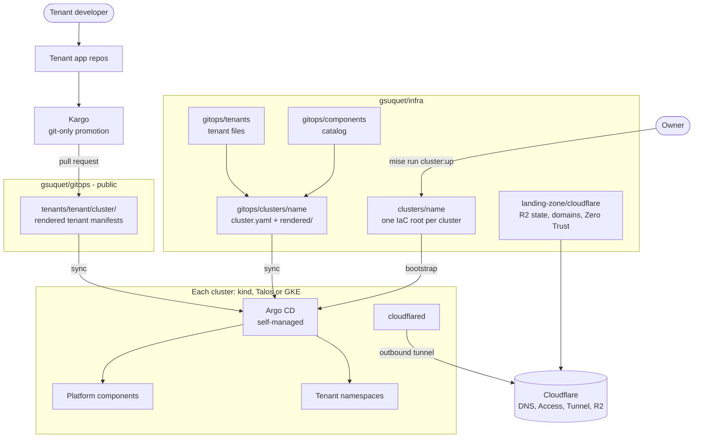

# Platform overview

`infra` builds Kubernetes clusters on three targets and runs everything on them through GitOps. This page shows
every part and who owns it; the other concept pages zoom into one part each.

## How it works

*Two Git repositories feed one Argo CD per cluster; public traffic enters only through Cloudflare.*

| Part | Owner | What it does |
| --- | --- | --- |
| Landing zone | `landing-zone/cloudflare/` | R2 state bucket, domains, Zero Trust foundation, account-wide and platform Access applications |
| Cluster root | `clusters/<name>/` | Creates the cluster and bootstraps Gateway API CRDs, Cilium and Argo CD, nothing else |
| Catalog | `gitops/components/<name>/` | One umbrella Helm chart per component, with default values |
| Cluster file | `gitops/clusters/<name>/cluster.yaml` | Target, enabled components, value overrides, tenants |
| Rendered manifests | `gitops/clusters/<name>/rendered/` | Plain YAML Argo CD applies; generated and committed |
| Tenant file | `gitops/tenants/<tenant>.yaml` | Namespaces, quota and limits of a tenant |
| Tenant manifests | `gsuquet/gitops`, `tenants/<tenant>/<cluster>/` | Rendered tenant workloads, written by Kargo pull requests |
| Argo CD | each cluster | Vanilla, self-managed; syncs the cluster's `rendered/` and its tenants' folders |

### Targets

| Target | Distribution | Network | Gateway API CRDs owner | State |
| --- | --- | --- | --- | --- |
| Developer machine | kind | Cilium, kube-proxy replacement | `gateway-api-crds` component | local |
| Raspberry Pis, local servers | Talos (`siderolabs/talos` provider, no Ansible) | Cilium, kube-proxy replacement | `gateway-api-crds` component | R2 |
| Cloud (first) | GKE; Spot pools, on-demand pools or both, per cluster | Dataplane V2 | GKE | R2 |

### Baseline components

Every cluster enables these, when they support its target.

| Component | kind | Talos | GKE |
| --- | --- | --- | --- |
| `gateway-api-crds` | yes | yes | no: GKE owns the CRDs |
| `cilium` | yes | yes | no: Dataplane V2 |
| `argocd` | yes | yes | yes |
| `cert-manager` | yes | yes | yes |
| `external-secrets` | yes | yes | yes |
| `network-policy` | yes | yes | yes |

Opt-in components include `cloudflared` (public exposure) and Kargo. Gateway API implementations install without
their bundled CRDs, own one `GatewayClass` each, and can coexist on a cluster.

### Secrets

Every namespace reads secrets through an External Secrets `SecretStore` named `secrets`, never a
`ClusterSecretStore`. On kind, the store is an in-cluster backend with dummy values; which ESO provider serves it
(`fake` or `kubernetes`) is open. The backend for the other targets is still open (RFC 0020).

## Why it works this way

| Constraint | Choice | Decision |
| --- | --- | --- |
| `gsuquet/homelab` stays frozen and keeps running the production k3s cluster until a Talos cluster replaces it | greenfield successor, homelab is reference only | [ADR-0002](../adr/0002-greenfield-successor-of-homelab.md) |
| Same platform on a laptop, a Pi and the cloud | kind, Talos, GKE first | [ADR-0003](../adr/0003-cluster-distribution-per-target.md) |
| Losing one cluster must not stop another | one Argo CD per cluster; argocd-agent and any hub deferred | [ADR-0004](../adr/0004-self-managed-argo-cd-per-cluster.md) |
| Reviewers see exactly what reaches the cluster | rendered manifests everywhere | [ADR-0005](../adr/0005-rendered-manifests-pattern.md) |
| Every cluster needs the same floor | fixed baseline; `network-policy` added on every cluster, GKE included (decided 2026-11-19, ADR pending) | [ADR-0014](../adr/0014-baseline-components.md) |
| One CNI story on self-managed targets | Cilium with kube-proxy replacement; Dataplane V2 on GKE | [ADR-0011](../adr/0011-cilium-cni-and-gke-dataplane-v2.md) |
| Swapping a Gateway implementation must not delete routes | one CRD owner, swappable implementations | [ADR-0012](../adr/0012-gateway-api-crd-ownership.md) |
| No inbound port, no public IP | Cloudflare Tunnel | [ADR-0013](../adr/0013-public-exposure-via-cloudflare-tunnel.md) |
| A cluster root must not edit account-wide security | the Cloudflare token of a cluster root is least-privileged: no account-wide Access edit | decided 2026-11-19, ADR pending |
| Consumers must not change when the backend does | one store named `secrets` | [ADR-0016](../adr/0016-secret-store-named-secrets.md) |
| CI needs no secret | CI runs static checks only; plan stays local | [ADR-0019](../adr/0019-lifecycle-tasks-and-ci-scope.md) |

| Deferred or open item | Decision |
| --- | --- |
| Cut-over from the homelab production cluster to Talos (data, DNS, tunnels): its own decision | [ADR-0002](../adr/0002-greenfield-successor-of-homelab.md) |
| Non-GKE clouds (AWS, Azure): out of scope | [ADR-0003](../adr/0003-cluster-distribution-per-target.md) |
| argocd-agent and any hub | [ADR-0004](../adr/0004-self-managed-argo-cd-per-cluster.md) |
| Default Gateway API implementation per cluster; experimental-channel CRDs (`TCPRoute`, `UDPRoute`) | [ADR-0012](../adr/0012-gateway-api-crd-ownership.md) |
| Gateways on kind and Talos: Cilium LB-IPAM with L2 announcements or Gateway API host network mode, chosen in the `cilium` component | [ADR-0012](../adr/0012-gateway-api-crd-ownership.md) |
| Tunnels and DNS records: per-cluster IaC root or tenant layer; `cloudflared` egress allow rules | [ADR-0013](../adr/0013-public-exposure-via-cloudflare-tunnel.md) |
| Secrets backend (RFC 0020); kind ESO provider, `fake` or `kubernetes` | [ADR-0016](../adr/0016-secret-store-named-secrets.md) |
| `landing-zone/gcp/` content (projects, IAM, network for GKE) | [ADR-0017](../adr/0017-repository-layout.md) |
| kind end-to-end CI job | [ADR-0019](../adr/0019-lifecycle-tasks-and-ci-scope.md) |

Network, tenant and state items: [Tenant isolation](tenant-isolation.md#why-it-works-this-way),
[Cluster lifecycle](cluster-lifecycle.md#why-it-works-this-way).

## Related

- [Cluster lifecycle](cluster-lifecycle.md), [Rendered manifests](rendered-manifests.md),
  [Tenant isolation](tenant-isolation.md), [Repository layout](repository-layout.md)
- [Terraform roots and modules](../reference/terraform-modules.md), [GitOps files](../reference/gitops-files.md)
