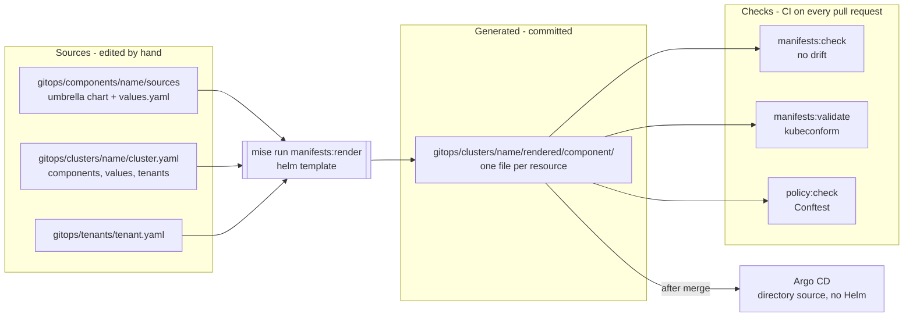
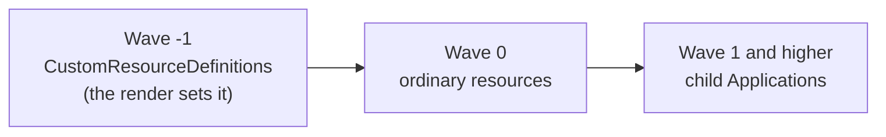

# Rendered manifests

Every manifest a cluster runs is rendered to plain YAML, committed, reviewed and applied by Argo CD with no Helm in
the cluster. Understand it before you change a chart, a value or a cluster file: the change is not live until its
render is committed.

## How it works

*Sources go through one render; the committed output is what CI checks and what Argo CD applies.*

Argo CD applies each `rendered/` folder in sync waves:

*CRDs exist before any custom resource; child Applications sync after the resources of their parent.*

The same model holds for tenants: Kargo renders tenant manifests into `gsuquet/gitops` under
`tenants/<tenant>/<cluster>/`, and the cluster's Argo CD applies them as plain YAML.

Helm hooks are kept: the render does not pass `--no-hooks`, and Argo CD maps `helm.sh/hook` annotations to its own
hooks (`PreSync`, `PostSync`). A component whose hooks do not map (rollback or test hooks, install-only logic that
breaks on every sync) disables them in its values or renders with `--no-hooks`, recorded in its folder. `helm test`
hooks never render.

### Where policy and tenant resources come from

| Resource | Rendered by |
| --- | --- |
| Cluster-wide default deny, platform network policies | `network-policy` baseline component, every cluster (decided 2026-11-19, ADR pending) |
| Tenant namespaces, `AppProject`, `ResourceQuota`, `LimitRange`, `SecretStore`, `Application` | components reading the injected `gitops.tenants` value |

[ADR-0010](../adr/0010-cluster-owned-default-deny-network-policy.md) reserved `platform` for a render-emitted
cluster layer (`rendered/platform/`: platform Namespaces, tenant onboarding, default deny). The `network-policy`
component replaces its policy part; the render does not emit that layer today, and `platform` stays reserved.

## Why it works this way

| Trade-off | Effect | Decision |
| --- | --- | --- |
| Reviewers see every changed field of every cluster | upgrades produce large diffs | [ADR-0005](../adr/0005-rendered-manifests-pattern.md) |
| Conftest and kubeconform check exactly what reaches the cluster | a source change without a render leaves stale files: `manifests:check` fails on drift, so Renovate chart bumps need a render commit | [ADR-0005](../adr/0005-rendered-manifests-pattern.md) |
| The render must be deterministic | no template-time generation (`genCA`, `genSelfSignedCert`, `randAlphaNum`); certificates come from cert-manager or an in-cluster generator (Cilium `certgen`, not `hubble.tls.auto.method=helm`), credentials from the `secrets` store | [ADR-0005](../adr/0005-rendered-manifests-pattern.md) |
| Output lands in public repositories | a chart rendering secret material would publish it; betterleaks scans `rendered/`, and Conftest fails any `Secret` with `data` or `stringData` | [ADR-0016](../adr/0016-secret-store-named-secrets.md) |
| Argo CD maps hook annotations, not Helm's lifecycle | it cannot tell install from upgrade: `pre-install` hooks run on every sync | [ADR-0005](../adr/0005-rendered-manifests-pattern.md) |
| The bootstrap needs the same files | IaC applies `rendered/argocd/` once, Argo CD adopts it | [ADR-0015](../adr/0015-bootstrap-boundary.md) |
| Components are reusable across clusters | catalog plus `cluster.yaml` | [ADR-0006](../adr/0006-component-catalog-and-cluster-file.md) |

## Related

- [How to render manifests](../how-to/render-manifests.md), [How to add a component](../how-to/add-a-component.md)
- [GitOps tooling reference](../reference/gitops-tooling.md)
