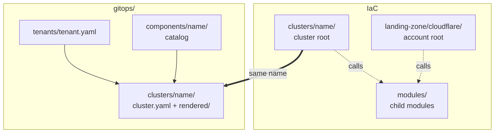

# Repository layout

`infra` splits account foundations, reusable modules, cluster roots and GitOps files into four top-level folders.
Knowing the split tells you where a change goes and which tool reads it.

## How it works

*Roots call modules; a cluster has the same name in `clusters/` and `gitops/clusters/`.*

| Folder | Holds | Read by |
| --- | --- | --- |
| `landing-zone/cloudflare/` | R2 state bucket, domains, Zero Trust foundation | IaC, `mise run tf` |
| `landing-zone/gcp/` | projects, IAM and network for GKE (planned, deferred) | IaC |
| `modules/` | every child module: `cluster-*`, `bootstrap-*`, `cloudflare-domain` | the roots above and below |
| `clusters/<name>/` | one root per cluster, calling only `cluster-*` and `bootstrap-*` modules | `mise run cluster:*` (planned) |
| `gitops/components/<name>/` | `component.yaml` and the umbrella chart in `sources/` | `manifests:render` |
| `gitops/clusters/<name>/` | `cluster.yaml` and `rendered/<component>/` | `manifests:render`, Argo CD |
| `gitops/tenants/<tenant>.yaml` | one tenant | `manifests:render` |
| `schemas/`, `policy/`, `testdata/` | JSON schemas, Conftest policies, a fixture cluster | `schemas:check`, `policy:*`, all GitOps tasks |
| `docs/` | human docs by type, RFCs, ADRs | people; agents read `docs/adr/` |

## Why it works this way

| Consequence | Decision |
| --- | --- |
| Removing a cluster removes two folders with the same name | [ADR-0017](../adr/0017-repository-layout.md) |
| Every child module is reusable by any root, so a module used by one root still lives away from it | [ADR-0017](../adr/0017-repository-layout.md) |
| A component's effective config is split between the catalog and each `cluster.yaml`, so `cluster.yaml` is a schema-checked contract | [ADR-0006](../adr/0006-component-catalog-and-cluster-file.md) |
| Tenant code and rendered tenant manifests stay out: the platform repo does not change on every release, but a first deploy touches three repositories (app, `gsuquet/gitops`, `infra`) | [ADR-0007](../adr/0007-tenant-manifests-in-gitops-repo.md) |

## Related

- [Terraform roots and modules](../reference/terraform-modules.md), [GitOps files](../reference/gitops-files.md)
