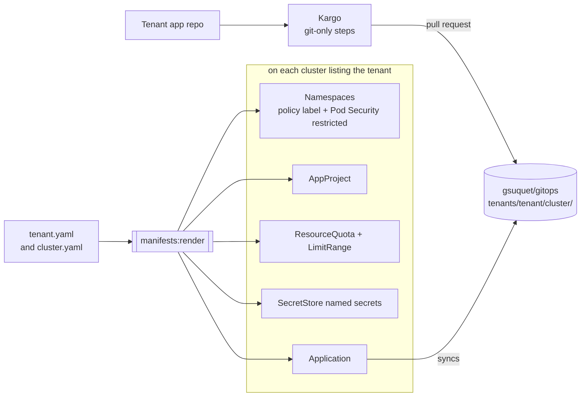
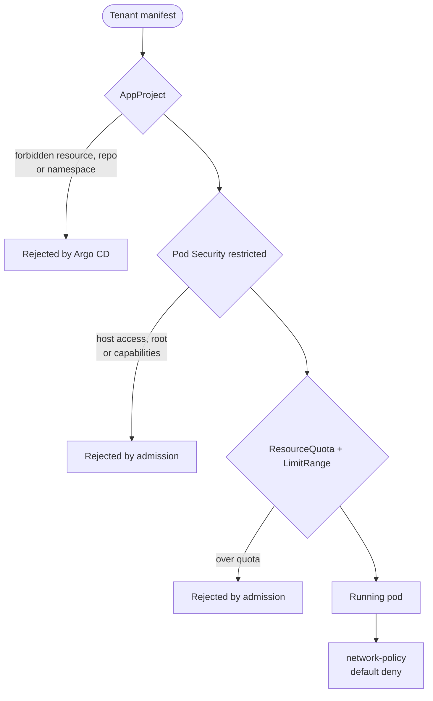

# Tenant onboarding and isolation

A tenant is a team or app that deploys its own workloads into namespaces the platform gives it. Understand the
layers below to know what a tenant can ship and which changes need an `infra` pull request.

## How it works

Onboarding: the platform declares the tenant, the render produces its guard rails, and Kargo fills its folder.

*`infra` decides where a tenant may deploy; `gsuquet/gitops` holds what it deploys.*

Isolation: four layers stop a tenant from reaching outside its namespaces.

*Argo CD, admission and the default deny each close a different escape.*

| Layer | Rule |
| --- | --- |
| `AppProject` | `sourceRepos` only `gsuquet/gitops`; destinations only the tenant namespaces on `in-cluster`; empty `clusterResourceWhitelist`; `namespaceResourceBlacklist` holds `NetworkPolicy` and `CiliumNetworkPolicy` |
| Pod Security | tenant namespaces `restricted`: no privileged, `hostNetwork`, `hostPID`, `hostPath`, root or extra capabilities; `baseline` only through an `infra` pull request; never `privileged` |
| Quota | `ResourceQuota` and `LimitRange` per namespace, from the tenant file; they protect shared hardware such as Raspberry Pis |
| Network | `network-policy` component: one `CiliumClusterwideNetworkPolicy` selects endpoints in namespaces labelled `network.infra.gsuquet.com/policy: default-deny` and denies ingress and egress; baseline allows egress to kube-dns and the API server |
| Secrets | one `SecretStore` named `secrets` per namespace, rendered by the platform |
| Names | a tenant namespace is `<tenant>` or `<tenant>-*`, never `kube-*` nor a component namespace; `default` and `platform` are reserved tenant names |

Platform namespaces carry the same policy label and default to Pod Security `baseline`, opting down to
`privileged` explicitly where a component needs host access. `kube-system` carries no label and is outside the
default deny.

## Why it works this way

| Choice | Cost or open risk | Decision |
| --- | --- | --- |
| Tenants are onboarded by `infra` | every new tenant or quota change is an `infra` pull request | [ADR-0009](../adr/0009-tenant-onboarding-by-infra.md) |
| Tenant code and manifests live outside `infra` | two repositories to follow | [ADR-0007](../adr/0007-tenant-manifests-in-gitops-repo.md) |
| Kargo promotes with git-only steps: each promotion is a commit with a diff, Kargo needs no write access to Argo CD | latency includes the merge and the sync interval; health checks cannot use `argocd-update` feedback | [ADR-0008](../adr/0008-kargo-git-only-promotion.md) |
| `restricted` by default | images that run as root or need capabilities must be rebuilt | [ADR-0009](../adr/0009-tenant-onboarding-by-infra.md) |
| The cluster owns network policy | tenants cannot add their own allows; the platform declares them, format not designed yet | [ADR-0010](../adr/0010-cluster-owned-default-deny-network-policy.md) |
| Policy lives in the `network-policy` component, on every cluster including GKE | replaces the render-emitted policy layer | decided 2026-11-19, ADR pending |
| The default deny selects by namespace label | fails open: a namespace created at runtime (`CreateNamespace=true`, an operator, Kargo `Project` namespaces) has no label; every namespace must be a rendered `Namespace` | [ADR-0010](../adr/0010-cluster-owned-default-deny-network-policy.md) |
| Endpoint policies | `hostNetwork` pods share the node identity: Pod Security keeps tenants off the host, platform components are reviewed one by one | [ADR-0010](../adr/0010-cluster-owned-default-deny-network-policy.md) |

| Open item | Status |
| --- | --- |
| Which part renders platform Namespaces and tenant onboarding: see [where policy and tenant resources come from](rendered-manifests.md#where-policy-and-tenant-resources-come-from) | open, pending an RFC |
| Tenant allow rules (ingress from a Gateway, egress to a database or external service) | deferred, likely in the tenant file |
| `ValidatingAdmissionPolicy` rejecting a `Namespace` without the policy and Pod Security labels | deferred |
| `SecretStore` in the tenant blacklist: a tenant could ship its own store named `secrets` | risk, pending the owner's decision |
| `CiliumClusterwideNetworkPolicy` with namespace-label selectors on GKE Dataplane V2 | unverified; fallback is a Kubernetes `NetworkPolicy` default deny per labelled namespace |
| Exact Kargo git step names (`git-clone`, `git-commit`, `git-push`, `git-open-pr`) | to verify against the Kargo docs when implementing |
| `argocd-update` step, where Kargo runs (opt-in component) | deferred |

## Related

- [How to onboard a tenant](../how-to/onboard-a-tenant.md)
- [GitOps files reference](../reference/gitops-files.md), [Policies](../reference/gitops-tooling.md#policies)
