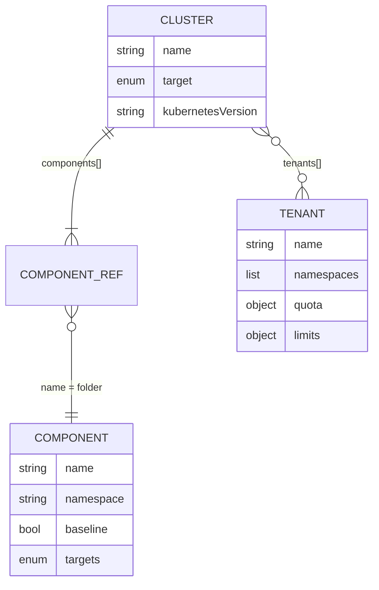

# GitOps files reference

Every field of the three hand-edited GitOps files, `apiVersion: infra.gsuquet.com/v1alpha1`. Source of truth: the
JSON schemas in `schemas/`; `mise run schemas:check` validates every file against them. Each file starts with a
`# yaml-language-server: $schema=...` comment, so editors validate while you type.



*A cluster enables catalog components and lists tenants; both are referenced by name.*

## Cluster: `gitops/clusters/<cluster>/cluster.yaml`

The target of the cluster, the components it enables with their value overrides, and the tenants it hosts.
Schema: `schemas/cluster.schema.json`. No other field is allowed.

| Name | Type | Default | Description |
| --- | --- | --- | --- |
| `apiVersion` | string, required | none | `infra.gsuquet.com/v1alpha1` |
| `kind` | string, required | none | `Cluster` |
| `name` | string, required | none | equals the folder name and the root in `clusters/<name>/`; `^[a-z0-9]+(-[a-z0-9]+)*$`, 40 characters max |
| `target` | enum, required | none | `kind`, `talos` or `gke`; a component lists the targets it supports |
| `kubernetesVersion` | string, required | none | `X.Y.Z`, no `v`; passed to `helm template --kube-version` and to kubeconform |
| `apiVersions` | list of strings | none | APIs served on top of the built-in ones (`monitoring.coreos.com/v1`, `gateway.networking.k8s.io/v1/HTTPRoute`); passed to `--api-versions`, unique |
| `components` | list, required | none | enabled catalog components, each rendered to `rendered/<name>/` |
| `components[].name` | string, required | none | folder name in `gitops/components/`; 53 characters max |
| `components[].values` | object | none | Helm values overriding `sources/values.yaml` |
| `tenants` | list of strings, required | none | tenant file names onboarded here, unique; passed to every component as `gitops.tenants` |

```yaml
apiVersion: infra.gsuquet.com/v1alpha1
kind: Cluster
name: kind-fixture
target: kind
kubernetesVersion: 1.35.0
apiVersions:
  - example.com/v1alpha1/Greeting
components:
  - name: hello
    values:
      hello:
        replicas: 2
tenants:
  - team-a
```

## Component: `gitops/components/<name>/component.yaml`

One catalog entry. The Helm source is the umbrella chart in `sources/`, defaults in `sources/values.yaml`.
Schema: `schemas/component.schema.json`. No other field is allowed.

| Name | Type | Default | Description |
| --- | --- | --- | --- |
| `apiVersion` | string, required | none | `infra.gsuquet.com/v1alpha1` |
| `kind` | string, required | none | `Component` |
| `name` | string, required | none | equals the folder name; also the Helm release name; 53 characters max |
| `description` | string, required | none | one sentence |
| `namespace` | string, required | none | Helm release namespace (`helm template --namespace`); 63 characters max |
| `baseline` | boolean, required | none | `true`: every cluster whose target is in `targets` must enable it |
| `targets` | list of enums, required | none | `kind`, `talos`, `gke`, at least one, unique; `schemas:check` fails if another target enables it |

## Tenant: `gitops/tenants/<tenant>.yaml`

A tenant that clusters can onboard. Schema: `schemas/tenant.schema.json`. No other field is allowed.

| Name | Type | Default | Description |
| --- | --- | --- | --- |
| `apiVersion` | string, required | none | `infra.gsuquet.com/v1alpha1` |
| `kind` | string, required | none | `Tenant` |
| `name` | string, required | none | equals the file name; also the `AppProject` name and `tenants/<tenant>/` in `gsuquet/gitops`; 30 characters max; not `default` nor `platform` |
| `description` | string, required | none | who the tenant is, one sentence |
| `namespaces` | list of strings, required | none | the only `AppProject` destinations; `<tenant>` or `<tenant>-*`, not `kube-*`, not a component namespace; 63 characters max, unique |
| `quota.requests` | `{cpu, memory}`, required | none | `ResourceQuota` requests per namespace |
| `quota.limits` | `{cpu, memory}`, required | none | `ResourceQuota` limits per namespace |
| `quota.pods` | integer, required | none | pod count per namespace, at least 1 |
| `limits.defaultRequest` | `{cpu, memory}`, required | none | `LimitRange` container default request |
| `limits.default` | `{cpu, memory}`, required | none | `LimitRange` container default limit |

`cpu` and `memory` are Kubernetes quantities (`500m`, `2`, `1Gi`).

```yaml
apiVersion: infra.gsuquet.com/v1alpha1
kind: Tenant
name: team-a
description: Test fixture tenant.
namespaces:
  - team-a
quota:
  requests: {cpu: "1", memory: 1Gi}
  limits: {cpu: "2", memory: 2Gi}
  pods: 10
limits:
  defaultRequest: {cpu: 50m, memory: 64Mi}
  default: {cpu: 200m, memory: 256Mi}
```

Related: [GitOps tooling](gitops-tooling.md#schema-checks) for the cross-file rules,
[How to onboard a tenant](../how-to/onboard-a-tenant.md).
