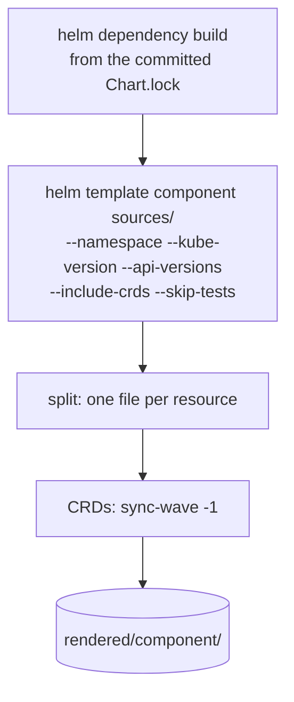
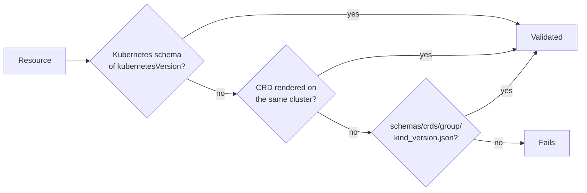
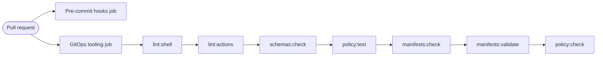

# GitOps tooling reference

What the GitOps mise tasks do, step by step, and the files and rules they enforce. Source of truth: `.mise/tasks/`,
`policy/` and `schemas/`. Task list and arguments: [mise tasks](mise-tasks.md); file fields:
[GitOps files](gitops-files.md).

## Files

| Path | Schema | Holds |
| --- | --- | --- |
| `gitops/components/<name>/component.yaml` | `schemas/component.schema.json` | catalog entry: namespace, `baseline`, `targets` |
| `gitops/components/<name>/sources/` | none | umbrella Helm chart: `Chart.yaml`, `Chart.lock`, default `values.yaml`, own `templates/` |
| `gitops/clusters/<name>/cluster.yaml` | `schemas/cluster.schema.json` | `target`, `kubernetesVersion`, `apiVersions`, `components` with `values`, `tenants` |
| `gitops/clusters/<name>/rendered/<component>/` | none | generated by `manifests:render`, committed, never edited by hand |
| `gitops/tenants/<tenant>.yaml` | `schemas/tenant.schema.json` | tenant namespaces, `ResourceQuota` and `LimitRange` defaults |
| `policy/` | none | Conftest policies (`*.rego`), unit tests (`*_test.rego`), data (`policy/data/`) |
| `schemas/crds/<group>/<kind>_<version>.json` | none | optional kubeconform schemas of CRDs an operator installs at runtime |
| `testdata/` | none | a fixture cluster with a local chart that proves the tooling end to end |

`rendered/` is re-included at the end of `.gitignore`, so a component named like an ignored folder (`lib`, `build`,
`out`, `env`) is still committed and checked.

## Render

`manifests:render`, for each `cluster.yaml`: delete `rendered/`, then for each entry of `components`:

*Each component renders in four steps; two resources with the same file name fail the render.*

| Step | Rule |
| --- | --- |
| Dependencies | `helm dependency build`, never `dependency update` (which re-resolves versions); HTTP repositories go to a throwaway repository file, not your `helm repo list` |
| Values, last wins | 1. `sources/values.yaml`; 2. `components[].values` of `cluster.yaml`; 3. the injected `gitops` key, last so no override can fake it |
| `gitops.cluster` | `name`, `target`, `kubernetesVersion`, `components` (`name` and `namespace` of each enabled component, for Argo CD Applications) |
| `gitops.tenants` | each tenant of the cluster, keyed by name, with the content of its tenant file |
| `gitops` scope | top-level value: only the umbrella chart's templates read it; upstream subcharts do not see it |
| File name | `<kind>-<name>.yaml`, lower case; `<kind>-<namespace>-<name>.yaml` for a resource outside the catalog namespace (a Role in `kube-system`); stable when a chart moves a resource between templates |
| CRD wave | every CRD gets `argocd.argoproj.io/sync-wave: "-1"`, with a warning when the chart set another value |
| `apiVersions` | without it, templates gated on `.Capabilities.APIVersions` (ServiceMonitor, HTTPRoute) do not render |
| Tests | `helm test` hooks never render: Argo CD would apply them as plain Pods |
| Determinism | deterministic as long as the charts are: a chart generating random values (passwords, self-signed certificates) breaks `manifests:check`; set the value, or let External Secrets or cert-manager produce it in the cluster |

## Validate

`manifests:validate` runs kubeconform with `-strict` on each cluster's `rendered/`. Schema lookup, first match wins:

*A custom resource needs its CRD rendered on the same cluster, or a committed schema.*

| Source | Rule |
| --- | --- |
| Kubernetes schemas | from `KUBERNETES_SCHEMA_LOCATION`; default is kubeconform's built-in location, the master branch of `yannh/kubernetes-json-schema`, not pinned yet (TODO in the task) |
| Rendered CRDs | converted to JSON schema: `nullable` becomes a `null` type; an object with `properties` denies unknown fields unless `x-kubernetes-preserve-unknown-fields` |
| Committed schemas | `schemas/crds/<group>/<kind>_<version>.json`, `<kind>` lower case, for CRDs an operator creates at runtime (Cilium creates CiliumNetworkPolicy and CiliumClusterwideNetworkPolicy); already kubeconform schemas (strict, `nullable` converted), as `openapi2jsonschema` produces |
| CRDs themselves | skipped: the Kubernetes catalog has no schema for them |

## Policies

`policy:check` runs `conftest test --combine` on the rendered manifests, so a policy sees each file's path and the
path tells the cluster and component. It also generates `data.clusters`, keyed by `<root>/clusters/<cluster>`: the
catalog namespace of each enabled component and each tenant's namespaces, because rendered manifests alone cannot
tell which namespaces a cluster needs.

| Package | Rule |
| --- | --- |
| `namespaces` | every Namespace has the label `network.infra.gsuquet.com/policy: default-deny`; every namespace a cluster uses (catalog namespace, tenant namespace, `metadata.namespace` of a rendered resource) is a Namespace rendered on that cluster, because one Argo CD (`CreateNamespace=true`) or Terraform creates has no label; `kube-system` is exempt |
| `gateway_api` | CRDs of `gateway.networking.k8s.io` and `gateway.networking.x-k8s.io` come only from `rendered/gateway-api-crds/` |
| `tenants` | every AppProject other than `default` and `platform` is a tenant listed in its `cluster.yaml`, with no `clusterResourceWhitelist`, NetworkPolicy and CiliumNetworkPolicy in `namespaceResourceBlacklist`, `sourceRepos` only `gsuquet/gitops`, destinations only the namespaces of its tenant file (never a component namespace), on `https://kubernetes.default.svc` / `in-cluster` only |

Policy data lives in `policy/data/gitops.yaml`: change it there, not in Rego.

| Key | Value |
| --- | --- |
| `network_policy_label` | `network.infra.gsuquet.com/policy: default-deny` |
| `network_policy_exempt_namespaces` | `kube-system` |
| `gateway_api` | component `gateway-api-crds`; groups `gateway.networking.k8s.io`, `gateway.networking.x-k8s.io` |
| `tenants.platform_projects` | `default`, `platform`; equal to the reserved names of the tenant schema |
| `tenants.destination` | `https://kubernetes.default.svc`, `in-cluster` |
| `tenants.source_repos` | `https://github.com/gsuquet/gitops.git`, `https://github.com/gsuquet/gitops` |
| `tenants.namespace_resource_blacklist` | `networking.k8s.io/NetworkPolicy`, `cilium.io/CiliumNetworkPolicy` |

## Schema checks

`schemas:check` runs, in order:

| # | Check |
| --- | --- |
| 1 | `jsonschema metaschema` and `jsonschema lint` on `schemas/*.schema.json` |
| 2 | each file in `schemas/tests/<schema>/valid/` passes, each in `schemas/tests/<schema>/invalid/` fails |
| 3 | every `component.yaml`, tenant file and `cluster.yaml` against its schema |
| 4 | `name` equals the folder (component, cluster) or file (tenant) name |
| 4 | a catalog folder has `component.yaml` and `sources/Chart.yaml` |
| 4 | a tenant namespace is `<tenant>` or starts with `<tenant>-`, does not start with `kube-`, is not a catalog component namespace |
| 4 | the reserved tenant names of the tenant schema equal the platform projects of `policy/data/gitops.yaml` (a tenant named `default` or `platform` would get an unchecked AppProject) |
| 4 | a cluster lists a component once, only from the catalog, only when it supports the cluster's `target` |
| 4 | a cluster enables every `baseline: true` component that supports its target (so GKE skips `cilium` by its `targets`) |
| 4 | every tenant a cluster lists has a file |

## Continuous integration

`.github/workflows/checks.yml` runs on every pull request, with tools from mise:

*Two parallel jobs, no secret; `terraform plan` stays local and a kind end-to-end job is deferred.*

| Job | Notes |
| --- | --- |
| Pre-commit hooks | `pre-commit run --all-files`; `terraform_providers_lock` checks each root's lock file hashes `darwin_arm64`, `linux_amd64`, `linux_arm64`, regenerating only one that misses a platform; child modules commit no lock file (`.gitignore`) |
| GitOps tooling | the seven tasks above, in order |
