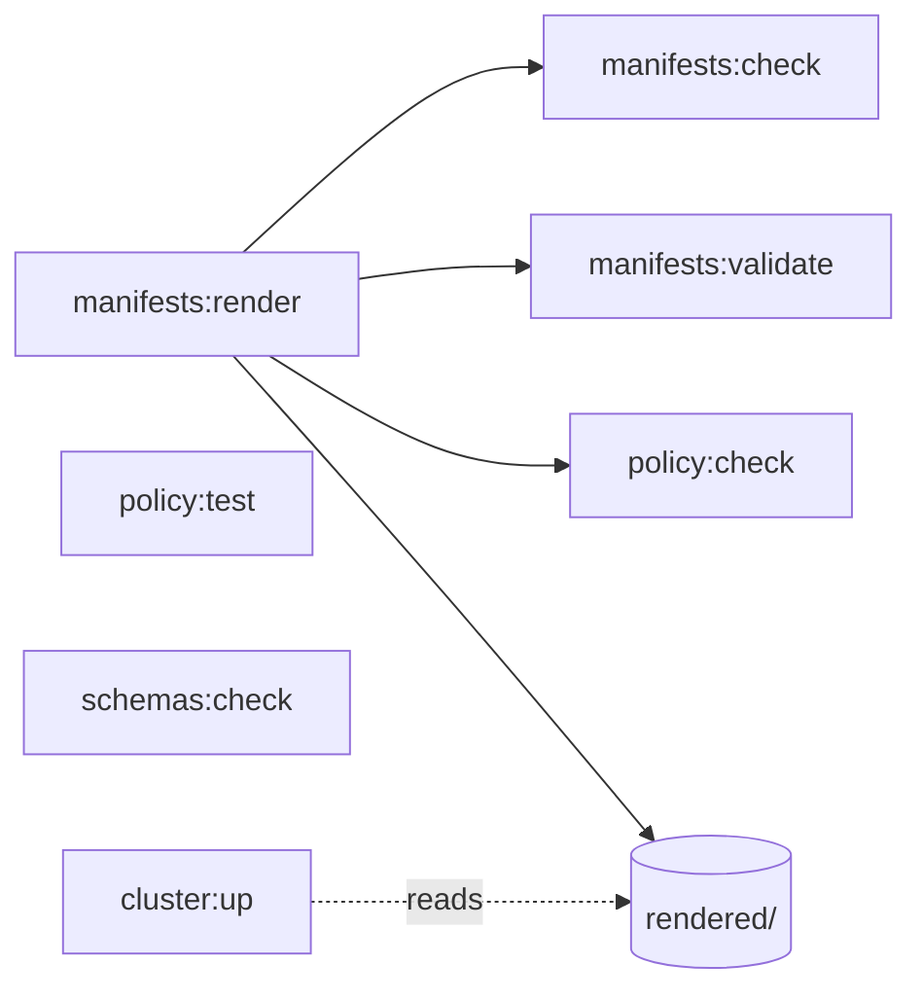

# mise tasks reference

Every `mise run` task of the repository, existing and planned. Source of truth: `.mise/tasks/`; `mise tasks`
generates the list of existing ones with their descriptions. This page is written by hand because it also lists
planned and referenced tasks that `mise tasks` cannot show. Tool versions are pinned in `.mise/config.toml` and `.mise/mise.lock`.

*Every GitOps check reads the output of `manifests:render`; `cluster:up` bootstraps from the same output.*

## GitOps

Walk the GitOps roots `gitops/` and `testdata/gitops/`; `GITOPS_ROOTS="<dir> ..."` chooses others, a missing root
is skipped. CI runs every task of this group on each pull request.

| Task | Arguments | Status | What it does |
| --- | --- | --- | --- |
| `manifests:render` | none | exists | renders each enabled component of each cluster to `rendered/<component>/` |
| `manifests:check` | none | exists | renders, then fails if `rendered/` differs from Git, untracked and ignored files included |
| `manifests:validate` | none | exists | kubeconform, strict, against `kubernetesVersion` and the CRDs rendered on the same cluster |
| `policy:test` | none | exists | `conftest verify`: Rego unit tests (`policy/**/*_test.rego`) |
| `policy:check` | none | exists | `conftest test` of every rendered manifest against the policies |
| `schemas:check` | none | exists | schemas valid and linted, schema tests, every GitOps file valid, cross-file rules |

## Lint

| Task | Arguments | Status | What it does |
| --- | --- | --- | --- |
| `lint:shell` | none | exists | shellcheck and shfmt on the task scripts |
| `lint:actions` | none | exists | actionlint and zizmor on the workflows |

## Cluster lifecycle

| Task | Arguments | Status | What it does |
| --- | --- | --- | --- |
| `cluster:plan` | `<name>` | planned | plan `clusters/<name>/`, locally |
| `cluster:up` | `<name>` | planned | init and apply `clusters/<name>/` |
| `cluster:down` | `<name>` | planned | destroy `clusters/<name>/`, in the documented order |

## Cloudflare landing zone

Run in `landing-zone/cloudflare/` with credentials resolved by `pass-cli run` for the IaC process only; binary:
[IaC tool](terraform-modules.md#iac-tool).

| Task | Arguments | Status | What it does |
| --- | --- | --- | --- |
| `tf` | IaC arguments | exists | the pinned IaC binary with the write token and the R2 state credentials |
| `tf:read` | IaC arguments | exists | the pinned IaC binary with the read-only token; use with `plan -lock=false` |
| `cf:ids` | `<domain>` | referenced, not in `.mise/tasks/` | lists the IDs of an existing zone, for `imports.tf` |
| `cf:zt-ids` | none | referenced, not in `.mise/tasks/` | lists the IDs of existing Zero Trust resources, for `imports.tf` |

Related: [GitOps tooling](gitops-tooling.md), [Cluster lifecycle](../concepts/cluster-lifecycle.md),
[Cloudflare landing zone](../../landing-zone/cloudflare/README.md).
