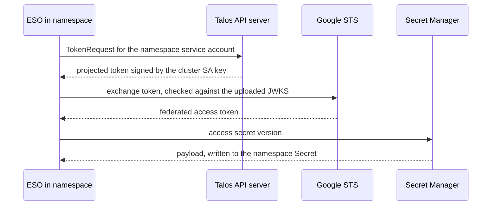
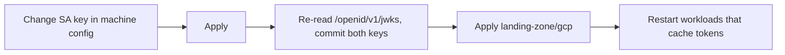

# Secrets backend design

Design detail of [RFC 0020](../rfc/0020-secrets-backend.md). Facts were checked on 2026-11-18 against the linked source unless marked **(unverified)**.

<!-- readability: allow-code R2 -->

## Stores per cluster type

| Cluster | Store `secrets` provider | Auth | Notes |
| --- | --- | --- | --- |
| GKE | `gcpsm` | `auth.workloadIdentity` with `serviceAccountRef` | With Workload Identity Federation for GKE, the role goes on `principal://iam.googleapis.com/projects/PROJECT_NUMBER/locations/global/workloadIdentityPools/PROJECT_ID.svc.id.goog/subject/ns/NAMESPACE/sa/KSA_NAME`, no Google service account. Standard clusters need nodes with the GKE metadata server; Autopilot handles it. |
| Talos | `gcpsm` | `auth.workloadIdentityFederation` with `serviceAccountRef` and `audience` (full provider name) | `projectID` must be set (no metadata server); optional `gcpServiceAccountEmail` for impersonation. One workload identity pool per Talos cluster. |
| kind | `fake` | none | `provider.fake.data` with dummy values such as `dummy-not-a-secret` that secret scanners do not flag; rendered from `gitops/clusters/<kind-cluster>/cluster.yaml`. |

## Talos authentication

The issuer stays private: the token is checked against the uploaded JWKS.

Read `/.well-known/openid-configuration` and `/openid/v1/jwks`, then create the provider with `--jwk-json-path` (`gcloud`) or `jwks_json` in the `oidc` block of `google_iam_workload_identity_pool_provider` (RSA and EC keys). The command does not validate the JWKS: a wrong or stale one fails later with `Error connecting to the given credential's issuer`. The issuer must match the token `iss` exactly; the Talos default issuer is the cluster endpoint **(unverified)**. Subject mapping `google.subject=assertion.sub` gives `system:serviceaccount:<ns>:<sa>`; a CEL attribute condition on `assertion['kubernetes.io']['namespace']` can limit namespaces. The JWKS changes only when the SA signing key changes.

## IAM, naming and IaC ownership

| Item | Rule |
| --- | --- |
| Principal | One per namespace: each store uses a service account in its own namespace (replaces the homelab seed namespace per consumer). |
| Grant | `roles/secretmanager.secretAccessor` once per namespace principal, with an IAM Condition `resource.name.startsWith("projects/PROJECT_NUMBER/secrets/<name-prefix>")`, where `<name-prefix>` follows [secret naming](../rfc/0020-secrets-backend.md#secret-naming). Bindings: O(namespaces), against O(secrets x namespaces x pools) with per-secret grants, where each new tenant `ExternalSecret` would need an `infra` change and a person-run apply. The exact `resource.name` format (number or ID) and whether the version name must match too are **(unverified)**: test on the first secret. |
| Key list | `gitops/tenants/<tenant>.yaml` lists the secret key names of each tenant namespace (names only). One list feeds the kind dummies and the IAM prefixes; a tenant adding a secret needs an `infra` change, which keeps the platform in control of what a tenant reads. Without it, a tenant key missing from the fake store stays `NotReady` on kind. |
| `landing-zone/gcp` | Owns the project, the Secret Manager API, secret objects (no versions), workload identity pools, Talos providers with `jwks_json`, and conditional IAM. Holds no value, so agents can write it and the owner reviews it. |
| JWKS | A `cluster:up` post-step reads `/openid/v1/jwks` and commits it as public data (for example `clusters/<name>/jwks.json`). The cluster root needs no Google credential and no live API read, and GCP is not a dependency of cluster creation. Cost: a second apply of `landing-zone/gcp` before ESO on a new Talos cluster turns `Ready`. |
| Versions | Written only by the person-only path, never by `landing-zone/gcp` or a cluster root. |

## Writing values

Proton Pass is the only human source of truth. A person-run task resolves `pass://` references with `pass-cli run` and writes a version through an identity that holds only `roles/secretmanager.secretVersionAdder` and that agents do not use; no human principal needs `secretAccessor`. Two write paths ([open question](../rfc/0020-secrets-backend.md#write-path)):

| Path | How | State |
| --- | --- | --- |
| IaC write-only | `google_secret_manager_secret_version.secret_data_wo` with `secret_data_wo_version`, fed by `ephemeral = true` variables; a rotation bumps the non-secret counter in Git. Write-only attribute support in OpenTofu is **(unverified)**. | No value in state |
| Pipe | `gcloud secrets versions add --data-file=-` from `pass-cli` (**unverified** exact syntax on the `pass-cli` side) | No state at all |

`remoteRef` convention: homelab objects set `property: value` because a seed holds a map; a plain-text Secret Manager payload has none. The fake provider ignores `property`, so plain payloads with no `property` should work on `gcpsm` and `fake`; that `gcpsm` returns the whole payload when `property` is omitted is **(unverified)**: neither ESO page documents it. Test it before tenants copy the convention. Homelab `ExternalSecret` objects are rewritten to the chosen convention when copied.

## Agent read paths

A value is only as isolated as the weakest credential the owner's OS user can reach.

| Path | Reach | Control that closes it |
| --- | --- | --- |
| Daily gcloud ADC with Owner, or any role with `secretmanager.versions.access`, on the secrets project | Every secret | The daily identity holds no Secret Manager role there; the writer identity needs an explicit step (separate account or impersonation). |
| Owner's `pass-cli` session | Every value of every cluster, for every option fed from Proton Pass | A dedicated vault for cluster values behind a separate login, re-authentication or biometric per use, a short session lifetime. Which of these `pass-cli` supports is **(unverified)**: not run. |
| Talos cluster state in R2: SA signing key and admin kubeconfig | With the key: any namespace principal of the pool, from anywhere, through STS and the uploaded JWKS; with a shared pool, every Talos cluster of the pool | One pool per Talos cluster; a state credential agents do not hold, person-run `cluster:up`/`plan` for production roots, or a signing key generated outside IaC with no state copy. |
| A kubeconfig that reads Secrets | Values of that cluster, from a network that reaches its API server | Same for every option. |

With [SOPS seeds](0020-secrets-backend-options.md#sops-seeds), a leaked Talos state reads values only from a network that reaches the API server; with Secret Manager the signing key works from anywhere. Secret Manager rates above SOPS seeds on isolation only once the `pass-cli` and Talos state paths are closed.

## Talos specifics

- The SA signing key is `talos_machine_secrets.machine_secrets.certs.k8s_serviceaccount`, in the cluster root state (R2) with every other cluster secret. The machine config field `cluster.serviceAccount` is a single `PEMEncodedKey` (Talos v1.11 and v1.12 references); the v1.14 page did not show the field when fetched, so the 1.14 shape is **(unverified)**. Update the links when the Talos pin is set.
- `talosctl rotate-ca` rotates the Talos and Kubernetes API CAs only; "other Kubernetes secrets might need to be rotated manually". Whether that covers the SA key is **(unverified)**: assume a manual machine config change.
- Talos generates etcd encryption-at-rest secrets (`secretbox_encryption_secret`, `aescbc_encryption_secret`); encryption at rest being on by default is **(unverified)**.
- Key rotation is disruptive and all at once: with one key, the API server most likely accepts only tokens of the new key, so every projected token (every pod, not only ESO) is invalid until kubelet refreshes it and long-lived token Secrets stop working. A two-key overlap needs API server flags and files outside `cluster.serviceAccount` **(unverified on Talos)**. Run it as a maintenance event:

Uploading old and new keys during the switch is harmless and avoids STS failures for tokens issued just before it.

## Pool sharing

All GKE clusters of one project share the pool `PROJECT_ID.svc.id.goog`, so namespace `foo` / KSA `bar` is one principal on all of them. The `principal://` identifier names the pool and the subject, not the provider, so Talos clusters sharing a pool with `google.subject=assertion.sub` share principals too, and one leaked signing key reads the secrets of every cluster of the pool. A cluster-prefixed subject mapping avoids it, but one wrong mapping silently re-opens it; separate pools limit a leak to one cluster by construction. GKE clusters that must not share secrets go in different projects, or use per-cluster names knowing IAM cannot tell them apart.

## Confirmation checks

- Conftest on `infra` refuses any `ClusterSecretStore`, any `SecretStore` not named `secrets`, any `fake` provider outside kind clusters, and any `secretRef` (static key) auth for `gcpsm`.
- The tenant `AppProject` adds `SecretStore` and `PushSecret` (group `external-secrets.io`) to `namespaceResourceBlacklist` (extends the ADR-0009 blacklist, [open question](../rfc/0020-secrets-backend.md#tenant-blacklist-change)), next to `NetworkPolicy` and `CiliumNetworkPolicy`; `ClusterSecretStore` and `ClusterExternalSecret` are cluster-scoped and already refused to tenants. So only the platform creates the store `secrets`.
- Tenant manifests in `gsuquet/gitops` are outside `infra` CI: tenant-side enforcement (Conftest in its CI, an admission policy per cluster, or both) is a requirement of the tenant onboarding work.
- A kind test cluster shows every `ExternalSecret` `Ready` with no network.
- A first Talos cluster shows `Ready` stores through Workload Identity Federation with a private issuer.
- `git grep` and the secret scanners find no ciphertext and no value in either public repository.

## GCP outage

A home ISP outage stops refreshes and new namespaces on the Pi clusters; running pods keep their Secrets in etcd. ESO keeping the last synced Secret when the provider is unreachable is **(unverified)**; `deletionPolicy` applies only when data is removed at the provider.

## Rollout

(1) kind fake store, key lists and Conftest rules; (2) `landing-zone/gcp`: project, API, secret objects, writer identity; (3) protect the Proton Pass vault and production Talos state before any production value is written; (4) first Talos cluster with its own pool and committed JWKS; (5) GKE; (6) tenant onboarding with key lists and tenant-side enforcement. Gate between steps: the confirmation checks of that step pass.

## Sources

- [ESO GCP Secret Manager provider](https://external-secrets.io/latest/provider/google-secrets-manager/)
- [ESO ExternalSecret API](https://external-secrets.io/latest/api/externalsecret/): `Ready` turns `False` on a failed refresh.
- [Workload Identity Federation for GKE](https://docs.cloud.google.com/kubernetes-engine/docs/how-to/workload-identity)
- [Workload Identity Federation with Kubernetes](https://docs.cloud.google.com/iam/docs/workload-identity-federation-with-kubernetes): private issuer with an uploaded JWKS; key rotation not covered.
- [Secret Manager access control](https://docs.cloud.google.com/secret-manager/docs/access-control) and [IAM conditions attribute reference](https://docs.cloud.google.com/iam/docs/conditions-attribute-reference): `resource.name` and `startsWith()`.
- [google_iam_workload_identity_pool_provider](https://raw.githubusercontent.com/hashicorp/terraform-provider-google/main/website/docs/r/iam_workload_identity_pool_provider.html.markdown): `jwks_json`.
- [google_secret_manager_secret_version](https://raw.githubusercontent.com/hashicorp/terraform-provider-google/main/website/docs/r/secret_manager_secret_version.html.markdown): `secret_data_wo`, `secret_data_wo_version`.
- [talos_machine_secrets](https://raw.githubusercontent.com/siderolabs/terraform-provider-talos/main/docs/resources/machine_secrets.md): `certs.k8s_serviceaccount`, etcd encryption secrets.
- [Talos v1.12 config reference](https://docs.siderolabs.com/talos/v1.12/reference/configuration/v1alpha1/config), [v1.11](https://docs.siderolabs.com/talos/v1.11/reference/configuration/v1alpha1/config), [CA rotation](https://docs.siderolabs.com/talos/v1.11/security/ca-rotation)
- [ESO fake provider and other ESO sources](0020-secrets-backend-options.md#sources)
