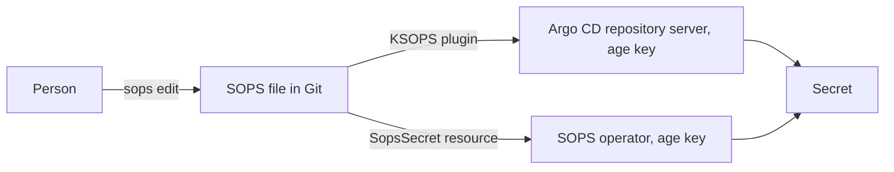
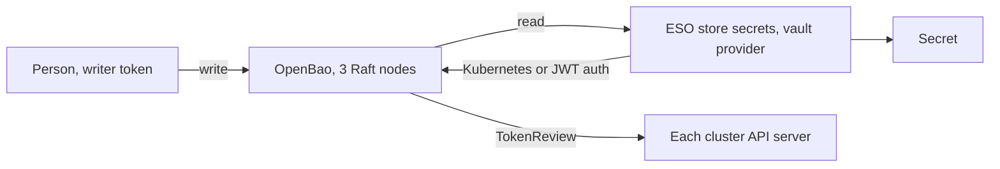

# Secrets backend options

Evidence for [RFC 0020](../rfc/0020-secrets-backend.md): why each backend scores as it does.

## Constraints

| Constraint | Consequence for the backend |
| --- | --- |
| `gsuquet/infra` and `gsuquet/gitops` are public. | Anything committed is public forever, ciphertext included: a key leaked in ten years opens every old ciphertext in the history. |
| Agents write the code but must never read or write a value; they run as the owner's OS user. | Agent rules are rules, not controls. A real control is an identity that agents do not hold. |
| N clusters: kind (many, ephemeral), Talos on Raspberry Pis and local servers, GKE. | The cost of one secret change must not grow with N, or must stay small. |
| kind is ephemeral and must work offline. | kind cannot depend on a credential, a network or a person at the keyboard. |
| Each cluster runs its own Argo CD on rendered manifests (ADR-0004, ADR-0005). | No value can go through the render step or the Argo CD repository server. |
| IaC (OpenTofu, RFC 0022) installs only the cluster, Gateway API CRDs, Cilium and Argo CD (ADR-0015). | The backend credential, if any, is created without a value in state, or not needed. |
| The owner's human store is Proton Pass; IaC credentials already come from `pass-cli run` with `pass://` references (`landing-zone/cloudflare/pass/*.env`). | A human-to-backend step already exists and can be reused. |

## Scores

Scores per criterion. Legend: `++` best, `+` good, `0` neutral, `-` poor, `--` blocking. The `pass-cli` read path applies to every option fed from Proton Pass, so the agent isolation row scores the other paths: no option beats `0` there until the `pass-cli` session is protected.

| Criterion | SOPS seeds | Secret Manager | kind fake | Sealed Secrets | SOPS in cluster | OpenBao | SaaS |
| --- | --- | --- | --- | --- | --- | --- | --- |
| Public repo (nothing to harvest) | - | ++ | 0 (dummies) | - | - | ++ | ++ |
| Agent isolation (`pass-cli` path aside) | 0 | 0 on Talos (+ once agents cannot read Talos state), + on GKE | n/a | 0 | 0 | + | + |
| Write cost for N clusters (values and IAM) | -- | + (++ with prefix-conditioned IAM) | n/a | -- | 0 | ++ | ++ |
| kind, offline and unattended | - | -- | ++ | - | - | -- | -- |
| No bootstrap credential per cluster | + | ++ | ++ | 0 | - | 0 | - |
| Outage resilience | ++ | 0 | ++ | ++ | ++ | - | 0 |
| DR and key loss | 0 | + | ++ | - | - | - | + |
| Cost | ++ | + (about USD 2-3/month) | ++ | ++ | ++ | - | 0 |
| Talos fit | + | 0 (disruptive key rotation, JWKS re-upload, signing key in state) | n/a | + | 0 | 0 | 0 |
| GKE fit | 0 | ++ | n/a | 0 | 0 | - | 0 |
| Operational complexity | - | + | ++ | 0 | - | -- | 0 |
| Keeps ESO store `secrets` contract | yes | yes | yes | no | no (KSOPS and operator) | yes | yes |
| Fits rendered manifests | yes | yes | yes | yes | no (KSOPS) | yes | yes |

## SOPS seeds

SOPS and age, seed Secrets and the ESO Kubernetes provider (homelab model). A person edits one SOPS file per cluster; a person-only root per cluster decrypts it in memory (`ephemeral "sops_file"`) and writes seed Secrets in `secret-seeds-<consumer>` through `data_wo`; ESO copies them with the Kubernetes provider (`beta`). Source: `gsuquet/homelab` `docs/explanation/secrets-management.md`.

One value for several clusters costs one person-run apply per cluster.

- Good: no runtime dependency, free, offline, proven in homelab; no bootstrap credential in the cluster (the applier needs a kubeconfig that writes the seed namespaces and network access to each Talos API server).
- Good: only a person runs `secrets:apply`, from a clean checkout of `main`, with a typed confirmation.
- Good: the production scope key on a hardware key with touch is a real control for decryption; a leaked Talos state reads values only from a network that reaches the API server.
- Bad: write cost: one SOPS edit and one person-run `secrets:apply` per cluster; a value shared by 3 clusters is 3 edits (or a shared file) and 3 applies.
- Bad: public repo: ciphertext in Git forever; a leaked scope or recovery key opens every past version and forces a rotation of every value at its issuer.
- Bad: a re-created kind has no seeds until a person applies them (this blocked tests in homelab); each value sits twice in etcd; on GKE it ignores the native store.
- Bad: a second human store next to Proton Pass, with the same `pass-cli` exposure; high complexity (SOPS rules, age keys, a root per cluster, seed namespaces, a state test, a clean-environment apply script). DR: lost scope key falls back to the offline paper recovery key; both lost means re-entering values from the issuer or Proton Pass.

## Secret Manager everywhere

Kind included (ESO `gcpsm`). Each value lives once in Secret Manager; each namespace store `secrets` uses `gcpsm` with a short-lived federated token, no static key.

- Good: as [Hybrid](#hybrid) on Talos and GKE.
- Bad: kind gets new service account signing keys at each creation (**unverified** for kind; kubeadm generates them at init), so each create needs a JWKS upload, a network and a GCP write by a person.

## Sealed Secrets

A controller per cluster holds a private key; `kubeseal` encrypts against that cluster's public certificate; the `SealedSecret` is committed. Facts are **unverified**: the project docs are outside the allowed documentation domains.

One seal and one commit per cluster per value.

- Good: free, no runtime dependency; decryption is in-cluster only; works the same on Talos and GKE.
- Bad: write cost; rotation is N seals.
- Bad: ciphertext in Git per cluster; a leaked controller key opens every past `SealedSecret` of that cluster; the key must be backed up per cluster, and renewal (every 30 days by default) adds keys that must be kept to read old objects.
- Bad: each new kind has a new key, so committed objects do not decrypt unless a fixed key is injected, which is then a secret on the laptop.
- Bad: bypasses ESO and breaks the store `secrets` contract; the risk on the agent side is a person piping plaintext through an agent session.

## SOPS in the cluster

Tools: KSOPS, sops-secrets-operator. KSOPS is a Kustomize plugin in the Argo CD repository server; a SOPS operator decrypts a `SopsSecret` resource in cluster. Tool facts are **unverified** (outside the allowed domains, except SOPS on `github.com/getsops`).

The age key sits in every cluster; decryption happens at sync (KSOPS) or in an operator, outside ESO.

- Good: one edit can serve many clusters when all are recipients of one file (but then the file opens on every cluster; per-cluster files cost N edits); no apply step; GKE could use Cloud KMS instead of age.
- Bad: an age key in every cluster (secret zero), injected by IaC (in state) or by hand, and re-injected at each kind create; DR as [SOPS seeds](#sops-seeds) plus a key copy in every etcd.
- Bad: KSOPS breaks rendered manifests (Argo CD runs a plugin, or the render writes plaintext into `rendered/`); the operator bypasses ESO.

## OpenBao or Vault

Self-hosted. ESO reads through the Vault provider (`stable`), documented for OpenBao (`alpha` pairing); clusters authenticate with Kubernetes or JWT auth. Operational facts are **unverified** (`openbao.org` is outside the allowed domains).

A stateful service every cluster reaches; Kubernetes auth also needs OpenBao to reach each API server.

- Good: nothing in Git; one write per change; path policies and a writer token agents do not hold; dynamic credentials, PKI and leases if ever needed.
- Bad: highest complexity: a stateful HA service (3 Raft nodes), upgrades, unseal keys or an auto-unseal KMS (back to a cloud KMS), off-site Raft snapshots and tested restores, audit logs, TLS; losing unseal keys and snapshots loses everything.
- Bad: on the Pi cluster it is a circular dependency (that cluster cannot bootstrap itself) and its outage stops every cluster's refresh; elsewhere it is a new single point of failure on always-on hardware.
- Bad: Kubernetes auth needs OpenBao to reach each API server for TokenReview; JWT auth has the JWKS upload problem of [Secret Manager everywhere](#secret-manager-everywhere); kind needs a network and a role per cluster; pointless next to Secret Manager on GKE.
- Bad: cost: no license, but hardware, an always-on host and time.

## SaaS managers

SaaS secrets managers with an ESO provider: Bitwarden Secrets Manager, 1Password, Infisical, Doppler, Keeper, Passbolt: all `alpha` in ESO.

- Good: nothing in Git, one write per change.
- Bad: `alpha` providers; a static machine token per cluster (secret zero); a new vendor; a network, so no offline kind; 1Password needs Connect or an SDK service account, Bitwarden the `bitwarden-sdk-server` (**unverified**).
- Bad: Proton Pass, the store already in use, has no ESO provider. The Generic Webhook provider (`alpha`) would need a documented Proton Pass machine API (none found, **unverified**) and a Proton credential with vault access in every cluster.

## Hybrid

The [proposed](../rfc/0020-secrets-backend.md#proposal) option: Secret Manager for real clusters, the ESO fake provider with dummy values for kind, values written from Proton Pass.

- Good: one version write per change and O(namespaces) IAM bindings; no secret zero; nothing harvestable in Git; store contract and rendered manifests intact; Proton Pass is the DR copy.
- Good: a new cluster needs a pool, a provider and bindings, no value work; a lost cluster is rebuilt and its IAM re-bound, values untouched.
- Good: on kind, the ESO Kubernetes provider with seeds also works offline, but needs an IaC step or a manifest per seed and a `beta` provider for no gain, so `fake` is chosen; this closes the ADR-0016 open item on the kind provider.
- Bad: two store providers to template (`gcpsm`, `fake`); a GCP dependency for the Pi clusters at refresh time; agent isolation depends on the [agent read paths](0020-secrets-backend-design.md#agent-read-paths).

## Sources

- [ESO stability and support](https://external-secrets.io/latest/introduction/stability-support/): GCP Secret Manager and Vault `stable`, Kubernetes `beta`, OpenBao, Generic Webhook, Bitwarden, 1Password, Infisical, Doppler, Keeper, Passbolt `alpha`; no Proton Pass and no SOPS provider.
- [ESO OpenBao provider](https://external-secrets.io/latest/provider/openbao/): through the Vault provider, tested with ESO v0.16.1 and OpenBao v2.2.0.
- [ESO fake provider](https://external-secrets.io/latest/provider/fake/): static pairs in the store manifest; ignores `property`.
- [ESO Kubernetes provider](https://external-secrets.io/latest/provider/kubernetes/): needs `get`, `list`, `watch` on `secrets` and `create` on `selfsubjectrulesreviews`; cannot use the ESO controller's own service account.
- `gsuquet/homelab` `docs/explanation/secrets-management.md`
