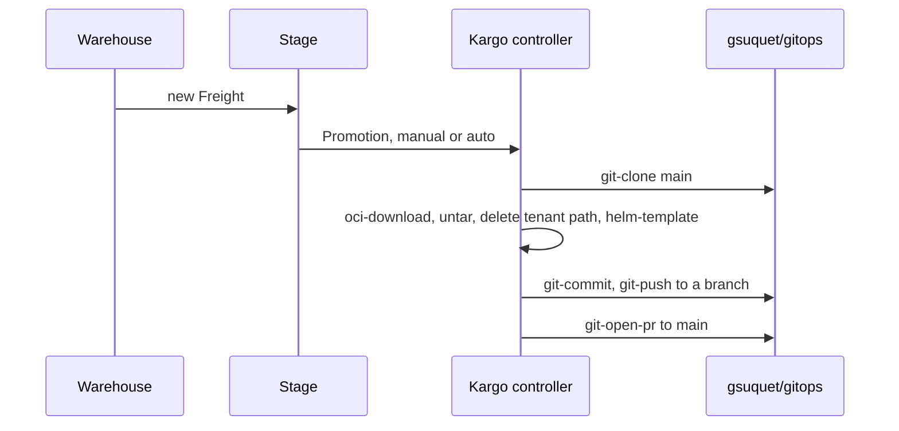
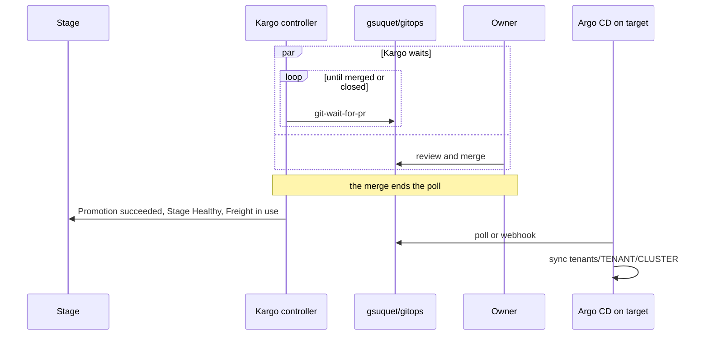

# Kargo promotion flow and steps

Detail of [RFC 0021](../rfc/0021-tenant-promotion-with-kargo.md). Study date 2026-11-18, against Kargo source tag `v1.12.6`.
"Verified" means checked against the linked source; "unverified" means prior knowledge, inference, or
unreachable source. The source links are in [sources](0021-tenant-promotion-with-kargo-evidence.md#sources).

## Promotion flow



Nothing on `main` has changed yet.



The Promotion succeeds on the merge, without waiting for the Argo CD sync.

After a pull request is closed unmerged, the Freight stays available for a new Promotion.

Design sketch: every field checked against the `v1.12.6` step reference docs (verified); not applied
to a cluster (unverified as a whole). Resources are rendered by `infra` on the Kargo host.

```yaml
apiVersion: kargo.akuity.io/v1alpha1
kind: Warehouse
metadata:
  name: app
  namespace: kargo-demo # Project namespace of tenant "demo"
spec:
  subscriptions:
    - image:
        repoURL: ghcr.io/gsuquet/demo
        imageSelectionStrategy: SemVer
        constraint: ^1.0.0
    - chart:
        repoURL: oci://ghcr.io/gsuquet/charts/demo # OCI: no chart name
        semverConstraint: ^1.0.0
---
apiVersion: kargo.akuity.io/v1alpha1
kind: ClusterPromotionTask
metadata:
  name: render-tenant-pull-request
spec:
  vars:
    - name: tenant
    - name: cluster
    - name: namespace
    - name: imageRepo
    - name: chartRepo
    - name: gitopsRepo
      value: https://github.com/gsuquet/gitops.git
  steps:
    - uses: git-clone
      config:
        repoURL: ${{ vars.gitopsRepo }}
        checkout:
          - branch: main
            path: ./gitops
    - uses: oci-download
      config:
        imageRef: ${{ vars.chartRepo }}:${{ chartFrom(vars.chartRepo).Version }}
        outPath: ./chart.tgz
    - uses: untar
      config:
        inPath: ./chart.tgz
        outPath: ./chart
        stripComponents: 1
    # git-clear would wipe the whole gitops checkout: delete only this tenant/cluster path.
    - uses: delete
      config:
        path: ./gitops/tenants/${{ vars.tenant }}/${{ vars.cluster }}
    - uses: helm-template
      config:
        path: ./chart
        releaseName: ${{ vars.tenant }}
        namespace: ${{ vars.namespace }}
        valuesFiles:
          - ./chart/values-${{ vars.cluster }}.yaml
        ignoreMissingValueFiles: true
        setValues:
          - key: image.tag
            value: ${{ imageFrom(vars.imageRepo).Tag }}
        outPath: ./gitops/tenants/${{ vars.tenant }}/${{ vars.cluster }}
        outLayout: flat
    - uses: git-commit
      config:
        path: ./gitops
        message: "chore(${{ vars.tenant }}): promote ${{ imageFrom(vars.imageRepo).Tag }} to ${{ vars.cluster }}"
    - uses: git-push
      as: push
      config:
        path: ./gitops
        generateTargetBranch: true # kargo/promotion/<promotion name>
    - uses: git-open-pr
      as: open-pr
      config:
        repoURL: ${{ vars.gitopsRepo }}
        sourceBranch: ${{ task.outputs.push.branch }}
        targetBranch: main
        labels: ["promotion", "tenant/${{ vars.tenant }}"]
    # No retry.timeout: a timeout fails the Promotion and leaves the pull request open.
    - uses: git-wait-for-pr
      if: ${{ status('open-pr') != 'Skipped' }}
      config:
        repoURL: ${{ vars.gitopsRepo }}
        prNumber: ${{ task.outputs['open-pr'].pr.id }}
---
apiVersion: kargo.akuity.io/v1alpha1
kind: Stage
metadata:
  name: pi
  namespace: kargo-demo
spec:
  requestedFreight:
    - origin:
        kind: Warehouse
        name: app
      sources:
        stages: [kind] # pi only takes Freight already promoted to kind
  promotionTemplate:
    spec:
      steps:
        - task:
            name: render-tenant-pull-request
            kind: ClusterPromotionTask
          vars:
            - name: tenant
              value: demo
            - name: cluster
              value: pi
            - name: namespace
              value: demo
            - name: imageRepo
              value: ghcr.io/gsuquet/demo
            - name: chartRepo
              value: oci://ghcr.io/gsuquet/charts/demo
```

| Step fact (verified unless marked unverified) | Design rule |
| --- | --- |
| `git-push` with `generateTargetBranch: true` pushes `kargo/promotion/<promotion name>`, outputs `branch`, `commit`; push policy `RebaseOrMerge` since `v1.12.0`; `force` defaults to `false` | Keep `force: false` |
| `git-open-pr` fails when `targetBranch` is missing (`createTargetBranch` removed in `v1.12.0`); skipped when branches do not differ | `if:` on the wait step |
| `git-wait-for-pr` keeps the Promotion `Running`, polls every `30s` (minimum `10s`), waits forever without `retry.timeout`, fails (no retry) when the pull request closes unmerged | An open pull request blocks the next Promotion to that Stage. See the [risk](../rfc/0021-tenant-promotion-with-kargo.md#drawbacks-and-risks) |
| A step `retry.timeout` fails the Promotion; docs do not say the pull request or `kargo/promotion/*` branch is closed (unverified: assumed left open) | No `retry.timeout` |
| `git-clear` empties the whole working tree | `delete` on `tenants/<tenant>/<cluster>/` only |
| `helm-template` takes a local chart dir with `Chart.yaml`; `oci-download` accepts `oci://...:tag` with Helm credentials; `includeCRDs` defaults to `false` | `oci-download` + `untar` first; tenants ship no cluster-scoped resources anyway |
| `kustomize-build` renders a dir with `kustomization.yaml` | Kustomize tenants need a `git` subscription with `includePaths` (open question [Tenant packaging](../rfc/0021-tenant-promotion-with-kargo.md#open-questions)) |
| `git-merge-pr` exists (beta) | Never used: a human merges |
| SSH repository URLs deprecated since `v1.10.0`, removal announced for `v1.13.0`; there is no `v1.13.0`, the next release is `v2.0.0` (roadmap) | HTTPS URLs only |
| Enterprise-only steps: `wait-for-approval`, `send-message`, `gh-*`, `gha-*`, `tf-*`, ServiceNow, Jira | None needed |

### Without `argocd-update`

| Lost | Effect (verified in source unless marked unverified) |
| --- | --- |
| Health | `argocd-update` registers an Argo CD health check. With none, the aggregating checker starts `Healthy`: the Stage is `Healthy` at merge time |
| Verification timing | Verification starts after Promotion success (and after Argo CD `Healthy` when Applications are involved): here, at merge time, before Argo CD syncs |
| Auto-promotion gating | A Stage with no `verification` counts Freight as verified: downstream eligibility follows the upstream merge |
| Sync trigger | Argo CD picks the merge up on its poll (default three minutes, unverified) or a webhook, as ADR-0008 accepted |

`argocd-wait` (read-only; waits on `health`, `sync`, `operation`; no `authorized-stage` annotation;
registers no health check) (verified) would need Kargo to read each Argo CD `Application`: host cluster
only, or a shard or `kubeconfigSecrets.argocd` per remote Argo CD. It keeps git-only writes but
breaks "no access to target clusters": out of scope.

### Stale promotion pull requests

A timed-out Promotion leaves an open pull request. Merged later, Argo CD deploys Freight that Kargo
records as a failed Promotion: Kargo and Git diverge, and downstream Stages do not see it promoted.

| Rule | Status |
| --- | --- |
| No `retry.timeout` on `git-wait-for-pr`; end a stale promotion by aborting it in Kargo and closing the pull request (the close also fails it on the next poll) | proposal |
| "Automatically delete head branches" on `gsuquet/gitops`; closed-unmerged branches deleted by hand, or by a scheduled workflow closing promotion pull requests older than N days | proposal |
| Merge only while the Promotion is `Running`; a pull request whose Promotion failed, was aborted or was lost with its host is closed and the Freight promoted again. Pull request CI cannot see Kargo state, so this is a human rule | proposal |

Two tenants, or two clusters of one tenant, can have open pull requests at once: different paths,
different branches. Conflicts only arise on one `tenants/<tenant>/<cluster>/`, which the
one-Promotion-per-Stage rule prevents. Kargo marks Freight "in use" only after the merge, so its
view matches `main`.

### Verification (not in slice 1)

| Fact | Status |
| --- | --- |
| Stage `verification` lists `AnalysisTemplate`s in the Project namespace; providers `job`, `web`, `prometheus` | verified |
| Argo Rollouts CRDs required; workloads need not use Rollouts | verified |
| The Rollouts controller itself is required (Kargo does not run `AnalysisRun`s; `controller.rollouts.controllerInstanceID`) | unverified (inferred from source) |
| Without a health gate the `AnalysisRun` starts at merge: a `web` metric must poll the tenant public URL `/version` against the Freight tag, with `count`, `interval`, `failureLimit` covering the sync delay | design |
| A `job` metric runs on the Kargo host: reaches other clusters only through public endpoints | design |
| Verifying blocks other Promotions to the Stage; failure blocks Freight downstream; manual Freight approval bypasses verification | verified |
