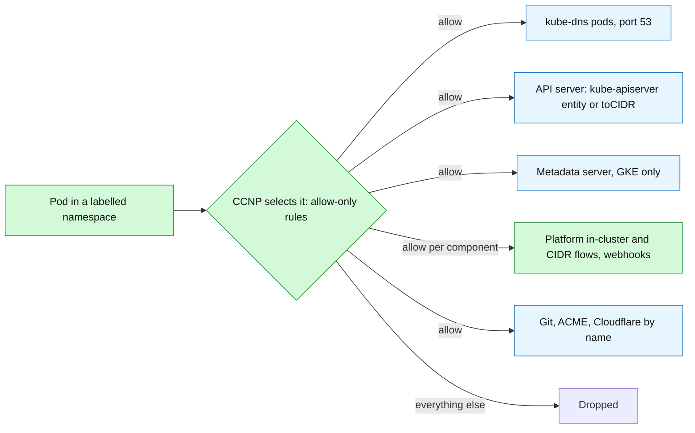

# GKE default deny and Dataplane V2

<!-- readability: allow-code V2 L3 L4 L7 -->

Detail for [RFC 0024](../rfc/0024-gke.md); check date, sources and **(unverified)** marks: see its
[Context](../rfc/0024-gke.md#context).

## Policy flows

The same CCNP as kind and Talos, plus the metadata server allow on GKE. Per component, in-cluster, CIDR and webhook
flows use CCNP `toCIDR` or webhook ports; names use `FQDNNetworkPolicy`, whose effect under a CCNP is **(unverified)**.

Legend: green is new, blue is external (GKE or the internet).

## Allow-only default deny

Express default deny with allow-only rules, never `ingressDeny`/`egressDeny`: on GKE "explicit Deny rules in a CCNP override allow rules in namespace-scoped policies", which would also block tenant NetworkPolicies. Selecting an endpoint with allow rules already denies the rest, as upstream Cilium does.

Source: [CCNP on GKE](https://docs.cloud.google.com/kubernetes-engine/docs/how-to/configure-cilium-network-policy).

## CCNP limits

CCNP on GKE is L3/L4 only: "Layer 7 policies are not supported", "Node selectors are not supported", 1000 CCNP per cluster max. GKE calls CCNP "a proprietary API" and steers new work to `ClusterNetworkPolicy`.

Source: [CCNP on GKE](https://docs.cloud.google.com/kubernetes-engine/docs/how-to/configure-cilium-network-policy).

## Namespace selectors and API server

Namespace-label `endpointSelector` (`k8s:io.cilium.k8s.namespace.labels.<key>`) and `toEntities: [kube-apiserver]` are not in the GKE examples **(unverified)**. If `toEntities` is rejected, the API server allow uses `toCIDR` with the control plane CIDR output of `cluster-gke`. CCNP needs gcloud 465.0.0+ for the CLI path (OpenTofu path: the GA provider field).

Source: [CCNP on GKE](https://docs.cloud.google.com/kubernetes-engine/docs/how-to/configure-cilium-network-policy).

## NetworkPolicy fallback

Fallback if namespace-label selectors are rejected (the ADR-0010 fallback): on GKE the `network-policy` component renders, into each labelled namespace, a Kubernetes `NetworkPolicy` selecting all pods with `policyTypes: [Ingress, Egress]` and the same baseline allows (kube-dns on 53, API server and metadata server by `ipBlock`). Kubernetes `NetworkPolicy` is additive: the per-component and per-tenant allows the platform renders (tenants cannot create `NetworkPolicy`, ADR-0009) open flows on top of it, nothing overrides it, and `FQDNNetworkPolicy` combines additively with it ("egress traffic is allowed as long as it matches one of the policies"). Conftest then checks one default-deny `NetworkPolicy` per labelled namespace on GKE.

Source: ADR-0010, [FQDN policies](https://docs.cloud.google.com/kubernetes-engine/docs/how-to/fqdn-network-policies).

## Metadata server

Workload Identity under a strict policy needs egress to `169.254.169.252/32:988` and, on DPv2, `169.254.169.254/32:80`. The GKE variant allows both on every labelled namespace (the metadata server only serves the Pod's own identity). Without it, ESO on Google Secret Manager and any Workload Identity caller fails.

Source: [Workload Identity](https://docs.cloud.google.com/kubernetes-engine/docs/concepts/workload-identity).

## DNS provider

Cloud DNS for GKE (default on new Autopilot since 1.25.9-gke.400, opt-in on Standard) resolves through `169.254.169.254:53` on Standard or NodeLocal DNSCache `169.254.20.10` on Autopilot, so a kube-dns pod selector stops matching. `cluster_dns = "KUBE_DNS"` is pinned; choosing Cloud DNS later needs `toCIDR` allows on port 53 instead.

Source: [Cloud DNS](https://docs.cloud.google.com/kubernetes-engine/docs/how-to/cloud-dns).

## GKE-managed namespaces

GKE-managed namespaces (`kube-system`, `gke-managed-*`, `gmp-system`, full list **(unverified)**) carry no policy label, so the selector leaves them out. Conftest only checks rendered namespaces: unchanged.

## ClusterNetworkPolicy

`ClusterNetworkPolicy` (`policy.networking.k8s.io/v1alpha2`, Admin and Baseline tiers, GKE `1.36.0-gke.4447000`+) would give a Baseline-tier default deny tenants can override. Pre-GA on GKE, alpha upstream, Cilium support **(unverified)**.

## FQDNNetworkPolicy

`FQDNNetworkPolicy` (`networking.gke.io/v1alpha1`): 50 IPs per policy, single-level wildcards, kube-dns or Cloud DNS only; enabling it on an existing Standard cluster needs an `anetd` restart. Whether CCNP `toFQDNs` works on GKE is **(unverified)**: assume not. How it combines with a CCNP default deny is undocumented ([open question](../rfc/0024-gke.md#open-questions)).

Source: [FQDN policies](https://docs.cloud.google.com/kubernetes-engine/docs/how-to/fqdn-network-policies).

## Platform egress by name

Platform egress by name on GKE (Argo CD to GitHub, cert-manager to ACME, cloudflared to `region1`/`region2.v2.argotunnel.com` and the Access team domain) is one `FQDNNetworkPolicy` per component in the `network-policy` component, within the 50-IP limit. If an `FQDNNetworkPolicy` does not open egress past the CCNP default deny, GKE switches to the [NetworkPolicy fallback](#networkpolicy-fallback) default deny, with which FQDN policies are documented as additive; CCNP `toCIDR` on published ranges (GitHub `meta`, Cloudflare) cannot cover ACME, which publishes none. Checked before the default deny is synced: without it Argo CD loses GitHub and cannot repair itself.

Source: [FQDN policies](https://docs.cloud.google.com/kubernetes-engine/docs/how-to/fqdn-network-policies).

## Dataplane V2 against our Cilium needs

| Need | DPv2 | Consequence |
|---|---|---|
| eBPF datapath, no kube-proxy | Yes, "uses `cilium` instead of `kube-proxy`" | Set from day one (creation-only) |
| CCNP | Opt-in, L3/L4 only | See [CCNP limits](#ccnp-limits) |
| `CiliumNetworkPolicy` | CRD present: the DPv2 doc caps "Clusters using the CiliumNetworkPolicy CRD" at 1,000 nodes; the CCNP page does not document it, so its use as an API is **(unverified)** | Tenants already denied it in the AppProject; platform policies on GKE use CCNP, `NetworkPolicy` or `FQDNNetworkPolicy`, never `CiliumNetworkPolicy` |
| Own Cilium DaemonSet | Not applicable: DPv2 is the Cilium | Catalog skips `cilium` on GKE |
| FQDN egress | GKE `FQDNNetworkPolicy`, not Cilium `toFQDNs` | Add it to the tenant AppProject `namespaceResourceBlacklist` on GKE |
| Hubble | Managed relay and CLI; Hubble UI optional | No Hubble component of ours; optional `hubble-ui` on the GKE relay (service name **(unverified)**) |
| Policy logging | Built in, through a logging CRD | Replaces Hubble-based deny auditing |
| Gateway API / Envoy L7 | Not offered **(unverified; the CCNP doc rejects L7)** | Non-Cilium Gateway implementation on GKE |
| Custom eBPF | "GKE doesn't support installing custom eBPF programs on nodes that use GKE Dataplane V2": they "might disrupt cluster networking", and GKE raises a Recommendation | Support statement, not a block: Falco and Tetragon attach tracing programs, so they may run on Standard at our own risk of interfering with `anetd`. Off on GKE until the owner decides. |

## Sources

- [Dataplane V2](https://docs.cloud.google.com/kubernetes-engine/docs/concepts/dataplane-v2)
- [DPv2 observability](https://docs.cloud.google.com/kubernetes-engine/docs/concepts/about-dpv2-observability)
