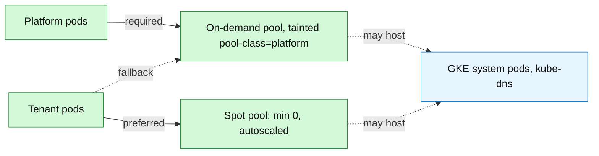

# GKE pod placement across Spot and on-demand pools

Detail for [RFC 0024](../rfc/0024-gke.md); check date, sources and **(unverified)** marks: see its
[Context](../rfc/0024-gke.md#context).

## Placement by pool mix

| Pools in `node_pools` | Module adds | Platform pods | Tenant and GKE system pods |
|---|---|---|---|
| Spot only | nothing | anywhere; preemption or stockout can take Argo CD down | anywhere |
| On-demand only | nothing | anywhere | anywhere |
| Both | on every on-demand pool: label and taint `pool-class=platform`, effect `PreferNoSchedule` | `nodeSelector` + toleration from `platform_placement`, `platform` PriorityClass | tenants: preferred nodeAffinity on `cloud.google.com/gke-spot=true` in the tenant defaults; GKE system pods: wherever GKE puts them |

Platform pods (argocd, cert-manager, external-secrets, Gateway, cloudflared) are pinned to on-demand; tenants prefer
Spot and spill over when it is preempted or out of stock; GKE system pods, kube-dns included, land on either.

Legend: green is new, blue is external (managed by GKE).

## Placement rules

- `cluster.yaml` declares `placement.platform` with the same `nodeSelector` and tolerations as the
  `platform_placement` output; the render applies them to every platform component. A mismatch leaves platform
  pods Pending, which is visible, never silently on Spot.
- The `platform` PriorityClass sits above the tenant default, so platform pods preempt tenant spillover on the
  on-demand pool. The on-demand `max` bounds the cost of spillover.
- `PreferNoSchedule`, not `NoSchedule`: GKE-managed kube-system pods do not carry our toleration
  **(unverified)**; with `NoSchedule` they could run only on Spot and would stay Pending while the Spot pool is
  empty. `PreferNoSchedule` lets them fall back to on-demand; it does not keep kube-dns off Spot: a preemption
  still drops the kube-dns replicas on Spot until they are rescheduled. Where GKE spreads kube-dns replicas across
  pool classes is **(unverified)**; GKE manages kube-dns, so we do not patch its affinity.
- Scale-up: the scheduler preference (taint, preferred affinity) does not steer which pool the cluster autoscaler
  grows **(unverified)**: tenant pods Pending while Spot capacity exists may grow the on-demand pool up to its
  `max`. Candidate fix: a GKE `ComputeClass` (Standard, `1.30.3-gke.1451000`+) whose `priorities` list the Spot
  pool before the on-demand pool, selected by the tenant defaults; Spot-then-on-demand with named pools is an
  inference from the doc's fallback order **(unverified)**
  ([ComputeClass](https://docs.cloud.google.com/kubernetes-engine/docs/concepts/about-custom-compute-classes)).
