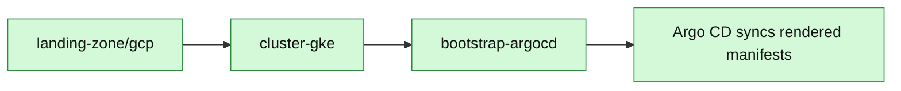

# GKE platform services

Detail for [RFC 0024](../rfc/0024-gke.md); check date, sources and **(unverified)** marks: see its
[Context](../rfc/0024-gke.md#context).

## Gateway API on GKE

| | GKE owns the CRDs (chosen, ADR-0012) | `gateway-api-crds` owns them |
|---|---|---|
| Setting | `CHANNEL_STANDARD`: GKE "[installs] the CRDs of the Gateway API Standard Channel with the cluster"; reconciliation up to 45 min | `CHANNEL_DISABLED` from creation |
| Catalog | Skip `gateway-api-crds`; the implementation must support the GKE-shipped version | Same as kind and Talos |
| Bootstrap | No `bootstrap-gateway-api` | `bootstrap-gateway-api` as on kind and Talos |
| Experimental types | Standard with `CHANNEL_STANDARD`: not installed **(unverified: the doc only says Experimental CRDs cannot be installed on Autopilot)**. `TLSRoute` is listed as supported by the GKE Gateway doc (TLS passthrough), so GKE may ship its CRD; which version and channel **(unverified)**. RFC 0025 needs `TLSRoute` for Cilium on Talos, not here | Available if the component ships them |
| GKE load balancer classes | Available, unused | Not available |

- The GKE Gateway controller provisions Google Cloud load balancers (`gke-l7-global-external-managed`,
  `gke-l7-regional-external-managed`, `gke-l7-gxlb`, `gke-l7-rilb`). "You can use multiple Gateway controllers,
  including controllers not provided by Google, in a GKE cluster simultaneously."
- The implementation on GKE is any non-Cilium one installed without bundled CRDs, with its own GatewayClass and a
  ClusterIP Service that cloudflared targets (Envoy Gateway is one example; the choice is out of scope).
- What GKE does with Gateway API CRDs it did not install, and whether disabling the channel removes them, is
  **(unverified)**.

## Workload Identity Federation

| Fact | Consequence |
|---|---|
| Direct principals work without a Google service account: `principal://iam.googleapis.com/projects/PROJECT_NUMBER/locations/global/workloadIdentityPools/PROJECT_ID.svc.id.goog/subject/ns/NAMESPACE/sa/KSA`; some APIs still need impersonation | Prefer direct principals |
| Identity sameness: every cluster in a project shares the pool | The same namespace and service account on two clusters get the same access |
| `hostNetwork: true` Pods get no Workload Identity | Keep consumers off the host network |

| Consumer | Identity |
|---|---|
| cert-manager DNS-01 | No Workload Identity: zones are on Cloudflare, ClusterIssuer uses `dns01.cloudflare.apiTokenSecretRef`. The token holds only "Zone - DNS - Edit" and "Zone - Zone - Read" on the platform zones, is created by hand in the Cloudflare dashboard and stored only in the secrets backend, delivered by ESO. Not a `cloudflare_api_token` in `landing-zone/cloudflare`: its value would land in state, against that root's rule "No secret value is created by a resource of this configuration". Cloud DNS plus Workload Identity applies only if a zone moves to Google Cloud. |
| ESO | Only if the backend is Google Secret Manager: per-namespace `SecretStore` named `secrets` with `auth.workloadIdentity.serviceAccountRef` to a service account in that namespace, as a direct principal holding `roles/secretmanager.secretAccessor`. IAM per secret, or per prefix with IAM conditions **(unverified on Secret Manager)**, so a tenant cannot read another's secrets. The annotation-linked service account and the controller identity (`gcpsm: {}`) are the other two patterns. |

## Bootstrap and catalog

GKE needs no `bootstrap-cilium` and no `bootstrap-gateway-api` (ADR-0015).

Legend: green is new.

`cluster.yaml` gains `distribution: gke | kind | talos` (the field ADR-0011's Confirmation names), which the
render uses for per-distribution defaults and the schema and Conftest checks use for the GKE exceptions.

| Component | GKE treatment |
|---|---|
| `cilium` | Skipped; DPv2 instead |
| `gateway-api-crds` | Skipped; GKE owns the CRDs |
| `network-policy` | Baseline (retro RFC 0010, RFC 0014); GKE variant adds the metadata server allow and per-component `FQDNNetworkPolicy` egress, may use `toCIDR` for the API server, or the `NetworkPolicy` fallback ([NetworkPolicy fallback](0024-gke-network-policy.md#networkpolicy-fallback)) |
| Gateway implementation | Non-Cilium, no bundled CRDs, own GatewayClass, ClusterIP behind cloudflared |
| `argocd` | Unchanged, plus `placement.platform` |
| `cert-manager` | `global.leaderElection.namespace=cert-manager` on every distribution (required on Autopilot, harmless elsewhere); Cloudflare DNS-01 issuer, token from `secrets` |
| `external-secrets` | Backend per the secrets RFC; Workload Identity wiring only for Google Secret Manager |
| `cloudflared` | Unchanged; outbound through Cloud NAT |
| Hubble | No relay component; optional `hubble-ui` |
| Tenant AppProject | Add `FQDNNetworkPolicy` (`networking.gke.io`) to `namespaceResourceBlacklist` on GKE |
| Falco, Tetragon | Not enabled on GKE until the owner decides |
| kubeconform | Schemas for GKE CRDs (`FQDNNetworkPolicy`, `ClusterNetworkPolicy` if used) |

## Sources

- [cert-manager compatibility](https://cert-manager.io/docs/installation/compatibility/)
- [cert-manager Cloudflare DNS-01](https://cert-manager.io/docs/configuration/acme/dns01/cloudflare/)
- [ESO Google Secret Manager](https://external-secrets.io/latest/provider/google-secrets-manager/)
