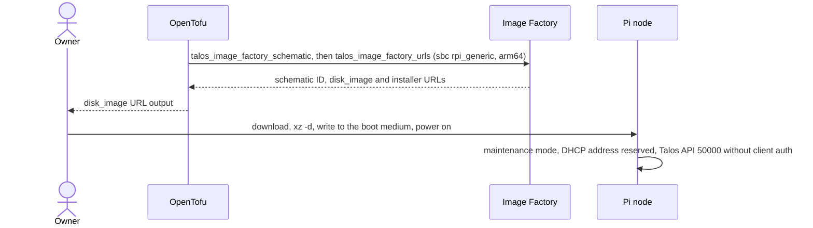
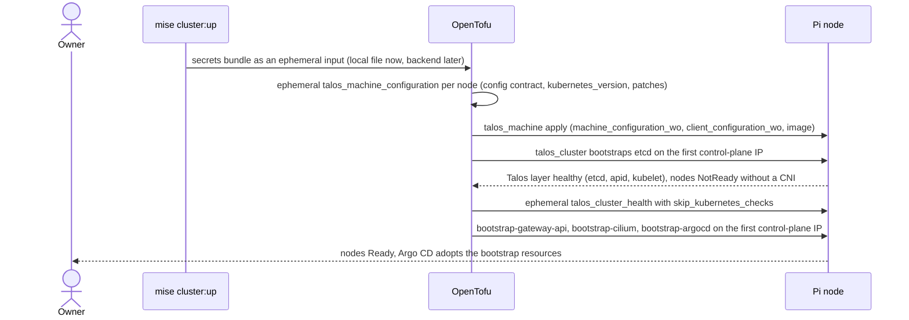

# Enrollment of a Talos node

From a blank boot medium to a Ready node, in one image apply, one flash and one cluster apply. **(unverified)** is defined in
[current state](0025-talos-raspberry-pi-rollout.md#current-state). Evidence for [RFC 0025](../rfc/0025-talos-raspberry-pi.md); the RFC holds the decision.

## Enrollment

### Boot image

Writing the boot medium is a manual step: a task may print the `dd` command but never runs `dd` or `sudo`.

### Apply and bootstrap

The bootstrap goes to the first control-plane IP, never the VIP.

### Rules

| Step | Rule |
| --- | --- |
| Address | Reserve the DHCP address (or set a static one in the config) before the apply: every resource is keyed on the node IP. |
| Configs | One `talos_machine_configuration` per node (`for_each`), `talos_version` pinned to the creation version ("the config-generation contract"). Patches go here: `talos_machine` 0.12.0 has no `config_patches`, only `machine_configuration[_wo]`, `image`, `client_configuration[_wo]`, `kubeconfig[_wo]`, `drain_on_upgrade`, `ignore_kubernetes_upgrade_drift`, `reboot_mode`, `on_destroy`. |
| First apply | `talos_machine` (new in 0.12.0) on a maintenance-mode node **(unverified)**: the docs do not describe the insecure first apply; official examples use the older `talos_machine_configuration_apply` (which has `client_configuration_wo` and `machine_configuration_input_wo` per RFC 0022). Test both on one node before writing the module. |
| Bootstrap | `talos_cluster`: `node` "Must be an IP" (a hostname goes in `endpoint`), every control-plane IP in `control_plane_nodes` ("Required for HA clusters"), tracks `kubernetes_version`, completes when the Talos layer is healthy and "does not wait for Kubernetes components". `talos_machine_bootstrap` is the older single-purpose resource. |
| Gate | Ephemeral `talos_cluster_health` with `skip_kubernetes_checks = true`: the full check waits for `Ready` nodes, which never happens before Cilium, so it deadlocks. That the skipped check proves the API server answers, and that an ephemeral resource can gate the `helm` / `kubernetes` providers in the same apply **(unverified)**. |
| Cilium window | After bootstrap Talos "will hang at phase 18/19 with `retrying error: node not ready`"; "you have about 10 minutes to apply Cilium before the node retries". One apply keeps the gap short. |
| Drain wiring | `drain_on_upgrade` needs `kubeconfig_wo` from the ephemeral `talos_cluster_kubeconfig`, which follows `talos_cluster`, which follows `talos_machine`: a reference cycle on the first create, when no cluster exists. Whether both can be wired on the first apply **(unverified)**. Fallback: drain disabled on create, enabled by a later apply through `mise run cluster:upgrade <name>`. |
| Credentials | `talos_client_configuration`: data source and ephemeral only. `talos_cluster_kubeconfig`: data source, resource, ephemeral. The module uses the ephemeral forms only. |

## Sources

- [Terraform Registry, `siderolabs/talos` 0.12.0: talos_machine_configuration_apply][tf-apply]
- [Terraform Registry, `siderolabs/talos` 0.12.0: talos_cluster][tf-cluster]
- [Terraform Registry, `siderolabs/talos` 0.12.0: talos_cluster_health][tf-health]
- [Terraform Registry, `siderolabs/talos` 0.12.0: talos_machine][tf-machine]

[tf-apply]: https://registry.terraform.io/providers/siderolabs/talos/0.12.0/docs/resources/machine_configuration_apply
[tf-cluster]: https://registry.terraform.io/providers/siderolabs/talos/0.12.0/docs/resources/cluster
[tf-health]: https://registry.terraform.io/providers/siderolabs/talos/0.12.0/docs/ephemeral-resources/cluster_health
[tf-machine]: https://registry.terraform.io/providers/siderolabs/talos/0.12.0/docs/resources/machine
