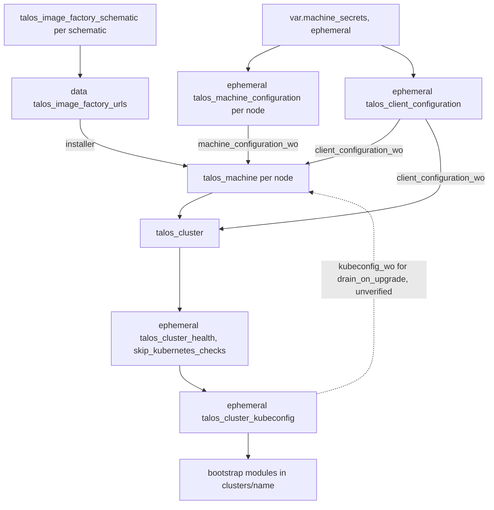

# The cluster-talos module

<!-- readability: allow-code R2 -->

Proposed inputs, outputs and resource graph of `modules/cluster-talos`. **(unverified)** is defined in
[current state](0025-talos-raspberry-pi-rollout.md#current-state). Evidence for [RFC 0025](../rfc/0025-talos-raspberry-pi.md); the RFC holds the decision.

## `modules/cluster-talos`

### Inputs

| Name | Type | Notes |
| --- | --- | --- |
| `name` | `string` | Cluster name. |
| `talos_version` | `string` | Installed version, e.g. `v1.14.6`; drives `talos_machine.image`. |
| `config_contract` | `string` | `talos_version` of `talos_machine_configuration`; pinned at creation; validation `>= v1.14`. |
| `kubernetes_version` | `string` | Feeds `talos_cluster` and `talos_machine_configuration`. |
| `endpoint` | `object({ host = string, port = optional(number, 6443) })` | Long-lived DNS name or VIP; added to cert SANs; not used for bootstrap. |
| `vip` | `object({ address = string, link = string })`, nullable | Renders `Layer2VIPConfig` on control planes. |
| `schematics` | `map(object({ overlay = optional(object({ name = string, image = string, options = optional(any) })), extensions = optional(list(string), []), extra_kernel_args = optional(list(string), []) }))` | One per hardware family (`rpi4`, `x86-intel`, ...). |
| `nodes` | `map(object({ ip = string, endpoint = optional(string), role = string, arch = string, schematic = string, install_selector = optional(string), labels = optional(map(string), {}), patches = optional(list(string), []) }))` | Key = hostname. `ip` required and validated (needed by `talos_cluster.node`, `control_plane_nodes`, `talos_cluster_health`); `endpoint` optional hostname. `role` in `controlplane` / `worker`; control-plane count 1 or odd 3+. |
| `allow_scheduling_on_control_planes` | `bool` | Default `true` for Pi-only clusters. |
| `pod_subnet`, `service_subnet` | `string` | Same names as `cluster-kind`. |
| `cluster_patches` | `list(string)` | Extra documents for every node (`ResolverConfig`, `SysctlConfig`, ...). |
| `cni` | `string` | `"none"` only (Cilium from `bootstrap-cilium`); renders the Flannel delete and `KubeProxyConfig`. |
| `discovery_service_endpoint` | `string`, nullable | `null` = public Talos service. |
| `machine_secrets` | `object`, `ephemeral = true`, required | The bundle (from Proton Pass or the local file). The module never creates secrets. |
| `drain_on_upgrade` | `bool` | Default `true`. |

- No Cilium outputs: KubePrism `localhost:7445` and the other Talos values live in `cluster.yaml`, not in the
  module.
- No `kubeconfig_path` / `talosconfig_path`: `local_file` cannot write ephemeral values and admin credentials must
  not land in the repo tree. `mise run cluster:creds <name>` writes them with `talosctl` / `kubectl` outside the repo
  (e.g. under `~/.config`) when a person needs them.
- Fixed inside, not inputs: KubePrism on 7445, `SecurityProfileConfig.workloadIsolation`, `FilesystemTrimConfig`,
  `ignore_kubernetes_upgrade_drift = true`.

### Outputs

| Name | Notes |
| --- | --- |
| `name`, `endpoint` | Same as `cluster-kind`; `endpoint` is the VIP DNS name. |
| `bootstrap_endpoint` | `https://<first control-plane IP>:6443`, for the bootstrap providers in the first apply. |
| `cluster_ca_certificate`, `client_certificate`, `client_key`, `kubeconfig` | Always `ephemeral = true`, wired only into provider blocks. That the `helm` and `kubernetes` providers accept ephemeral values in their configuration **(unverified)**: the language allows it; the rehearsal checks the providers. If `cluster-kind` keeps non-ephemeral outputs, root wiring differs per target. |
| `talosconfig` | Ephemeral. |
| `schematic_ids`, `installer_images`, `disk_image_urls` | Per schematic; `disk_image_urls` drives flashing. |
| `nodes` | Node name to address and role, for talosconfig endpoints and tasks. |

### Resource graph

The module hands over to the cluster root (R2 key `clusters/<name>/terraform.tfstate`); the dashed edge is the
[drain wiring](0025-talos-raspberry-pi-enrollment.md#rules).

| Node | Settings |
| --- | --- |
| `talos_machine` | `image`, Kubernetes upgrade drift ignored |
| `talos_cluster` | `node` = first control-plane IP, `control_plane_nodes` = all control-plane IPs, `kubernetes_version` |
| bootstrap modules | `bootstrap-gateway-api`, `bootstrap-cilium`, `bootstrap-argocd` |

## Sources

- `gsuquet/homelab` (frozen): `docs/reference/terraform-modules/cluster-kind/index.md`
- [Terraform Registry, `siderolabs/talos` 0.12.0: talos_cluster][tf-cluster]
- [Terraform Registry, `siderolabs/talos` 0.12.0: talos_machine][tf-machine]
- [Terraform Registry, `siderolabs/talos` 0.12.0: talos_image_factory_urls][tf-urls]

[tf-cluster]: https://registry.terraform.io/providers/siderolabs/talos/0.12.0/docs/resources/cluster
[tf-machine]: https://registry.terraform.io/providers/siderolabs/talos/0.12.0/docs/resources/machine
[tf-urls]: https://registry.terraform.io/providers/siderolabs/talos/0.12.0/docs/data-sources/image_factory_urls
