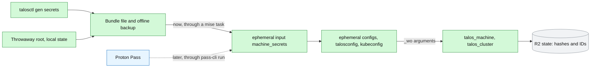

# Secrets of the Talos cluster

<!-- readability: allow-code R2 -->

Where the cluster PKI lives and how it reaches OpenTofu. **(unverified)** is defined in
[current state](0025-talos-raspberry-pi-rollout.md#current-state). Evidence for [RFC 0025](../rfc/0025-talos-raspberry-pi.md); the RFC holds the decision.

## Secrets

Only the source of the bundle changes between now and later; the module contract stays the same.

Legend: green is new, gray is unchanged, blue is external.

| Option | Bundle source | State content | Plan needs |
| --- | --- | --- | --- |
| `talos_machine_secrets` resource | State | Kubernetes, etcd and Talos OS CA keys, service-account key, etcd encryption secret, bootstrap token, `os:admin` key, plus a cluster-admin kubeconfig with the `talos_cluster_kubeconfig` resource | State token (rejected) |
| Proton Pass | Generated once, stored in Proton Pass (the only human store of RFC 0020), injected at plan time by the mise task with `pass-cli run`, as RFC 0022 does for the state passphrase | Hashes and IDs | A `pass-cli` session with the vault |
| Local file (stopgap) | Generated once, kept outside the repo with an offline backup, passed by a mise task | Hashes and IDs | The machine holding the file |

- **Proposed: local file now, Proton Pass once the Proton Pass item and the task exist.** Both keep the settled layout (`terraform-state`,
  `clusters/<name>/terraform.tfstate`); moving from the file to Proton Pass changes only where the task reads the bundle, no PKI rotation.
- `sensitive` hides values in plan output but still writes them to state ([machine_secrets][tf-secrets]).
- The [ephemeral guide][tf-ephemeral] warns: ephemeral secrets **must** live in a secret manager, or each run
  generates a new PKI. Ephemeral resources: `talos_machine_secrets`, `talos_machine_configuration`,
  `talos_client_configuration`, `talos_cluster_kubeconfig`, `talos_cluster_health` (since 0.11.0); write-only:
  `machine_configuration_wo`, `client_configuration_wo`, `kubeconfig_wo`. The guide targets Terraform 1.11+;
  OpenTofu has both features since 1.11 (RFC 0022); the provider's behavior on OpenTofu **(unverified)**, the
  rehearsal confirms it.
- OpenTofu client-side state and plan encryption (RFC 0022) is defense in depth on top, not the control.
- R2 has no versioning: a lost bundle loses the PKI. A bundle can be rebuilt from a control-plane config
  (`talosctl gen secrets --from-controlplane-config` **(unverified)**), but that needs a working node and a
  talosconfig.
- Mapping the `talosctl gen secrets` YAML to the provider's `machine_secrets` object (field names differ)
  **(unverified)**; the throwaway-root variant avoids it: its `talos_machine_secrets` output has the right shape.
- Dependency on RFC 0020: its "Talos specifics" assume the SA signing key
  (`talos_machine_secrets...certs.k8s_serviceaccount`) sits in the cluster root state in R2. This RFC keeps it out
  of state, so RFC 0020 must drop that assumption ([open question](../rfc/0025-talos-raspberry-pi.md#open-questions)). GCP Secret Manager in RFC 0020 serves ESO only,
  not plan-time reads: the bundle stays in Proton Pass with an offline backup.

## Sources

- [Terraform Registry, `siderolabs/talos` 0.12.0: Using Ephemeral Resources][tf-ephemeral]
- [Terraform Registry, `siderolabs/talos` 0.12.0: talos_machine_secrets][tf-secrets]

[tf-ephemeral]: https://registry.terraform.io/providers/siderolabs/talos/0.12.0/docs/guides/using_ephemeral_resources
[tf-secrets]: https://registry.terraform.io/providers/siderolabs/talos/0.12.0/docs/resources/machine_secrets
