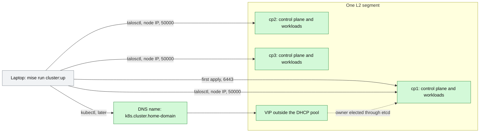
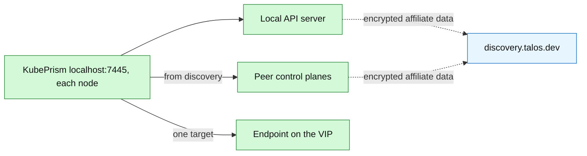

# Topology and API endpoint of the Talos cluster

<!-- readability: allow-code L2 -->

How many nodes, and how clients reach the API. **(unverified)** is defined in
[current state](0025-talos-raspberry-pi-rollout.md#current-state). Evidence for [RFC 0025](../rfc/0025-talos-raspberry-pi.md); the RFC holds the decision.

## Topology

### API access

`kubectl` goes through the VIP; `talosctl` never does, because the VIP depends on etcd. The first apply uses the first
control-plane IP.

Legend: green is new, gray is unchanged.

### In-cluster API access

KubePrism balances over the local API server, the peers and the endpoint, so a VIP failover does not reach workloads.

Legend: green is new, blue is external.

### Node count

Three Pi control planes on one segment, workloads allowed.

| Nodes | Topology | Trade-off |
| --- | --- | --- |
| 1 Pi | 1 control plane, workloads on it | Same as `olympus`: no HA, an upgrade reboot stops the API. |
| 3 Pis | 3 control planes, workloads allowed, no workers | **Recommended for 3 to 4 Pis.** Survives one loss; etcd and control plane cost part of each 8 GiB node **(unverified figure, measure)**. |
| 5+ nodes | 3 control planes + workers | x86 servers make better control planes. |

- etcd needs a majority: useful control-plane counts are 1 and 3+ (odd). Two is worse than one.
- Workloads on control planes: the `NoSchedule` taint now sits in `KubeNodeConfig` (replaces
  `.cluster.allowSchedulingOnControlPlanes`).

### API endpoint

| Endpoint option | Verdict |
| --- | --- |
| L2 VIP (`Layer2VIPConfig` on each control plane) | **Yes**, behind a DNS name. Needs all control planes on one L2 segment and a free address outside DHCP. Comes up only after bootstrap; failover after a crash takes "up to a minute"; depends on etcd, so **never** the talosconfig endpoint. With one control plane it still gives a stable address for a later move to three. |
| DNS name, one A record per control plane | Works without L2; clients do not skip a dead node quickly. |
| External TCP load balancer | No device at home; not worth it. |

- The DNS name (for example `k8s.<cluster>.<home-domain>`) goes in the API server cert SANs, so the VIP can move
  without new certificates, and in the long-lived kubeconfig.
- talosconfig lists the control-plane node addresses; `talosctl` fails over between them.
- [KubePrism][kubeprism] (default on, `KubePrismConfig`; `.machine.features.kubePrism` is deprecated): TCP balancer
  on `localhost:7445` over the endpoint, the local API server and every control plane from discovery. Kubelet,
  scheduler and controller manager use it; host-network clients (Cilium) must too. Keep the default.
- [Discovery][discovery]: public `https://discovery.talos.dev/` by default, affiliate data encrypted by a cluster
  key; KubePrism learns control planes from it. Default kept; external dependency ([open question](../rfc/0025-talos-raspberry-pi.md#open-questions)).
- The Talos API is gRPC with mutual TLS: only a TCP proxy can carry it remotely.

## Sources

- [Sidero Labs, Talos v1.14 (accessed 2026-11-18): Discovery][discovery]
- [Sidero Labs, Talos v1.14 (accessed 2026-11-18): KubePrism][kubeprism]
- [Sidero Labs, Talos v1.14 (accessed 2026-11-18): Production Clusters][prod]
- [Sidero Labs, Talos v1.14 (accessed 2026-11-18, re-checked 2026-11-19): Virtual (shared) IP][vip]

[discovery]: https://docs.siderolabs.com/talos/v1.14/configure-your-talos-cluster/system-configuration/discovery.md
[kubeprism]: https://docs.siderolabs.com/talos/v1.14/configure-your-talos-cluster/system-configuration/kubeprism.md
[prod]: https://docs.siderolabs.com/talos/v1.14/getting-started/prodnotes.md
[vip]: https://docs.siderolabs.com/talos/v1.14/networking/advanced/vip.md
