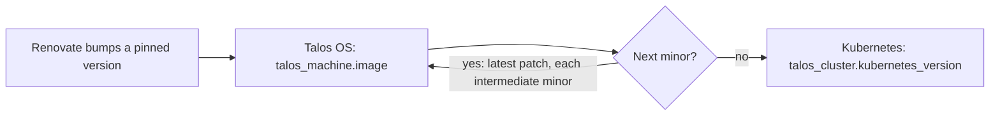

# Upgrades of Talos and Kubernetes

Order and rules of an upgrade. **(unverified)** is defined in
[current state](0025-talos-raspberry-pi-rollout.md#current-state). Evidence for [RFC 0025](../rfc/0025-talos-raspberry-pi.md); the RFC holds the decision.

## Upgrades

Talos first, inside its supported Kubernetes range, then Kubernetes.

| Rule | Detail |
| --- | --- |
| Talos OS | `talos_machine.image = factory.talos.dev/metal-installer/<id>:<version>`; a new version or schematic ID upgrades in place. `drain_on_upgrade` cordons and drains, with `kubeconfig_wo` from the ephemeral kubeconfig (see the Drain wiring row of [Enrollment rules](0025-talos-raspberry-pi-enrollment.md#rules)). |
| One node at a time | Talos refuses a control-plane upgrade that loses etcd quorum; Longhorn or CloudNativePG have no such guard. `for_each` cannot chain instances, so `mise run cluster:upgrade <name>` forces `tofu apply -parallelism=1`. |
| Upgrade path | Through the latest patch of every intermediate minor: several applies. A validation can reject a jump of more than one minor; how the module learns the running version **(unverified)** (`talos_machine` reads it on refresh). |
| Rollback | A/B images allow `talosctl rollback`; an invalid installer reference aborts the upgrade. |
| Config contract | Never bump `talos_version` of `talos_machine_configuration` with an upgrade: it is the contract of creation; bumping it is a separate change. |
| Old defaults | Upgraded clusters get neither workload isolation nor filesystem trim until the documents exist: the module sets them explicitly. |
| Kubernetes | `talos_cluster.kubernetes_version` runs `upgrade-k8s` (pre-pull, static pods one by one with health gates, kubelet per node, bootstrap manifests re-applied). `ignore_kubernetes_upgrade_drift = true` on `talos_machine` (provider: **experimental**); `kubernetes_version` in configs equals the cluster's, so new nodes join at it. |
| Ranges | Talos 1.14 supports Kubernetes 1.33 to 1.37; check the matrix before each Talos minor. |
| Pins | Talos version, Kubernetes version and provider pinned; Renovate custom regex managers bump them (datasource **(unverified)**). |

## Sources

- [Sidero Labs, Talos v1.14 (accessed 2026-11-18): Upgrading Talos Linux][upgrading]
- [Sidero Labs, Kubernetes guides: Upgrading Kubernetes][upgrading-k8s]

[upgrading]: https://docs.siderolabs.com/talos/v1.14/configure-your-talos-cluster/lifecycle-management/upgrading-talos.md
[upgrading-k8s]: https://docs.siderolabs.com/kubernetes-guides/advanced-guides/upgrading-kubernetes.md
