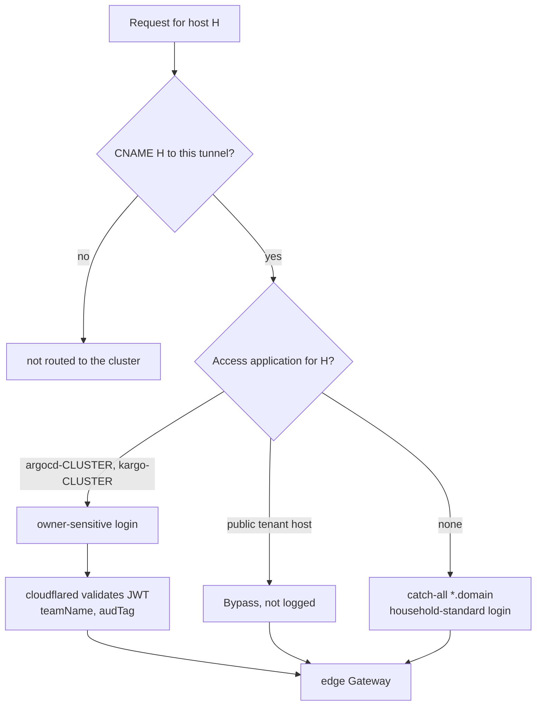

# Access, hostnames and limits

Every hostname falls under at least one Access application. Universal SSL covers apex and first-level names; a deeper
name would need Advanced Certificate Manager.

Detail of [RFC 0026](../rfc/0026-cloudflare-tunnel.md), which defines the [verified and unverified marks](../rfc/0026-cloudflare-tunnel.md#context).

## Access

The most specific application wins; anything not listed fails
closed to the catch-all.

- Argo CD and Kargo keep their own SSO behind Access. Access as OIDC provider (SaaS app) is out: its
  `saas_app.client_secret` is `computed` + `sensitive` in 5.28.1 **(verified, schema)**.
- Bypass "disables Access enforcement" and is "not logged"; Service Auth keeps logging
  ([policies](https://developers.cloudflare.com/cloudflare-one/access-controls/policies/), **verified**). A host-level
  application beating `*.<domain>` is **(unverified)**; the landing zone already relies on it.
- CLI access through Access ([question](../rfc/0026-cloudflare-tunnel.md#open-questions)): `cloudflared access` login or a service token in headers,
  both **unverified** for the Argo CD and Kargo CLIs.
- Git webhooks off by default: Argo CD polls every three minutes; its webhook secret is optional, the endpoint
  "lacks rate limiting protection" ([Argo CD webhooks](https://argo-cd.readthedocs.io/en/stable/operator-manual/webhook/),
  **verified**). Kargo warehouses poll.

| Webhook opt-in | Shape |
| --- | --- |
| Argo CD | Landing-zone Bypass application on `argocd-<cluster>` path `/api/webhook` (path-over-host precedence **unverified**), `webhook.github.secret` from ESO mandatory, `webhook.maxPayloadSizeMB` lowered |
| Kargo | External webhook server on its own Service **(unverified)**, own host `kargo-hooks-<cluster>`, own platform listener, host-level Bypass application, receiver secret from ESO |

- GitHub webhooks send no custom headers, so Service Auth cannot serve them **(unverified)**.

## Hostnames, DNS and limits

| Fact | Consequence | Source |
| --- | --- | --- |
| Universal SSL covers apex and first-level subdomains only | `<app>-<cluster>.gsuquet.com` for platform UIs, `<app>.gsuquet.com` for tenants; `*.olympus.gsuquet.com` would need Advanced Certificate Manager | [limitations](https://developers.cloudflare.com/ssl/edge-certificates/universal-ssl/limitations/) **(verified)** |
| CNAME to `<UUID>.cfargotunnel.com` proxies records of the same account only; a stopped tunnel leaves the record (error 1016) | Records in the tunnel's state | [DNS records](https://developers.cloudflare.com/cloudflare-one/networks/connectors/cloudflare-tunnel/routing-to-tunnel/dns/) **(verified)** |
| Wildcard records are proxied on every plan; an exact record wins | Exact records only | [wildcards](https://developers.cloudflare.com/dns/manage-dns-records/reference/wildcard-dns-records/) **(verified)** |
| Rules first to last, last is a catch-all, leading wildcard only, `path` is a Go regexp | Catch-all to the Gateway | [configuration file](https://developers.cloudflare.com/cloudflare-one/networks/connectors/cloudflare-tunnel/do-more-with-tunnels/local-management/configuration-file/) **(verified local; remote unverified)** |
| 1,000 tunnels, 25 replicas per tunnel, 1 MB config, 500 Access apps, 500 reusable policies, 50 domains per app | One tunnel and two replicas per cluster; three policies today | [account limits](https://developers.cloudflare.com/cloudflare-one/account-limits/) **(verified)** |
| Any Access login consumes a seat; Free plan 50 users **(unverified)**; Bypass visitors take none **(unverified)**; tunnels free **(unverified)** | Household and family logins count | [seats](https://developers.cloudflare.com/cloudflare-one/team-and-resources/users/seat-management/) |
