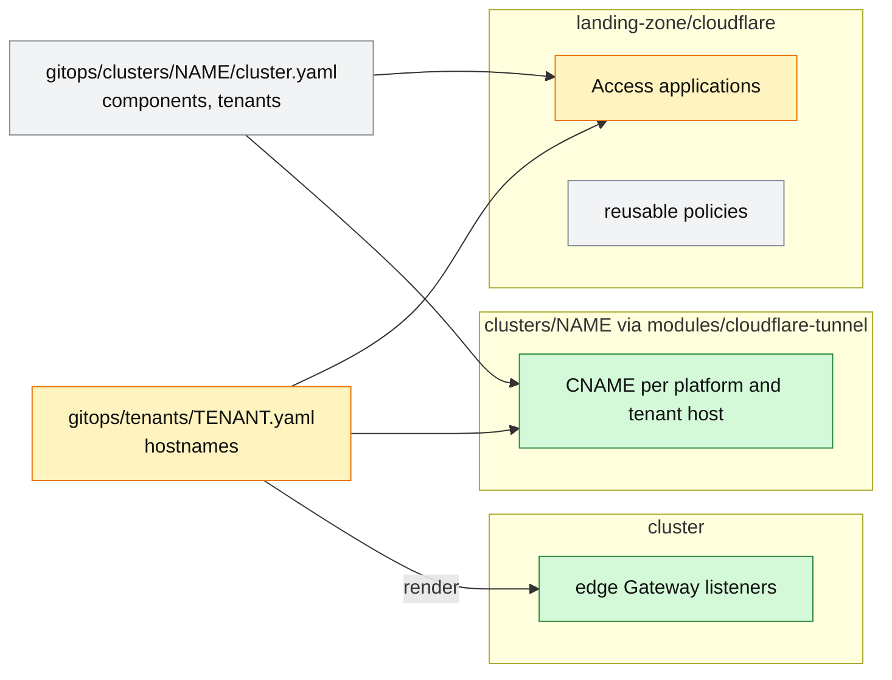
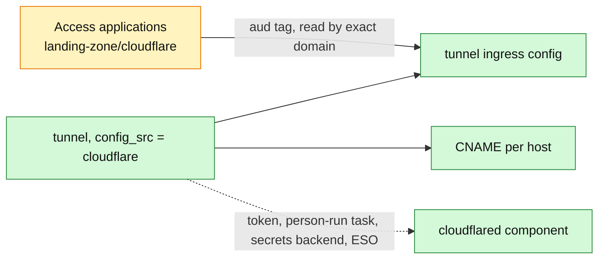

# Cloudflare resource ownership

The landing zone owns Access, each cluster root owns its tunnel and DNS, and the cluster owns the connector.

Detail of [RFC 0026](../rfc/0026-cloudflare-tunnel.md), which defines the [verified and unverified marks](../rfc/0026-cloudflare-tunnel.md#context).

## Owners

One list of hostnames per tenant feeds DNS, Access and the Gateway listeners; the gitops files are read-only inputs.

Legend: green is new, yellow is changed, gray is unchanged.

The connector token reaches the cluster outside IaC.

Legend: green is new, yellow is changed.

| Owner | Resources | Inputs |
| --- | --- | --- |
| `landing-zone/cloudflare` | Every `cloudflare_zero_trust_access_application`: catch-all, `argocd-<cluster>` and `kargo-<cluster>` (`owner-sensitive`) per cluster that enables `cloudflared`, a Bypass application per public tenant hostname | `gitops/clusters/*/cluster.yaml`, `gitops/tenants/*.yaml`, read with `yamldecode(file(...))` |
| `modules/cloudflare-tunnel` in `clusters/<name>/` | `cloudflare_zero_trust_tunnel_cloudflared` (no `tunnel_secret`), `cloudflare_zero_trust_tunnel_cloudflared_config`, one `cloudflare_dns_record` per platform and tenant hostname (`CNAME`, `content = "${tunnel.id}.cfargotunnel.com"`, `proxied = true`, `ttl = 1`). Outputs: tunnel ID, hostnames | `tenants` of its `cluster.yaml`, `hostnames` of each tenant file, `var.tunnel_origin`, `var.zero_trust_team_name` |
| `gitops/components/cloudflared/` | Deployment, `ExternalSecret`, `PodDisruptionBudget`, CA bundle mount | opt-in in `cluster.yaml`; no value goes through the render step |
| `network-policy` component | `cloudflared` egress and the edge Gateway admission policy, emitted by the render only when `cloudflared` is enabled | network implementation of the cluster, `cloudflared` enabled in `cluster.yaml` |

- The coupling of IaC roots to gitops files is deliberate and read-only: `tenants` of `cluster.yaml`, and a new
  `hostnames` field of the tenant schema (per hostname: `public: true` for a Bypass application, else the catch-all).
- Cluster roots never read the landing-zone state: `cloudflare_zone` by `filter` (name),
  `cloudflare_zero_trust_access_applications` by `domain` with `exact = true` for the `aud` tag **(verified, schema)**.
- `cloudflare_zero_trust_tunnel_cloudflared_config` owns the whole ingress list of one tunnel: two roots cannot
  share it (inferred from the resource shape).
- Apply order: landing zone, then cluster root. A cluster root whose Access application is missing fails at plan
  (data source empty); a tenant host without its Bypass application stays behind the catch-all. Both fail closed.
- Tenant CNAMEs share the cluster state: `cluster:down` takes a tenant's public hostname down with the cluster. A
  hostname listed by two clusters fails `manifests:check`.

## Landing zone today

Besides what the [RFC context](../rfc/0026-cloudflare-tunnel.md#context) lists, it owns Access groups and the reusable policies `owner-sensitive`,
`household-standard` (used by the catch-all) and `family-sensitive`.

Proposed README change: replace "Access applications belong to the tenant layer" with "every Access application,
account-wide and per cluster, lives in `landing-zone/cloudflare`; cluster roots only read them".
