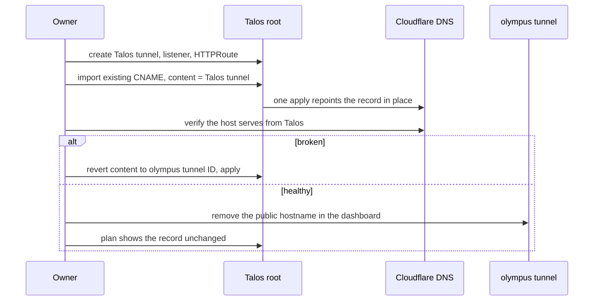

# Verification gates and olympus migration

A failed kind gate reopens the matching design choice, and each olympus hostname moves with one apply.

Detail of [RFC 0026](../rfc/0026-cloudflare-tunnel.md), which defines the [verified and unverified marks](../rfc/0026-cloudflare-tunnel.md#context).

## Verification gates

| Gate | Check | Blocks |
| --- | --- | --- |
| Kind, before implementation | Edge Gateway with `allocateLoadBalancerNodePorts: false` and no LB IPAM pool serves on its ClusterIP from a pod, unreachable from the host | Rollout step 2 |
| Kind, before implementation | With the default-deny CCNP: `cloudflared` reaches the Gateway, `world` is refused at `ingress`, `ingress` reaches backends | Rollout step 2 |
| Kind, before implementation | A tenant `HTTPRoute` on a platform or another tenant's host gets `Accepted=False` | Rollout step 2 |
| Kind, before implementation | `caPool` of a remote config reads a file mounted in the `cloudflared` container | HTTPS to the Gateway |
| First run | No drift on the tunnel resource after an API rotation | First `--rotate` |
| First run | Import-and-flip of a dashboard CNAME; the [record deletion](#olympus-migration) question | Rollout step 7 |
| First run, opt-in only | Host-plus-path Access precedence (Argo CD webhooks); Kargo webhook Service and host; CLI behaviour behind Access | The matching opt-in |

The rollout waits on these gates.

## Rollout steps

From the [operational impact of the RFC](../rfc/0026-cloudflare-tunnel.md#operational-impact):

1. pass the kind [gates](#verification-gates) on a throwaway cluster
2. add `hostnames` to the tenant schema and the listener render
3. landing-zone Access applications for the Talos cluster
4. `modules/cloudflare-tunnel` and the Talos root, with a new cluster-root token
5. `cluster:tunnel-token` once [RFC 0020](https://github.com/gsuquet/infra/pull/4) has a backend
6. enable `cloudflared` and the policies
7. olympus hostnames one at a time. Each step waits for the previous one.

## Olympus migration

Each hostname flips atomically and rolls back with one apply.

- Hostnames deeper than one level get new names under the scheme (no flip possible). When olympus is gone, delete
  its tunnel in the dashboard. A record later moved between clusters: the old root drops it with a `removed` block.
- Whether removing a dashboard public hostname deletes its record is **(unverified)**: Cloudflare only states that
  "The DNS record and the tunnel are independent".

## Fallback when the edge Gateway gate fails

The gate protects against the [pending LoadBalancer risk](../rfc/0026-cloudflare-tunnel.md#drawbacks-and-risks). A `NodePort` reopens the LAN path around Access unless a Talos host firewall blocks the port
**(unverified, not studied)**.

## Olympus today

One replica, token from a SealedSecret, hostnames and DNS records added in the dashboard
([context in the RFC](../rfc/0026-cloudflare-tunnel.md#context)).
