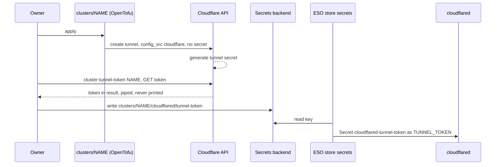

# Cloudflare tokens of a cluster

The cluster root uses a least-privileged API token, and a person-run task moves the connector token to the secrets backend.

Detail of [RFC 0026](../rfc/0026-cloudflare-tunnel.md), which defines the [verified and unverified marks](../rfc/0026-cloudflare-tunnel.md#context).

<!-- readability: allow-code R2 -->

## Cluster-root Cloudflare token

One Pass item per cluster root, used only by the person running `plan`/`apply` and the token task. Names from
[API token permissions](https://developers.cloudflare.com/fundamentals/api/reference/permissions/) and each endpoint's
"Accepted permissions" in the [API reference](https://developers.cloudflare.com/api/) **(verified)**.

| Scope | Permission | Needed by |
| --- | --- | --- |
| Account | `Cloudflare One Connector: cloudflared Write` | `POST /accounts/{account_id}/cfd_tunnel` (create), delete, `PUT .../cfd_tunnel/{tunnel_id}/configurations`, `GET .../token` and `PATCH` for the token task |
| Account | `Access: Apps and Policies Read` | `GET /accounts/{account_id}/access/apps?domain=` for the `aud` tag of `argocd-<cluster>` and `kargo-<cluster>` |
| Zone, each domain the cluster serves | `Zone Read` | `GET /zones` for the `cloudflare_zone` lookup by name |
| Zone, each domain the cluster serves | `DNS Write` | `cloudflare_dns_record` create, update, delete |

- Not granted: `Access: Apps and Policies Write` (account or zone), `Access: Organizations`, `Zero Trust`,
  `Zone Edit`, R2 (state uses its own R2 token), any other zone.
- `Cloudflare Tunnel Write` and `Cloudflare One Connectors Write` are accepted by the same endpoints; the latter also
  covers WARP connectors, so `cloudflared Write` is the narrowest.
- The Access team name comes from `var.zero_trust_team_name` (not secret), so no `Access: Organizations Read`.
- The `aud` lookup by exact domain returns `self_hosted` applications only; the SaaS `client_secret` in the data
  source schema is "only returned on POST request" **(verified, schema)**.
- Alternative to the Access read permission ([risk](../rfc/0026-cloudflare-tunnel.md#drawbacks-and-risks)): copying `aud` by hand, which breaks on
  every recreation.

## Connector token delivery

The token goes from the API straight into the backend, never into state, a file or a terminal.

- `cloudflare_zero_trust_tunnel_cloudflared` without `tunnel_secret` holds no secret: the attribute is optional +
  sensitive, not computed and not write_only, so the provider cannot fill it from the API; no other attribute stores
  the `token` or `credentials_file.TunnelSecret` the create API returns **(verified, schema 5.28.1)**.

| Option | Secret in state | Person step | Verdict |
| --- | --- | --- | --- |
| `tunnel_secret` from `random_bytes` | Yes | None | Violates the repo rule |
| Token data source pushed by IaC into the backend | Yes: `token` is `computed` + `sensitive` **(verified, schema)** | None | Violates the repo rule |
| **IaC creates the tunnel without a secret; person-run task moves the token** | No | One run per creation or rotation | **Chosen**: same pattern as the OAuth identity providers kept out of IaC |
| Tunnel created in the dashboard, then imported | No | Click + import | More manual, no benefit |
| Wait for a write-only `tunnel_secret_wo` or an ephemeral token resource | No | None | Exists neither in 5.28.1 nor in 5.29.0 (2026-11-11) **(verified)**; revisit at each provider bump |

- Task `mise run cluster:tunnel-token <name> [--rotate]`: tunnel ID from `tofu output`, API token from
  `pass-cli run`, `result` piped into the backend CLI. Person-run only, like `cf:ids`. The write step waits for
  [RFC 0020](https://github.com/gsuquet/infra/pull/4).
- `--rotate`: generate the secret inside the task, `PATCH /accounts/{account_id}/cfd_tunnel/{tunnel_id}`, write the
  returned token, let ESO refresh, restart the Deployment. The old token opens no new connection; live connectors
  keep serving; two replicas roll half at a time. Compromise: also `DELETE .../cfd_tunnel/{tunnel_id}/connections`
  ([tunnel permissions](https://developers.cloudflare.com/cloudflare-one/networks/connectors/cloudflare-tunnel/configure-tunnels/remote-tunnel-permissions/),
  **verified**).
- Component side: an `ExternalSecret` (`external-secrets.io/v1`, store kind and key path per [RFC 0020](https://github.com/gsuquet/infra/pull/4)
  **(unverified)**) targets Secret `cloudflared-tunnel-token`, key `token`, read as `TUNNEL_TOKEN` via `secretKeyRef`.
- The person-run task ([risk](../rfc/0026-cloudflare-tunnel.md#drawbacks-and-risks)) is dropped when the provider ships a write-only secret or an
  ephemeral token.
