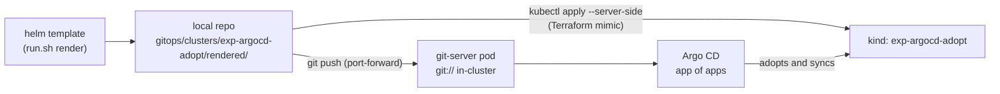

# Experiment 1: Argo CD adopts the bootstrap (argocd-adopt)

Status: done, 2026-11-19. Result: **the bootstrap boundary works**. Argo CD
adopts the Gateway API CRDs, Cilium and itself with no pod restart, no prune,
no OutOfSync loop, and then upgrades itself with no failed health probe. Two
conditions: the bootstrap applies with server-side apply **as the field
manager `argocd-controller`**, and Terraform never applies the files again.

Scripts: [`experiments/argocd-adopt/`](../../../experiments/argocd-adopt/).
One command creates the cluster, runs all the checks and deletes the cluster.

## Goal

The plan says: Terraform installs the cluster, the Gateway API CRDs, Cilium and
Argo CD (from `rendered/argocd`). Argo CD then adopts these and manages
everything else. This experiment answers:

1. Does Argo CD adopt resources that another tool applied, without restarts,
   pruning, OutOfSync loops or downtime? Itself included?
2. Does Argo CD then upgrade itself from a change in its own rendered files?
3. Which tracking method, which sync options, which field manager?
4. What must Terraform do after the first apply: `ignore_changes`, or a
   one-shot apply?

## Setup



- **Cluster:** kind, one node, `disableDefaultCNI: true`, `kubeProxyMode: none`.
  Cilium runs with `kubeProxyReplacement: true`.
- **Rendered manifests:** `helm template` for Cilium and Argo CD; the Gateway API
  `standard-install.yaml` as is. The render step adds the sync wave `-1` to every
  CRD, as `manifests:render` will. Layout:
  `gitops/clusters/exp-argocd-adopt/rendered/{gateway-api-crds,cilium,argocd,probe}/`.
- **Terraform mimic:** `kubectl apply --server-side --field-manager=argocd-controller`
  on the same rendered files, in the order the modules will use:
  1. Gateway API CRDs (and their `ValidatingAdmissionPolicy`), wait `Established`.
  2. Cilium, wait for the DaemonSet, the operator, the node `Ready` and CoreDNS.
  3. Argo CD: the Namespace and the CRDs, then all the other resources except the
     `argoproj.io` ones, wait for the rollouts.
  4. Hand-over: the `platform` AppProject and the `argocd` Application only. The
     `argocd` Application holds the other Applications (`gateway-api-crds`,
     `cilium`, `probe`, sync wave 1) and creates them. This is the homelab
     `bootstrap-argocd` design.
- **Git server: in-cluster `git daemon`.** A Deployment in the namespace
  `git-server` runs `git daemon --enable=receive-pack` on an `emptyDir`.
  It uses the Argo CD image, which already has `git` and `git-daemon`: no extra
  image. `run.sh` pushes through `kubectl port-forward` on a random local port.
  Argo CD reads `git://git-server.git-server.svc.cluster.local/infra.git`.
  - Why not `file://`: Argo CD would need a volume on `argocd-repo-server`. That
    changes the Argo CD manifests under test, and Argo CD would revert or fight it
    when it adopts itself.
  - Why not Gitea or similar: more memory and one more image, for no extra signal.
  - Limit: `git://` has no auth and no TLS. The real repoURL is
    `https://github.com/gsuquet/infra.git`; the protocol does not change the
    adoption behavior.
- **All Applications:** `automated: {prune: true, selfHeal: true}`,
  `syncOptions: [ServerSideApply=true]`. Argo CD has
  `controller.diff.server.side: true` and `application.resourceTrackingMethod:
  annotation` (the 3.x default, set to be visible).
- **Probe component:** two ConfigMaps with keys `a` and `b`. The bootstrap applies
  `probe-kubectl` with the field manager `kubectl` (the kubectl default) and
  `probe-argocd` with `argocd-controller`. A later commit removes `b` from both.

### Versions

All pinned in `experiments/argocd-adopt/` (`mise.toml` + `mise.lock`, `run.sh`).

| Item | Version | Pin |
| --- | --- | --- |
| kind | 0.33.0 | mise |
| kind node image | `kindest/node:v1.37.0` | `sha256:a1ed56cf…580ae5` |
| kubectl | 1.37.2 | mise |
| helm | 4.3.1 | mise |
| yq | 4.54.1 | mise |
| jq | 1.8.2 | root `.mise/config.toml` |
| Gateway API | v1.6.2 standard channel | file `sha256:faede450…ca40d9` |
| Cilium chart | 1.20.0 | tgz `sha256:c5f01391…d27883` |
| argo-cd chart (bootstrap) | 10.11.6 (Argo CD v3.5.6) | tgz `sha256:d8f096d8…d05` (argo-helm index digest) |
| argo-cd chart (upgrade) | 10.11.7 (Argo CD v3.5.7) | tgz `sha256:9f24a574…f04e` (argo-helm index digest) |
| git-server image | `quay.io/argoproj/argocd:v3.5.6` | `sha256:8e5cc5bb…5e4e5335` |

Host: macOS arm64, Docker 26.1.1 with 4 CPUs and 7.7 GiB, next to another
two-node kind cluster. Run time: about 7 minutes.

### How to run

```sh
cd experiments/argocd-adopt
mise install
mise exec -- ./run.sh
```

`run.sh` fails if a cluster `exp-argocd-adopt` exists, and always deletes the
cluster at the end, also on failure (`trap … EXIT`). It writes everything to
`$WORK/run.log` (a `mktemp -d` folder, or `WORK=…`). Optional inputs:
`GATEWAY_API_MANIFEST` and `CILIUM_CHART_TGZ` point to local copies; `run.sh`
checks their SHA-256 in all cases. Else it downloads them from GitHub releases
and `https://helm.cilium.io`.

## Results

Excerpts from the last of six runs (run 6). Runs 2 to 6 gave the same results;
run 1 failed on a script bug (see [What failed](#what-failed)).

### Render reproducibility

```text
cilium (our values): reproducible
argo-cd: reproducible
cilium with hubble.tls.auto.method=helm (chart default): NOT reproducible:
<   ca.crt: LS0tLS1CRUdJTiBDRVJUSUZJQ0FURS0tLS0tCk1JSURF... (cut)
>   ca.crt: LS0tLS1CRUdJTiBDRVJUSUZJQ0FURS0tLS0tCk1JSURG... (cut)
```

With the chart default, `helm template` generates a new Hubble CA and new
certificates on each render. `manifests:check` would always fail, and each
render would rotate the Hubble certificates. The experiment turns Hubble off.

### Adoption (phase 4)

The `argocd` Application created the three others, and all four were Synced and
Healthy 21 s after the hand-over, each with exactly one sync:

```text
all 4 Applications Synced and Healthy at 01cb93f8 after 21s
APP               SYNC    HEALTH   REV       SYNCS  LAST_OP
argocd            Synced  Healthy  01cb93f8  1      Succeeded
cilium            Synced  Healthy  01cb93f8  1      Succeeded
gateway-api-crds  Synced  Healthy  01cb93f8  1      Succeeded
probe             Synced  Healthy  01cb93f8  1      Succeeded
```

- **No OutOfSync loop.** Sampled every 10 s for 120 s: no sample not Synced, and
  the sync history did not grow:

  ```text
  sync history before: [{"n":"argocd","h":1},{"n":"cilium","h":1},{"n":"gateway-api-crds","h":1},{"n":"probe","h":1}]
  sync history after:  [{"n":"argocd","h":1},{"n":"cilium","h":1},{"n":"gateway-api-crds","h":1},{"n":"probe","h":1}]
  samples not Synced during the watch: 0
  ```

- **No restart.** Same pod UIDs and restart counts in `kube-system` and
  `argocd`, and the same pod templates:

  ```text
  pods: identical (same UIDs, same restart counts, 14 pods)
  pod templates of the Deployments: identical
  ```

- **Deployment generations go +1, harmless.** The first sync adds the
  `argocd.argoproj.io/tracking-id` annotation. The Deployment API bumps
  `metadata.generation` on an annotation change; the DaemonSet and StatefulSet
  APIs do not. The pod template is the same, so no new ReplicaSet and no new pod.
  A control run on resources outside Argo CD shows the same:

  ```text
  control: does a metadata-only change bump the generation?
    deploy/coredns: annotation added, generation 1 -> 2
    ds/cilium: annotation added, generation 1 -> 1
  ```

- **No prune, no delete.** No sync result has the status `Pruned`.
- **Tracking:** annotation. Argo CD added the tracking annotation on the first
  sync; the kubectl bootstrap did not set it:

  ```text
  tracking annotation on ds/cilium before adoption:
  ds/cilium: cilium:apps/DaemonSet:kube-system/cilium
  deploy/argocd-server: argocd:apps/Deployment:argocd/argocd-server
  sts/argocd-application-controller: argocd:apps/StatefulSet:argocd/argocd-application-controller
  ```

- **CRDs get no tracking annotation, but Argo CD manages them.** Checked on
  `httproutes.gateway.networking.k8s.io` and `applications.argoproj.io`: no
  tracking annotation, and `httproutes` shows `Synced` in its Application. Argo CD
  applies them (`argocd-controller Apply` with a new timestamp after a CRD change
  in Git, phase 5, and the new label is there), but never writes
  `argocd.argoproj.io/tracking-id` on them. The cause is not verified (not in the
  [resource tracking docs](https://argo-cd.readthedocs.io/en/stable/user-guide/resource_tracking/)).
  Effect: a CRD removed from Git is probably not pruned. The plan sets
  `Prune=false` on CRDs anyway.

  ```text
  crd/httproutes after a CRD change in git:
    labels: exp.invalid/rev
    manager: argocd-controller Apply 2026-11-18T23:27:36Z
    manager: kube-apiserver Update 2026-11-18T23:23:41Z
    tracking-id:
  ```

- **Helm hooks.** The chart renders `argocd-redis-secret-init` (ServiceAccount,
  Role, RoleBinding, Job) with `helm.sh/hook: pre-install,pre-upgrade`. kubectl
  applies them as normal resources; Argo CD maps them to `PreSync` hooks and runs
  them again on each sync of the `argocd` Application
  (`before-hook-creation` replaces the bootstrap copies). No error, no conflict.
  The Job is idempotent: it creates the Redis password only if it is missing.

  ```text
  PreSync ServiceAccount/argocd-redis-secret-init: Succeeded argocd-redis-secret-init created
  PreSync Job/argocd-redis-secret-init: Succeeded Reached expected number of succeeded pods
  ```

### Field managers (phase 5)

Git removes the key `b` from both probe ConfigMaps. Argo CD reports `Synced`
for both, but only one lost the key:

```text
probe-kubectl data: {"a":"kept","b":"removed-in-git"}
  kubectl Apply
  argocd-controller Apply
probe-argocd data: {"a":"kept"}
  argocd-controller Apply
probe app sync status: Synced
```

With a bootstrap manager other than `argocd-controller`, the bootstrap manager
keeps co-ownership of every field forever. A field that Git removes stays in the
cluster, and Argo CD shows `Synced` (the server-side diff sees no change, because
the field is not Argo CD's to remove). This drift is silent.

Argo CD's
[client-side apply migration](https://argo-cd.readthedocs.io/en/stable/user-guide/sync-options/#client-side-apply-migration)
does not help here: it moves only managers with `operation: Update` (client-side
apply). A server-side bootstrap creates `operation: Apply` entries.

### Self-upgrade: value bump (phase 6)

Commit: `controller.status.processors` 20 → 10. It changes
`argocd-cmd-params-cm` and the `checksum/cmd-params` annotation of four pod
templates, so the application controller restarts during its own sync.

```text
all 4 Applications Synced and Healthy at 0961298e after 51s
argocd-server /healthz: 58 ok, 0 failed probes (1 per second)
argocd-cmd-params-cm controller.status.processors: 10
argocd app last operation: Succeeded - successfully synced (all tasks run) (started 2026-11-18T23:27:52Z, finished 2026-11-18T23:28:17Z)
```

New pods for the application controller, the ApplicationSet controller, the repo
server and the server; Redis (no checksum annotation) kept its pod. All restart
counts 0. The `/healthz` probe goes through the API server service proxy, so a
pod replacement does not break the probe itself.

### Self-upgrade: chart version (phase 7)

Commit: argo-cd chart 10.11.6 → 10.11.7 (Argo CD v3.5.6 → v3.5.7, 100 lines
changed in the rendered file).

```text
all 4 Applications Synced and Healthy at d608be44 after 61s
argocd-server /healthz: 68 ok, 0 failed probes (1 per second)
Argo CD images now running:
  ecr-public.aws.com/docker/library/redis:8.6.4-alpine
  quay.io/argoproj/argocd:v3.5.7
argocd app last operation: Succeeded - successfully synced (all tasks run)
```

The sync history of the `argocd` Application has one auto-sync per commit:

```text
#0 rev 01cb93f8 started 2026-11-18T23:25:13Z deployed 2026-11-18T23:25:25Z by auto-sync
#1 rev 0f3d75c7 started 2026-11-18T23:27:36Z deployed 2026-11-18T23:27:49Z by auto-sync
#2 rev 0961298e started 2026-11-18T23:27:52Z deployed 2026-11-18T23:28:17Z by auto-sync
#3 rev d608be44 started 2026-11-18T23:28:55Z deployed 2026-11-18T23:29:34Z by auto-sync
```

Sync #1 is for the probe commit, which did not change `rendered/argocd/`. It
changed nothing: the pods and workload generations before and after it are the
same. The cause is not verified; a likely one is the `refresh` annotation that
`run.sh` puts on the child Applications, which are resources of the `argocd`
Application.

### A stale re-apply (phase 8, dry-run)

What happens if Terraform applies the v1 files again after the upgrade
(`kubectl apply --server-side --dry-run=server` of the v1 `argocd-server`
Deployment):

```text
- field manager 'kubectl' (Terraform default), no force-conflicts:
  error: Apply failed with 6 conflicts: conflicts with "argocd-controller":
  - .metadata.labels.app.kubernetes.io/version
  - .metadata.labels.helm.sh/chart
  - .spec.template.metadata.annotations.checksum/cmd-params
  - .spec.template.metadata.labels.app.kubernetes.io/version
  - .spec.template.metadata.labels.helm.sh/chart
- field manager 'argocd-controller' (same as Argo CD):
  accepted, image would become quay.io/argoproj/argocd:v3.5.6
```

With the shared manager, a re-apply is accepted with no warning and **downgrades
Argo CD**, until `selfHeal` puts the Git version back (another rollout). With a
separate manager it fails on conflicts, and `force_conflicts` would take the
fields away from Argo CD. So a second apply is wrong in both cases.

## What failed

- **Run 1: the bootstrap split.** `cat rendered/argocd/*.yaml` glued the last
  document of `manifest.yaml` to the first one of `namespace.yaml` (no `---`
  between files), so the Namespace was lost and the apply failed with
  `namespaces "argocd" not found`. Fix: each file is its own document stream. The
  Terraform module must split per file and per document (the homelab module
  does: `fileset` then `split("\n---\n", …)`). The cleanup trap deleted the
  cluster as intended.
- **Investigations, not failures:** runs 2 to 5 added diagnostics for the
  Deployment generation bump, the CRD tracking and the hook Jobs. The results did
  not change between runs.
- **Not tested:** a real Terraform run (the `kubectl` provider), a Cilium chart
  upgrade through Argo CD, an upgrade of the Gateway API bundle to a new version
  (only a label change), multi-replica Argo CD, Argo CD HA Redis, the downtime of
  the data plane during a Cilium upgrade.

## Conclusions for the plan

1. **The bootstrap boundary holds.** Terraform installs the cluster, the Gateway
   API CRDs, Cilium and Argo CD from the rendered files; one `argocd` Application
   (app of apps) takes everything over in about 20 s with no restart and no prune.
   Argo CD then upgrades itself from Git (config and version) with no failed
   `argocd-server` health probe.
2. **Tracking method: `annotation`** (the Argo CD 3.x default). Set it explicitly
   in `argocd-cm`. The rendered files do not need a pre-set tracking annotation:
   the first sync adds it with no rollout. The only side effect is a Deployment
   generation +1.
3. **Sync options:**
   - `ServerSideApply=true` on every Application. Needed for the large CRDs (the
     262144-byte annotation limit of client-side apply) and for clean adoption.
     Argo CD applies with `--force-conflicts`
     ([docs](https://argo-cd.readthedocs.io/en/stable/user-guide/sync-options/#server-side-apply)),
     so it always wins a conflict.
   - `controller.diff.server.side: true`. With it, no OutOfSync loop on defaulted
     fields.
   - **`Replace=true`: not needed** for any CRD here. Avoid it: it takes
     precedence over server-side apply, uses `kubectl replace/create`, and the
     docs warn it can recreate resources
     ([docs](https://argo-cd.readthedocs.io/en/stable/user-guide/sync-options/#replace-resource-instead-of-applying-changes)).
   - `Prune=false` on CRDs (chart value `crds.annotations` for Argo CD, a render
     step for the others), and `Prune=false,Delete=false` on the `argocd`
     Namespace and `argocd-secret`.
   - `PrunePropagationPolicy`: no effect on adoption (nothing is pruned). Keep the
     default (`foreground`, per the
     [docs](https://argo-cd.readthedocs.io/en/stable/user-guide/sync-options/#resources-prune-deletion-propagation-policy)).
4. **Field manager: Terraform must apply as `argocd-controller`.** Else every
   field removed from Git later stays in the cluster with a `Synced` status
   (phase 5). This matches the homelab `bootstrap-argocd` module, and the plan
   must make it the rule for all three bootstrap modules (`bootstrap-gateway-api`,
   `bootstrap-cilium`, `bootstrap-argocd`), not only Argo CD.
5. **Terraform must not apply again.** With the shared manager a re-apply
   silently downgrades (phase 8). Two options:
   - `kubectl_manifest` per document with `server_side_apply = true`,
     `field_manager = "argocd-controller"` and `lifecycle { ignore_changes = all }`
     (the homelab design). The state still holds every resource: `terraform
     destroy` on the root would delete them, and a provider upgrade that changes
     the resource schema can plan a replace. Acceptable, because a cluster root
     destroys the cluster anyway.
   - A one-shot apply (`terraform_data` + `local-exec` `kubectl apply
     --server-side --field-manager=argocd-controller`, triggered by the cluster
     ID). No resource in the state, so no drift and no accidental re-apply; but
     a `kubectl` dependency and no plan output.

   Recommendation: `kubectl_manifest` + `ignore_changes = all`, as tested in
   homelab, unless the owner prefers a state with no Kubernetes objects.
6. **Cilium must not use `hubble.tls.auto.method=helm`** with rendered manifests:
   the render is not reproducible. Use `certmanager` (cert-manager is a baseline
   component, but it comes after Cilium) or `cronJob`, or keep Hubble TLS off in
   the bootstrap and turn it on later. To decide in the Cilium component.
7. **Helm hooks are fine.** Argo CD runs the chart hooks as `PreSync` hooks. The
   homelab trick (a renamed copy of the hook Job) is only for a clean
   `terraform plan`, because the Job deletes itself after 60 s
   (`ttlSecondsAfterFinished`); with `ignore_changes = all` it is not needed for
   adoption. Not tested with Terraform.
8. **Generic render rule:** every CRD gets `argocd.argoproj.io/sync-wave: "-1"`
   (done here with one `yq` expression over all files). Kept for the plan.

## Open questions

- **CRD tracking.** Why does Argo CD v3.5 not write the tracking annotation on
  CRDs, and does a CRD removed from Git get pruned or orphaned? Matters only if
  `Prune=false` is ever removed.
- **Field manager for every bootstrap module.** The plan names the field manager
  only implicitly. Confirm: all bootstrap modules apply as `argocd-controller`.
- **`kubectl_manifest` + `ignore_changes = all`, or a one-shot apply?**
- **Hubble TLS method** with rendered manifests.
- **Applications health.** The waves of the app of apps order the Applications
  only if Argo CD has a health check for `Application` (homelab has one). Not
  tested here: all children are in wave 1.
