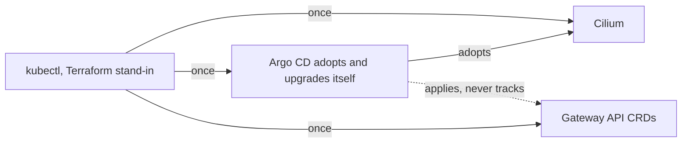

# Experiment 1: Argo CD adopts the bootstrap (argocd-adopt)

**Status:** done, 2026-11-19. Six first runs, then a re-run the same day in three
configurations (defaults, `REFRESH_SELF=false`, `GENERATE_PATHS=true`). The committed
`run.sh` [never ran as it is](argocd-adopt/limits.md#which-script-ran). Result: the
bootstrap boundary works for Cilium and Argo CD, under the conditions in the table.

Argo CD adopts Cilium and itself, not the CRDs: a CRD removed from Git stays in the
cluster, and nothing reports it (3 of 3 runs).

## Questions and answers

| Question | Answer | Evidence |
|---|---|---|
| Does Argo CD adopt what another tool applied, itself included? | Yes, for Cilium and Argo CD: about 20 s, no pod restart, no prune, no OutOfSync loop in a 300 s watch | [Adoption](argocd-adopt/adoption.md) |
| Does it upgrade itself from its own rendered files? | Yes, config and version, with no failed `argocd-server` health probe | [Self-upgrade](argocd-adopt/self-upgrade.md) |
| Which tracking method and sync options? | `annotation`; server-side apply and diff (no control run) | [Proposals](argocd-adopt/proposals.md#tracking-method) |
| Which field manager? | Server-side apply as `argocd-controller`; with another manager, a field removed from Git stays, with status `Synced` | [Field managers](argocd-adopt/field-managers.md#field-removal) |
| What must Terraform do after the first apply? | Never apply again; the mechanism is open | [Bootstrap apply](argocd-adopt/proposals.md#bootstrap-apply) |
| Does Argo CD own the CRDs? | No, by design in v3.5 | [CRDs](argocd-adopt/crds.md) |
| Does Argo CD sync only on its own changes? | No: it can also sync when it compares while a child syncs | [Self-sync](argocd-adopt/self-sync.md) |

Five points [touch accepted ADRs](argocd-adopt/proposals.md#points-against-accepted-adrs).

## Read more

- [Setup, versions and how to run](argocd-adopt/setup.md)
- [Failures and what was not tested](argocd-adopt/limits.md)
- [Proposals for RFCs](argocd-adopt/proposals.md)
- Scripts: [`experiments/argocd-adopt/`](../../../experiments/argocd-adopt/). One
  command creates the cluster, runs all the checks and deletes the cluster.

## Open questions

- **Left-over CRDs.** How does the plan detect a CRD that Git no longer has?
- **ADR conflicts.** Are the ADRs amended through superseding RFCs, or not?
- **Self-sync of the `argocd` Application.** Which field of a syncing child Application
  makes the diff (capture `argocd app diff` or the `managed-resources` API at that
  moment), how often it hits with a webhook, and whether an `ignoreDifferences` on
  `/operation` of child Applications stops it. Does `manifest-generate-paths` remove the
  overlap with a webhook?
- **Field manager for every bootstrap module.** The plan names the field manager only
  implicitly. Confirm: all bootstrap modules apply as `argocd-controller`.
- **`kubectl_manifest` + `ignore_changes = all`, or a one-shot apply?**
- **Hubble TLS method** with rendered manifests.
- **Applications health.** The waves of the app of apps order the Applications only if
  Argo CD has a health check for `Application` (homelab has one). Not tested here: all
  children are in wave 1.
