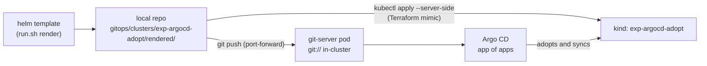

# Experiment 1: Argo CD adopts the bootstrap (argocd-adopt)

Status: done, 2026-11-19; revised after review the same day (no new cluster
run, see [Review follow-up](#review-follow-up)). Result: **the bootstrap
boundary works for Cilium and Argo CD**. Argo CD adopts Cilium and itself with
no pod restart, no prune and no OutOfSync loop in the watch window, and then
upgrades itself with no failed health probe. **It applies the Gateway API CRDs,
but its ownership of them is unverified**: they never get a tracking
annotation. Two conditions: the bootstrap applies with server-side apply **as
the field manager `argocd-controller`**, and Terraform never applies the files
again.

Scripts: [`experiments/argocd-adopt/`](../../../experiments/argocd-adopt/).
One command creates the cluster, runs all the checks and deletes the cluster.

## Goal

The plan says: Terraform installs the cluster, the Gateway API CRDs, Cilium and
Argo CD (from `rendered/argocd`). Argo CD then adopts these and manages
everything else. This experiment answers:

1. Does Argo CD adopt resources that another tool applied, without restarts,
   pruning, OutOfSync loops or downtime? Itself included?
2. Does Argo CD then upgrade itself from a change in its own rendered files?
3. Which tracking method, which sync options, which field manager?
4. What must Terraform do after the first apply: `ignore_changes`, or a
   one-shot apply?

## Setup



- **Cluster:** kind, one node, `disableDefaultCNI: true`, `kubeProxyMode: none`.
  Cilium runs with `kubeProxyReplacement: true`.
- **Rendered manifests:** `helm template` for Cilium and Argo CD; the Gateway API
  `standard-install.yaml` as is. The render step adds the sync wave `-1` to every
  CRD, as `manifests:render` will. Layout:
  `gitops/clusters/exp-argocd-adopt/rendered/{gateway-api-crds,cilium,argocd,probe}/`.
- **Terraform mimic:** `kubectl apply --server-side --field-manager=argocd-controller`
  on the same rendered files, in the order the modules will use:
  1. Gateway API CRDs (and their `ValidatingAdmissionPolicy`), wait `Established`.
  2. Cilium, wait for the DaemonSet, the operator, the node `Ready` and CoreDNS.
  3. Argo CD: the Namespace and the CRDs, then all the other resources except the
     `argoproj.io` ones, wait for the rollouts.
  4. Hand-over: the `platform` AppProject and the `argocd` Application only. The
     `argocd` Application holds the other Applications (`gateway-api-crds`,
     `cilium`, `probe`, sync wave 1) and creates them. This is the homelab
     `bootstrap-argocd` design.
- **Git server: in-cluster `git daemon`.** A Deployment in the namespace
  `git-server` runs `git daemon --enable=receive-pack` on an `emptyDir`.
  It uses the Argo CD image, which already has `git` and `git-daemon`: no extra
  image. `run.sh` pushes through `kubectl port-forward` on a random local port.
  Argo CD reads `git://git-server.git-server.svc.cluster.local/infra.git`.
  - Why not `file://`: Argo CD would need a volume on `argocd-repo-server`. That
    changes the Argo CD manifests under test, and Argo CD would revert or fight it
    when it adopts itself.
  - Why not Gitea or similar: more memory and one more image, for no extra signal.
  - Limit: `git://` has no auth and no TLS. The real repoURL is
    `https://github.com/gsuquet/infra.git`; the protocol does not change the
    adoption behavior.
- **All Applications:** `automated: {prune: true, selfHeal: true}`,
  `syncOptions: [ServerSideApply=true]`. Argo CD has
  `controller.diff.server.side: true` and `application.resourceTrackingMethod:
  annotation` (the 3.x default, set to be visible).
- **Experiment-only settings, not for the component catalog:** the AppProject
  `platform` allows every destination namespace and every cluster-scoped kind
  (`clusterResourceWhitelist: */*`), Argo CD runs with `server.insecure: true`,
  and the git daemon has no auth and accepts pushes. Do not copy any of these into
  `gitops/components/argocd`: the real `platform` project needs its source repo,
  destinations and cluster resources scoped to the platform components.
- **Probe component:** two ConfigMaps with keys `a` and `b`. The bootstrap applies
  `probe-kubectl` with the field manager `kubectl` (the kubectl default) and
  `probe-argocd` with `argocd-controller`. A later commit removes `b` from both.

### Versions

All pinned in `experiments/argocd-adopt/` (`mise.toml` + `mise.lock`, `run.sh`).

| Item | Version | Pin |
| --- | --- | --- |
| kind | 0.33.0 | mise |
| kind node image | `kindest/node:v1.37.0` | `sha256:a1ed56cf…580ae5` |
| kubectl | 1.37.2 | mise |
| helm | 4.3.1 | mise |
| yq | 4.54.1 | mise |
| jq | 1.8.2 | root `.mise/config.toml` |
| Gateway API | v1.6.2 standard channel | file `sha256:faede450…ca40d9` |
| Cilium chart | 1.20.0 | tgz `sha256:c5f01391…d27883` |
| argo-cd chart (bootstrap) | 10.11.6 (Argo CD v3.5.6) | tgz `sha256:d8f096d8…d05` (argo-helm index digest) |
| argo-cd chart (upgrade) | 10.11.7 (Argo CD v3.5.7) | tgz `sha256:9f24a574…f04e` (argo-helm index digest) |
| git-server image | `quay.io/argoproj/argocd:v3.5.6` | `sha256:8e5cc5bb…5e4e5335` |

Host: macOS arm64, Docker 26.1.1 with 4 CPUs and 7.7 GiB, next to another
two-node kind cluster. Run time: about 7 minutes.

### How to run

```sh
cd experiments/argocd-adopt
mise install
mise exec -- ./run.sh
```

`run.sh` switches added after the review (not run yet): `REFRESH_SELF=false`
(no refresh annotation on the `argocd` Application itself),
`GENERATE_PATHS=true` (`argocd.argoproj.io/manifest-generate-paths: .` on every
Application) and `WATCH_SECONDS` (default 300). The defaults reproduce runs 2
to 6, except for the longer watch and the new phase 5b.

`run.sh` fails if a cluster `exp-argocd-adopt` exists, and always deletes the
cluster at the end, also on failure (`trap … EXIT`). It writes everything to
`$WORK/run.log` (a `mktemp -d` folder, or `WORK=…`). Optional inputs:
`GATEWAY_API_MANIFEST` and `CILIUM_CHART_TGZ` point to local copies; `run.sh`
checks their SHA-256 in all cases. Else it downloads them from GitHub releases
and `https://helm.cilium.io`.

## Results

Excerpts from the last of six runs (run 6). Runs 2 to 6 gave the same results;
run 1 failed on a script bug (see [What failed](#what-failed)).

### Render reproducibility

```text
cilium (our values): reproducible
argo-cd: reproducible
cilium with hubble.tls.auto.method=helm (chart default): NOT reproducible:
<   ca.crt: LS0tLS1CRUdJTiBDRVJUSUZJQ0FURS0tLS0tCk1JSURF... (cut)
>   ca.crt: LS0tLS1CRUdJTiBDRVJUSUZJQ0FURS0tLS0tCk1JSURG... (cut)
```

With the chart default, `helm template` generates a new Hubble CA and new
certificates on each render. `manifests:check` would always fail, and each
render would rotate the Hubble certificates. The experiment turns Hubble off.

### Adoption (phase 4)

The `argocd` Application created the three others, and all four were Synced and
Healthy 21 s after the hand-over, each with exactly one sync:

```text
all 4 Applications Synced and Healthy at 01cb93f8 after 21s
APP               SYNC    HEALTH   REV       SYNCS  LAST_OP
argocd            Synced  Healthy  01cb93f8  1      Succeeded
cilium            Synced  Healthy  01cb93f8  1      Succeeded
gateway-api-crds  Synced  Healthy  01cb93f8  1      Succeeded
probe             Synced  Healthy  01cb93f8  1      Succeeded
```

- **No OutOfSync loop in a 120 s window.** Sampled every 10 s for 120 s: no
  sample not Synced, and the sync history did not grow. Limit: Argo CD's default
  reconcile period is 120 s plus up to 60 s of jitter, so this window may not hold
  one full periodic reconcile, and a flap shorter than 10 s can fall between two
  samples. `run.sh` now watches 300 s with a hard refresh midway and compares
  `reconciledAt`; that version has not run yet.

  ```text
  sync history before: [{"n":"argocd","h":1},{"n":"cilium","h":1},{"n":"gateway-api-crds","h":1},{"n":"probe","h":1}]
  sync history after:  [{"n":"argocd","h":1},{"n":"cilium","h":1},{"n":"gateway-api-crds","h":1},{"n":"probe","h":1}]
  samples not Synced during the watch: 0
  ```

- **No restart.** Same pod UIDs and restart counts in `kube-system` and
  `argocd`, and the same pod templates:

  ```text
  pods: identical (same UIDs, same restart counts, 14 pods)
  pod templates of the Deployments: identical
  ```

- **Deployment generations go +1, harmless.** The first sync adds the
  `argocd.argoproj.io/tracking-id` annotation. The Deployment API bumps
  `metadata.generation` on an annotation change; the DaemonSet and StatefulSet
  APIs do not. The pod template is the same, so no new ReplicaSet and no new pod.
  A control run on resources outside Argo CD shows the same:

  ```text
  control: does a metadata-only change bump the generation?
    deploy/coredns: annotation added, generation 1 -> 2
    ds/cilium: annotation added, generation 1 -> 1
  ```

- **No prune, no delete.** No sync result has the status `Pruned`.
- **Tracking:** annotation. Argo CD added the tracking annotation on the first
  sync; the kubectl bootstrap did not set it:

  ```text
  tracking annotation on ds/cilium before adoption:
  ds/cilium: cilium:apps/DaemonSet:kube-system/cilium
  deploy/argocd-server: argocd:apps/Deployment:argocd/argocd-server
  sts/argocd-application-controller: argocd:apps/StatefulSet:argocd/argocd-application-controller
  ```

- **CRDs: Argo CD applies them, but they get no tracking annotation.
  Ownership is unverified.** Checked on `httproutes.gateway.networking.k8s.io`
  and `applications.argoproj.io`. The full `crd_state` output of run 6 lists every
  annotation key, and `argocd.argoproj.io/tracking-id` is not among them, after
  adoption and after a sync that changed the CRD:

  ```text
  crd/httproutes: 
  crd/applications: 
  crd/httproutes after adoption:
    annotations: api-approved.kubernetes.io, argocd.argoproj.io/sync-wave, gateway.networking.k8s.io/bundle-version, gateway.networking.k8s.io/channel
    labels: 
    manager: argocd-controller Apply 2026-11-18T23:23:41Z
    manager: kube-apiserver Update 2026-11-18T23:23:41Z
    status in the Application: Synced 
  [...]
  crd/httproutes after a CRD change in git:
    annotations: api-approved.kubernetes.io, argocd.argoproj.io/sync-wave, gateway.networking.k8s.io/bundle-version, gateway.networking.k8s.io/channel
    labels: exp.invalid/rev
    manager: argocd-controller Apply 2026-11-18T23:27:36Z
    manager: kube-apiserver Update 2026-11-18T23:23:41Z
    tracking-id: 
  ```

  What is proven: Argo CD applies the CRDs. The `argocd-controller Apply` entry
  gets a new timestamp after the CRD change in Git, and the new label is there.
  Note that the bootstrap also applied as `argocd-controller`, so the managed
  fields alone cannot tell the bootstrap and Argo CD apart: only the new
  timestamp and the label show that Argo CD applied. The sync result of every
  CRD is `CRD is healthy`, where the other kinds report `serverside-applied`:

  ```text
  argocd CustomResourceDefinition x3: CRD is healthy
  gateway-api-crds CustomResourceDefinition x10: CRD is healthy
  ```

  What is not proven: that Argo CD owns them. The
  [resource tracking docs](https://argo-cd.readthedocs.io/en/stable/user-guide/resource_tracking/)
  say Argo CD uses the tracking annotation to decide whether a live object
  belongs to an Application, and an object whose annotation points elsewhere
  "will neither affect the application's sync status nor be marked for pruning".
  The docs say nothing about an object with no annotation, and nothing special
  about CRDs. A likely reading (unverified): the `Synced` status comes from the
  comparison of the Git object with the live object of the same name, which
  needs no tracking, while pruning needs the annotation. Then a CRD removed from
  Git would be orphaned, not pruned and not reported. The cause of the missing
  annotation is unknown: an Argo CD special case for CRDs, a probe bug and the
  shared field manager are all still open. Phase 5b of `run.sh` (added after the
  review, not run yet) removes one CRD from Git without `Prune=false` and records
  whether it is pruned, orphaned or reported OutOfSync, and compares the CRDs
  listed in the Application with the live ones.

- **Helm hooks.** The chart renders `argocd-redis-secret-init` (ServiceAccount,
  Role, RoleBinding, Job) with `helm.sh/hook: pre-install,pre-upgrade`. kubectl
  applies them as normal resources; Argo CD maps them to `PreSync` hooks and runs
  them again on each sync of the `argocd` Application
  (`before-hook-creation` replaces the bootstrap copies). No error, no conflict.
  The Job is idempotent: it creates the Redis password only if it is missing.

  ```text
  PreSync ServiceAccount/argocd-redis-secret-init: Succeeded argocd-redis-secret-init created
  PreSync Job/argocd-redis-secret-init: Succeeded Reached expected number of succeeded pods
  ```

### Field managers (phase 5)

Git removes the key `b` from both probe ConfigMaps. Argo CD reports `Synced`
for both, but only one lost the key:

```text
probe-kubectl data: {"a":"kept","b":"removed-in-git"}
  kubectl Apply
  argocd-controller Apply
probe-argocd data: {"a":"kept"}
  argocd-controller Apply
probe app sync status: Synced
```

With a bootstrap manager other than `argocd-controller`, the bootstrap manager
keeps co-ownership of every field forever. A field that Git removes stays in the
cluster, and Argo CD shows `Synced` (the server-side diff sees no change, because
the field is not Argo CD's to remove). This drift is silent.

Argo CD's
[client-side apply migration](https://argo-cd.readthedocs.io/en/stable/user-guide/sync-options/#client-side-apply-migration)
does not help here: it moves only managers with `operation: Update` (client-side
apply). A server-side bootstrap creates `operation: Apply` entries.

### Self-upgrade: value bump (phase 6)

Commit: `controller.status.processors` 20 → 10. It changes
`argocd-cmd-params-cm` and the `checksum/cmd-params` annotation of four pod
templates, so the application controller restarts during its own sync.

```text
all 4 Applications Synced and Healthy at 0961298e after 51s
argocd-server /healthz: 58 ok, 0 failed probes (1 per second)
argocd-cmd-params-cm controller.status.processors: 10
argocd app last operation: Succeeded - successfully synced (all tasks run) (started 2026-11-18T23:27:52Z, finished 2026-11-18T23:28:17Z)
```

New pods for the application controller, the ApplicationSet controller, the repo
server and the server; Redis (no checksum annotation) kept its pod. All restart
counts 0. The `/healthz` probe goes through the API server service proxy, so a
pod replacement does not break the probe itself.

### Self-upgrade: chart version (phase 7)

Commit: argo-cd chart 10.11.6 → 10.11.7 (Argo CD v3.5.6 → v3.5.7, 100 lines
changed in the rendered file).

```text
all 4 Applications Synced and Healthy at d608be44 after 61s
argocd-server /healthz: 68 ok, 0 failed probes (1 per second)
Argo CD images now running:
  ecr-public.aws.com/docker/library/redis:8.6.4-alpine
  quay.io/argoproj/argocd:v3.5.7
argocd app last operation: Succeeded - successfully synced (all tasks run)
```

The sync history of the `argocd` Application has one auto-sync per commit:

```text
#0 rev 01cb93f8 started 2026-11-18T23:25:13Z deployed 2026-11-18T23:25:25Z by auto-sync
#1 rev 0f3d75c7 started 2026-11-18T23:27:36Z deployed 2026-11-18T23:27:49Z by auto-sync
#2 rev 0961298e started 2026-11-18T23:27:52Z deployed 2026-11-18T23:28:17Z by auto-sync
#3 rev d608be44 started 2026-11-18T23:28:55Z deployed 2026-11-18T23:29:34Z by auto-sync
```

**Open issue: sync #1.** It is for the probe commit, which did not change
`rendered/argocd/`. Argo CD auto-syncs only an OutOfSync Application
([auto-sync docs](https://argo-cd.readthedocs.io/en/stable/user-guide/auto_sync/#automated-sync-semantics)),
so some resource of the `argocd` Application was OutOfSync on an unrelated
commit. The sync changed no pod and no workload generation, but each sync of
this Application runs the `argocd-redis-secret-init` PreSync hook Job again. If
the trigger is not an artifact of `run.sh`, every merge to `infra` would sync Argo
CD and run that Job. Run 6 did not record which resource was OutOfSync. The
cause is not verified. Candidates:

- The `argocd` Application is in its own resource tree (its sync result lists
  `application.argoproj.io/argocd`), and `run.sh` puts the
  `argocd.argoproj.io/refresh` annotation on it and on its three children, all of
  which are resources of the `argocd` Application. This would be an artifact of
  the experiment.
- The children write their own `operation` and `status` during their own syncs
  (the probe and CRD commit made two of them sync). If the `argocd` Application
  sees that as a diff, it would happen on every commit that syncs a child. This
  would be a real cost.

`run.sh` now records the OutOfSync resources of the `argocd` Application while
it waits for each revision, and has `REFRESH_SELF=false` and
`GENERATE_PATHS=true` to tell the candidates apart. Not run yet: a cluster run
was out of scope for the review follow-up.

### A stale re-apply (phase 8, dry-run)

What happens if Terraform applies the v1 files again after the upgrade
(`kubectl apply --server-side --dry-run=server` of the v1 `argocd-server`
Deployment):

```text
- field manager 'kubectl' (alekc/kubectl kubectl_manifest default), no force-conflicts:
  error: Apply failed with 6 conflicts: conflicts with "argocd-controller":
  - .metadata.labels.app.kubernetes.io/version
  - .metadata.labels.helm.sh/chart
  - .spec.template.metadata.annotations.checksum/cmd-params
  - .spec.template.metadata.labels.app.kubernetes.io/version
  - .spec.template.metadata.labels.helm.sh/chart
- field manager 'argocd-controller' (same as Argo CD):
  accepted, image would become quay.io/argoproj/argocd:v3.5.6
```

The field manager depends on the Terraform provider. `alekc/kubectl`
`kubectl_manifest` (the homelab module, pinned there at 2.2.0) has
`field_manager`, default `kubectl`, and `server_side_apply`
([registry docs, 3.0.1](https://registry.terraform.io/providers/alekc/kubectl/latest/docs/resources/kubectl_manifest)).
`hashicorp/kubernetes` `kubernetes_manifest` has a `field_manager { name }` block
([registry docs, 3.5.0](https://registry.terraform.io/providers/hashicorp/kubernetes/latest/docs/resources/manifest));
its default name (`Terraform`) is not on that page: unverified. The conclusions
below assume `kubectl_manifest` with `field_manager = "argocd-controller"` and
`server_side_apply = true`.

With the shared manager, a re-apply is accepted with no warning and **downgrades
Argo CD**, until `selfHeal` puts the Git version back (another rollout). With a
separate manager it fails on conflicts, and `force_conflicts` would take the
fields away from Argo CD. So a second apply is wrong in both cases.

## What failed

- **Run 1: the bootstrap split.** `cat rendered/argocd/*.yaml` glued the last
  document of `manifest.yaml` to the first one of `namespace.yaml` (no `---`
  between files), so the Namespace was lost and the apply failed with
  `namespaces "argocd" not found`. Fix: each file is its own document stream. The
  Terraform module must split per file and per document (the homelab module
  does: `fileset` then `split("\n---\n", …)`). The cleanup trap deleted the
  cluster as intended.
- **Investigations, not failures:** runs 2 to 5 added diagnostics for the
  Deployment generation bump, the CRD tracking and the hook Jobs. The results did
  not change between runs.
- **Not tested:** a real Terraform run (the `kubectl` provider), the changes
  to `run.sh` made after the review (phase 5b, longer watch, OutOfSync
  recording, `REFRESH_SELF`, `GENERATE_PATHS`), client-side apply or client-side
  diff as controls, a Cilium chart
  upgrade through Argo CD, an upgrade of the Gateway API bundle to a new version
  (only a label change), multi-replica Argo CD, Argo CD HA Redis, the downtime of
  the data plane during a Cilium upgrade.

## Conclusions for the plan

1. **The bootstrap boundary holds for Cilium and Argo CD.** The bootstrap
   (kubectl mimicking Terraform) installs the Gateway API CRDs, Cilium and Argo
   CD from the rendered files; one `argocd` Application (app of apps) adopts
   Cilium and Argo CD in about 20 s with no restart and no prune. Argo CD then
   upgrades itself from Git (config and version) with no failed `argocd-server`
   health probe. The Gateway API CRDs are applied by Argo CD, but not tracked
   (see the CRD result): their ownership is unverified until phase 5b runs. One
   open issue: an unrelated commit made the `argocd` Application sync itself
   (sync #1).
2. **Tracking method: `annotation`** (the Argo CD 3.x default). Set it explicitly
   in `argocd-cm`. The rendered files do not need a pre-set tracking annotation:
   the first sync adds it with no rollout. The only side effect is a Deployment
   generation +1. CRDs are the exception: no annotation (open issue).
3. **Sync options.** Only server-side apply with server-side diff was run; the
   first two items are recommendations, not compared with a control:
   - `ServerSideApply=true` on every Application (tested configuration, no
     control run with client-side apply). Reasons from the docs, not from this
     run: the large CRDs hit the 262144-byte annotation limit of client-side
     apply, and Argo CD applies with `--force-conflicts`
     ([docs](https://argo-cd.readthedocs.io/en/stable/user-guide/sync-options/#server-side-apply)),
     so it always wins a conflict.
   - `controller.diff.server.side: true` (tested configuration, no control run
     with client-side diff). With it, no OutOfSync loop was seen; whether the
     client-side diff would loop on defaulted fields is not tested.
   - **`Replace=true`: not needed** for any CRD here. Avoid it: it takes
     precedence over server-side apply, uses `kubectl replace/create`, and the
     docs warn it can recreate resources
     ([docs](https://argo-cd.readthedocs.io/en/stable/user-guide/sync-options/#replace-resource-instead-of-applying-changes)).
   - **Proposal for the plan** (not in the settled plan, not tested here):
     `Prune=false` on CRDs (chart value `crds.annotations` for Argo CD, a render
     step for the others), and `Prune=false,Delete=false` on the `argocd`
     Namespace and `argocd-secret`. Given the CRD tracking issue, removing a CRD
     must be a manual step anyway.
   - `PrunePropagationPolicy`: no effect on adoption (nothing is pruned). Keep the
     default (`foreground`, per the
     [docs](https://argo-cd.readthedocs.io/en/stable/user-guide/sync-options/#resources-prune-deletion-propagation-policy)).
4. **Field manager: Terraform must apply as `argocd-controller`.** Else every
   field removed from Git later stays in the cluster with a `Synced` status
   (phase 5). This matches the homelab `bootstrap-argocd` module, and the plan
   must make it the rule for all three bootstrap modules (`bootstrap-gateway-api`,
   `bootstrap-cilium`, `bootstrap-argocd`), not only Argo CD.
5. **Terraform must not apply again.** With the shared manager a re-apply
   silently downgrades (phase 8). Phase 8 tested only a stale update of an
   existing object, not Terraform's create and destroy paths. Options:
   - `kubectl_manifest` per document with `server_side_apply = true`,
     `field_manager = "argocd-controller"` and `lifecycle { ignore_changes = all }`
     (the homelab design). `ignore_changes` only stops in-place updates. It does
     not stop:
     - **re-creation**: an object gone from the cluster (deleted by Argo CD, by a
       TTL, by hand) leaves the state on refresh, and the next apply creates it
       again, without the tracking annotation;
     - **create and destroy on key changes**: the `for_each` keys come from the
       rendered files at the checked-out HEAD. A plan or apply from a feature
       branch, or after a merge that adds or removes a document, creates objects
       from unmerged or newer renders (Argo CD does not track them until a sync)
       or destroys objects that left the render (Argo CD may still want them);
     - `terraform destroy` on the root deletes them (acceptable: a cluster root
       destroys the cluster anyway); `alekc/kubectl` 3.x has `apply_only` to skip
       the delete (docs only, not tested);
     - a provider upgrade that changes the schema can plan a replace.
   - Pin the bootstrap input to a fixed snapshot instead of HEAD (a copy of
     `rendered/{gateway-api-crds,cilium,argocd}` made at cluster creation, or a
     Git ref in a variable). The key set then stops moving with `main`; the
     re-create risk stays.
   - A one-shot apply (`terraform_data` + `local-exec` `kubectl apply
     --server-side --field-manager=argocd-controller`, triggered by the cluster
     ID). No Kubernetes object in the state, so no drift, no re-create and no
     key-set churn; but a `kubectl` dependency on the runner and no plan output.

   No recommendation until a Terraform run (`mise run cluster:up` twice, once
   after a render change and once after Argo CD deleted a bootstrap object)
   compares the options. Leaning: the one-shot apply, since the bootstrap is by
   design a one-time hand-over.
6. **Cilium must not use `hubble.tls.auto.method=helm`** with rendered manifests:
   the render is not reproducible. Use `certmanager` (cert-manager is a baseline
   component, but it comes after Cilium) or `cronJob`, or keep Hubble TLS off in
   the bootstrap and turn it on later. To decide in the Cilium component.
7. **Helm hooks are fine for Argo CD, not for `kubectl_manifest`.** Argo CD runs
   the chart hooks as `PreSync` hooks. Under `kubectl_manifest` +
   `ignore_changes = all`, the hook Job deletes itself after 60 s
   (`ttlSecondsAfterFinished`), so every later `mise run cluster:up` would
   re-create it and run it again as a plain Job. The homelab trick is therefore
   required with that option: apply a renamed copy without the hook annotations
   and without the TTL (homelab `modules/bootstrap-argocd/main.tf`), or drop the
   hook resources from the bootstrap set and let Argo CD's first sync run them.
   The one-shot apply needs neither. Not tested with Terraform.
8. **Generic render rule:** every CRD gets `argocd.argoproj.io/sync-wave: "-1"`
   (done here with one `yq` expression over all files). Kept for the plan.

## Review follow-up

A review of the first version found unproven claims. No cluster was created for
the follow-up; the changes rest on the saved run 6 log and on the docs:

- CRD ownership downgraded to "applied, ownership unverified", with the full
  `crd_state` output; phase 5b added to `run.sh`.
- Sync #1 of the `argocd` Application is now an open issue, with OutOfSync
  recording and two switches in `run.sh`.
- Conclusions 5 and 7 rewritten: `ignore_changes` does not stop re-creation or
  key-set changes, and the renamed hook copy is required under it.
- The OutOfSync watch is now 300 s with a hard refresh midway.
- Untested sync-option claims and the `Prune=false` item are labeled as
  recommendations or proposals.
- The Terraform provider and its default field manager are named.
- Experiment-only settings flagged.
- `cilium-cli` removed from `mise.toml` and `mise.lock` (unused).

## Open questions

- **CRD tracking.** Why does Argo CD v3.5 not write the tracking annotation on
  CRDs, and does a CRD removed from Git get pruned or orphaned? Phase 5b answers
  the second part on the next run.
- **Sync #1 of the `argocd` Application on an unrelated commit.** Artifact of
  `run.sh` (self-refresh) or real (child Application status)? Next run with
  `REFRESH_SELF=false`, then with `GENERATE_PATHS=true`. If it is real,
  `argocd.argoproj.io/manifest-generate-paths` is a candidate fix to record in
  the plan: since v2.11 Argo CD uses it also without webhooks, to skip
  regeneration when no file under the paths changed
  ([docs](https://argo-cd.readthedocs.io/en/stable/operator-manual/high_availability/#manifest-paths-annotation)).
  It would not help if the diff comes from live child Applications.
- **Field manager for every bootstrap module.** The plan names the field manager
  only implicitly. Confirm: all bootstrap modules apply as `argocd-controller`.
- **`kubectl_manifest` + `ignore_changes = all`, or a one-shot apply?**
- **Hubble TLS method** with rendered manifests.
- **Applications health.** The waves of the app of apps order the Applications
  only if Argo CD has a health check for `Application` (homelab has one). Not
  tested here: all children are in wave 1.
