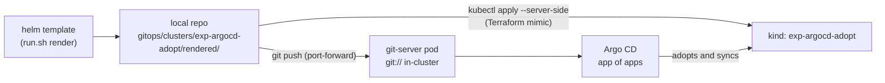

# Experiment 1: Argo CD adopts the bootstrap (argocd-adopt)

Status: done, 2026-11-19. First version from six runs; revised after review;
**re-run the same day** with the revised `run.sh` in three configurations
(defaults, `REFRESH_SELF=false`, `GENERATE_PATHS=true`, see
[Review follow-up](#review-follow-up) and
[What failed](#what-failed)). Result: **the bootstrap boundary works for
Cilium and Argo CD**. Argo CD adopts Cilium and itself with no pod restart, no
prune and no OutOfSync loop in a 300 s watch, and then upgrades itself with no
failed health probe. **Argo CD applies the Gateway API CRDs but never tracks
them, by design**: the repo-server does not put the tracking annotation on any
CRD. A CRD removed from Git therefore stays in the cluster, and nothing reports
it (3 of 3 runs). Two conditions: the bootstrap applies with server-side apply
**as the field manager `argocd-controller`**, and Terraform never applies the
files again. One open cost: the `argocd` Application can sync itself on a commit
that does not touch it, when it compares while a child Application is syncing.

Scripts: [`experiments/argocd-adopt/`](../../../experiments/argocd-adopt/).
One command creates the cluster, runs all the checks and deletes the cluster.

## Goal

The plan says: Terraform installs the cluster, the Gateway API CRDs, Cilium and
Argo CD (from `rendered/argocd`). Argo CD then adopts these and manages
everything else. This experiment answers:

1. Does Argo CD adopt resources that another tool applied, without restarts,
   pruning, OutOfSync loops or downtime? Itself included?
2. Does Argo CD then upgrade itself from a change in its own rendered files?
3. Which tracking method, which sync options, which field manager?
4. What must Terraform do after the first apply: `ignore_changes`, or a
   one-shot apply?

## Setup



- **Cluster:** kind, one node, `disableDefaultCNI: true`, `kubeProxyMode: none`.
  Cilium runs with `kubeProxyReplacement: true`.
- **Rendered manifests:** `helm template` for Cilium and Argo CD; the Gateway API
  `standard-install.yaml` as is. The render step adds the sync wave `-1` to every
  CRD, as `manifests:render` will. Layout:
  `gitops/clusters/exp-argocd-adopt/rendered/{gateway-api-crds,cilium,argocd,probe}/`.
- **Terraform mimic:** `kubectl apply --server-side --field-manager=argocd-controller`
  on the same rendered files, in the order the modules will use:
  1. Gateway API CRDs (and their `ValidatingAdmissionPolicy`), wait `Established`.
  2. Cilium, wait for the DaemonSet, the operator, the node `Ready` and CoreDNS.
  3. Argo CD: the Namespace and the CRDs, then all the other resources except the
     `argoproj.io` ones, wait for the rollouts.
  4. Hand-over: the `platform` AppProject and the `argocd` Application only. The
     `argocd` Application holds the other Applications (`gateway-api-crds`,
     `cilium`, `probe`, sync wave 1) and creates them. This is the homelab
     `bootstrap-argocd` design.
- **Git server: in-cluster `git daemon`.** A Deployment in the namespace
  `git-server` runs `git daemon --enable=receive-pack` on an `emptyDir`.
  It uses the Argo CD image, which already has `git` and `git-daemon`: no extra
  image. `run.sh` pushes through `kubectl port-forward` on a random local port.
  Argo CD reads `git://git-server.git-server.svc.cluster.local/infra.git`.
  - Why not `file://`: Argo CD would need a volume on `argocd-repo-server`. That
    changes the Argo CD manifests under test, and Argo CD would revert or fight it
    when it adopts itself.
  - Why not Gitea or similar: more memory and one more image, for no extra signal.
  - Limit: `git://` has no auth and no TLS. The real repoURL is
    `https://github.com/gsuquet/infra.git`; the protocol does not change the
    adoption behavior.
- **All Applications:** `automated: {prune: true, selfHeal: true}`,
  `syncOptions: [ServerSideApply=true]`. Argo CD has
  `controller.diff.server.side: true` and `application.resourceTrackingMethod:
  annotation` (the 3.x default, set to be visible).
- **Experiment-only settings, not for the component catalog:** the AppProject
  `platform` allows every destination namespace and every cluster-scoped kind
  (`clusterResourceWhitelist: */*`), Argo CD runs with `server.insecure: true`,
  and the git daemon has no auth and accepts pushes. Do not copy any of these into
  `gitops/components/argocd`: the real `platform` project needs its source repo,
  destinations and cluster resources scoped to the platform components.
- **Probe component:** two ConfigMaps with keys `a` and `b`. The bootstrap applies
  `probe-kubectl` with the field manager `kubectl` (the kubectl default) and
  `probe-argocd` with `argocd-controller`. A later commit removes `b` from both.

### Versions

All pinned in `experiments/argocd-adopt/` (`mise.toml` + `mise.lock`, `run.sh`).

| Item | Version | Pin |
| --- | --- | --- |
| kind | 0.33.0 | mise |
| kind node image | `kindest/node:v1.37.0` | `sha256:a1ed56cf…580ae5` |
| kubectl | 1.37.2 | mise |
| helm | 4.3.1 | mise |
| yq | 4.54.1 | mise |
| jq | 1.8.2 | root `.mise/config.toml` |
| Gateway API | v1.6.2 standard channel | file `sha256:faede450…ca40d9` |
| Cilium chart | 1.20.0 | tgz `sha256:c5f01391…d27883` |
| argo-cd chart (bootstrap) | 10.11.6 (Argo CD v3.5.6) | tgz `sha256:d8f096d8…d05` (argo-helm index digest) |
| argo-cd chart (upgrade) | 10.11.7 (Argo CD v3.5.7) | tgz `sha256:9f24a574…f04e` (argo-helm index digest) |
| git-server image | `quay.io/argoproj/argocd:v3.5.6` | `sha256:8e5cc5bb…5e4e5335` |

Argo CD itself: v3.5.6 after the bootstrap (controller log: `version=v3.5.6`,
`commit=c2b1e301`), v3.5.7 after phase 7. The versions above are the ones the
re-run printed (`kind v0.33.0`, `kubectl v1.37.2`, `helm v4.3.1`, `yq v4.54.1`)
and the SHA-256 of all four inputs matched.

Host: macOS arm64, Docker 26.1.1 with 4 CPUs and 7.7 GiB, next to another
two-node kind cluster (about 2 GiB in use). Run time of the re-run: 9.5 min
(defaults), 15.5 min (`REFRESH_SELF=false`: the `argocd` Application waits for
its periodic reconcile), 9.3 min (`GENERATE_PATHS=true`).

### How to run

```sh
cd experiments/argocd-adopt
mise install
mise exec -- ./run.sh
```

Switches: `REFRESH_SELF=false` (no refresh annotation on the `argocd`
Application itself), `GENERATE_PATHS=true`
(`argocd.argoproj.io/manifest-generate-paths: .` on every Application) and
`WATCH_SECONDS` (default 300). All three ran in the re-run:

```sh
mise exec -- ./run.sh
REFRESH_SELF=false mise exec -- ./run.sh
GENERATE_PATHS=true mise exec -- ./run.sh
```

`run.sh` fails if a cluster `exp-argocd-adopt` exists, and always deletes the
cluster at the end, also on failure (`trap … EXIT`). It writes everything to
`$WORK/run.log` (a `mktemp -d` folder, or `WORK=…`), plus
`$WORK/apps-watch.json` (every update of every Application from the hand-over
on) and `$WORK/controller-phase5.log`. Optional inputs:
`GATEWAY_API_MANIFEST` and `CILIUM_CHART_TGZ` point to local copies; `run.sh`
checks their SHA-256 in all cases. Else it downloads them from GitHub releases
and `https://helm.cilium.io`.

## Results

Excerpts from the re-run (defaults run unless marked), with the first six runs
where they agree. Every check gave the same result in the three re-run
configurations, except the self-sync of the `argocd` Application (see
[Sync #1](#open-issue-the-argocd-application-syncs-itself-on-an-unrelated-commit)).

### Render reproducibility

```text
cilium (our values): reproducible
argo-cd: reproducible
cilium with hubble.tls.auto.method=helm (chart default): NOT reproducible:
<   ca.crt: LS0tLS1CRUdJTiBDRVJUSUZJQ0FURS0tLS0tCk1JSURF... (cut)
>   ca.crt: LS0tLS1CRUdJTiBDRVJUSUZJQ0FURS0tLS0tCk1JSURG... (cut)
```

With the chart default, `helm template` generates a new Hubble CA and new
certificates on each render. `manifests:check` would always fail, and each
render would rotate the Hubble certificates. The experiment turns Hubble off.

### Adoption (phase 4)

The `argocd` Application created the three others, and all four were Synced and
Healthy 20 to 21 s after the hand-over, each with one entry in its sync history
(re-run: 20 s, 20 s, 21 s):

```text
all 4 Applications Synced and Healthy at e3ded2a2 after 20s
```

- **Correction: the `argocd` Application runs two operations at the hand-over,
  not one.** The first version read "each with exactly one sync" from the sync
  history. The watch of the re-run shows a second, partial operation a second
  later, at the same revision, for one child Application only. It is a
  `selfHeal` sync: the `argocd` Application saw a child Application OutOfSync
  while that child was running its own first sync (the same pattern as
  [Sync #1](#open-issue-the-argocd-application-syncs-itself-on-an-unrelated-commit)).
  It runs no hook and does not add a history entry. 3 of 3 runs:

  ```text
  2026-11-19T07:46:44Z argocd rev e3ded2a2 Succeeded: 46 resources, 4 hook resources
  2026-11-19T07:46:45Z argocd rev e3ded2a2 Succeeded: 1 resources, 0 hook resources (partial sync of Application cilium)
  ```

  (`REFRESH_SELF=false`: the same, for `cilium`; `GENERATE_PATHS=true`: the
  same, for `probe`.) The phase 4 summary of the first version read
  `.status.operationState`, which keeps only the last operation, and labeled it
  "first sync". In the re-run it showed this partial sync: one Application and
  no hook. `run.sh` now labels it "last sync" and lists all operations from the
  watch.

- **No OutOfSync loop in a 300 s watch** (3 of 3 runs). Sampled every 5 s, with
  a hard refresh of all Applications midway: no sample not Synced, the sync
  history did not grow, and `reconciledAt` moved to the hard refresh time, so
  every Application ran at least one full comparison (level 3) in the window.
  The controller log also shows periodic reconciles ("comparison expired") of
  `cilium` (defaults run) and of `probe` and `argocd` (`GENERATE_PATHS=true`)
  inside the window. Limit: a flap shorter than 5 s can still fall between two
  samples; the watch file has no OutOfSync update of the `argocd` Application
  in that window either.

  ```text
  hard refresh of all Applications at 08:49:23
  reconciledAt before: [{"n":"argocd","r":"2026-11-19T07:46:45Z"},{"n":"cilium","r":"2026-11-19T07:46:45Z"},{"n":"gateway-api-crds","r":"2026-11-19T07:46:47Z"},{"n":"probe","r":"2026-11-19T07:46:44Z"}]
  reconciledAt after:  [{"n":"argocd","r":"2026-11-19T07:49:23Z"},{"n":"cilium","r":"2026-11-19T07:49:23Z"},{"n":"gateway-api-crds","r":"2026-11-19T07:49:23Z"},{"n":"probe","r":"2026-11-19T07:49:23Z"}]
  sync history before: [{"n":"argocd","h":1},{"n":"cilium","h":1},{"n":"gateway-api-crds","h":1},{"n":"probe","h":1}]
  sync history after:  [{"n":"argocd","h":1},{"n":"cilium","h":1},{"n":"gateway-api-crds","h":1},{"n":"probe","h":1}]
  samples not Synced during the watch (every 5 s): 0
  ```

- **No restart** (3 of 3 runs). Same pod UIDs and restart counts in
  `kube-system` and `argocd`, and the same pod templates:

  ```text
  pods: identical (same UIDs, same restart counts, 14 pods)
  pod templates of the Deployments: identical
  ```

- **Deployment generations go +1, harmless.** The first sync adds the
  `argocd.argoproj.io/tracking-id` annotation. The Deployment API bumps
  `metadata.generation` on an annotation change; the DaemonSet and StatefulSet
  APIs do not. The pod template is the same, so no new ReplicaSet and no new pod.
  A control run on resources outside Argo CD shows the same:

  ```text
  control: does a metadata-only change bump the generation?
    deploy/coredns: annotation added, generation 1 -> 2
    ds/cilium: annotation added, generation 1 -> 1
  ```

- **Deployment generations +1** on `argocd-applicationset-controller`,
  `argocd-redis`, `argocd-repo-server`, `argocd-server` and `cilium-operator`
  in the re-run too, with identical pod templates.
- **No prune, no delete.** No sync result has the status `Pruned`.
- **Tracking:** annotation. Argo CD added the tracking annotation on the first
  sync; the kubectl bootstrap did not set it:

  ```text
  tracking annotation on ds/cilium before adoption: 
  ds/cilium: cilium:apps/DaemonSet:kube-system/cilium
  deploy/argocd-server: argocd:apps/Deployment:argocd/argocd-server
  sts/argocd-application-controller: argocd:apps/StatefulSet:argocd/argocd-application-controller
  ```

- **CRDs: Argo CD applies them but never tracks them. This is by design, not a
  probe bug.** Checked on `httproutes.gateway.networking.k8s.io` and
  `applications.argoproj.io`, 3 of 3 runs: no `argocd.argoproj.io/tracking-id`
  after adoption and after a sync that changed the CRD:

  ```text
  crd/httproutes: 
  crd/applications: 
  crd/httproutes after adoption:
    annotations: api-approved.kubernetes.io, argocd.argoproj.io/sync-wave, gateway.networking.k8s.io/bundle-version, gateway.networking.k8s.io/channel
    labels: 
    manager: argocd-controller Apply 2026-11-19T07:33:16Z
    manager: kube-apiserver Update 2026-11-19T07:33:16Z
    status in the Application: Synced 
  [...]
  crd/httproutes after a CRD change in git:
    annotations: api-approved.kubernetes.io, argocd.argoproj.io/sync-wave, gateway.networking.k8s.io/bundle-version, gateway.networking.k8s.io/channel
    labels: exp.invalid/rev
    manager: argocd-controller Apply 2026-11-19T07:40:09Z
    manager: kube-apiserver Update 2026-11-19T07:33:16Z
    tracking-id: 
  ```

  (Timestamps from the first attempt of the defaults run, see
  [What failed](#what-failed).) **Cause, from the Argo CD v3.5.6 source:**
  - The repo-server adds the tracking annotation to every generated manifest
    except CRDs:
    `if q.AppLabelKey != "" && q.AppName != "" && !kube.IsCRD(target)`
    ([`reposerver/repository/repository.go#L1807`](https://github.com/argoproj/argo-cd/blob/v3.5.6/reposerver/repository/repository.go#L1807)).
    So the target object that Argo CD applies has no annotation, and the live
    CRD never gets one.
  - The diff normalizer skips CRDs with the comment "CRDs don't get tracking
    annotations"
    ([`util/argo/resource_tracking.go#L279`](https://github.com/argoproj/argo-cd/blob/v3.5.6/util/argo/resource_tracking.go#L279),
    added by [argo-cd#22722](https://github.com/argoproj/argo-cd/pull/22722):
    "CRDs should not have resource annotations set on them").
  - A live object belongs to an Application only if its tracking says so
    ([`controller/cache/cache.go#L734`](https://github.com/argoproj/argo-cd/blob/v3.5.6/controller/cache/cache.go#L734)).
    Objects that are in Git are added by name on top of that
    ([`gitops-engine/pkg/cache/cluster.go#L1554`](https://github.com/argoproj/argo-cd/blob/v3.5.6/gitops-engine/pkg/cache/cluster.go#L1554),
    "but are simply missing our label"). That is why a CRD in Git shows
    `Synced` and gets applied, while a CRD no longer in Git is invisible.
  - Deleting an Application never deletes its CRDs either: `shouldBeDeleted`
    returns false for every CRD
    ([`controller/appcontroller.go#L1339`](https://github.com/argoproj/argo-cd/blob/v3.5.6/controller/appcontroller.go#L1339)).
  - The resource tracking docs do not mention this.

  The sync result message `CRD is healthy` (other kinds:
  `serverside-applied`) is not a sign of a skipped apply: it is the message of
  the CRD health check
  ([`resource_customizations/apiextensions.k8s.io/CustomResourceDefinition/health.lua`](https://github.com/argoproj/argo-cd/blob/v3.5.6/resource_customizations/apiextensions.k8s.io/CustomResourceDefinition/health.lua)),
  which replaces the apply message of a task while the sync waits for its
  health
  ([`gitops-engine/pkg/sync/sync_context.go#L564`](https://github.com/argoproj/argo-cd/blob/v3.5.6/gitops-engine/pkg/sync/sync_context.go#L564)).
  The new label after the CRD change and the new `argocd-controller Apply`
  timestamp show that Argo CD applied it.

- **A CRD removed from Git is orphaned: not pruned, not reported (phase 5b, 3
  of 3 runs).** The commit drops `grpcroutes.gateway.networking.k8s.io` from
  the bundle, with `prune: true` and no `Prune=false`:

  ```text
  live Gateway API CRDs: 10
  pushed 2d5c2fc8…: gateway CRDs: drop grpcroutes.gateway.networking.k8s.io
  gateway-api-crds: Synced at 2d5c2fc8, last operation Succeeded
  crd/grpcroutes.gateway.networking.k8s.io: still in the cluster (not pruned)
    in the Application: no
  ```

  The Application stays `Synced`, ran no operation for that commit, and no
  longer lists the CRD among its resources. Nothing in Argo CD shows that the
  CRD is left over.

- **Helm hooks.** The chart renders `argocd-redis-secret-init` (ServiceAccount,
  Role, RoleBinding, Job) with `helm.sh/hook: pre-install,pre-upgrade`. kubectl
  applies them as normal resources; Argo CD maps them to `PreSync` hooks and runs
  them again on each sync of the `argocd` Application
  (`before-hook-creation` replaces the bootstrap copies). No error, no conflict.
  The Job is idempotent: it creates the Redis password only if it is missing.
  Re-run: every full sync of the `argocd` Application ran the 4 hook
  resources; the partial self-heal sync at the hand-over ran none.

  ```text
  PreSync ServiceAccount/argocd-redis-secret-init: Succeeded argocd-redis-secret-init created
  PreSync Job/argocd-redis-secret-init: Succeeded Reached expected number of succeeded pods
  ```

### Field managers (phase 5)

Git removes the key `b` from both probe ConfigMaps. Argo CD reports `Synced`
for both, but only one lost the key (3 of 3 runs):

```text
probe-kubectl data: {"a":"kept","b":"removed-in-git"}
  kubectl Apply
  argocd-controller Apply
probe-argocd data: {"a":"kept"}
  argocd-controller Apply
probe app sync status: Synced
```

With a bootstrap manager other than `argocd-controller`, the bootstrap manager
keeps co-ownership of every field forever. A field that Git removes stays in the
cluster, and Argo CD shows `Synced` (the server-side diff sees no change, because
the field is not Argo CD's to remove). This drift is silent.

Argo CD's
[client-side apply migration](https://argo-cd.readthedocs.io/en/stable/user-guide/sync-options/#client-side-apply-migration)
does not help here: it moves only managers with `operation: Update` (client-side
apply). A server-side bootstrap creates `operation: Apply` entries.

### Self-upgrade: value bump (phase 6)

Commit: `controller.status.processors` 20 → 10. It changes
`argocd-cmd-params-cm` and the `checksum/cmd-params` annotation of four pod
templates, so the application controller restarts during its own sync.

```text
all 4 Applications Synced and Healthy at 1fbf67c5 after 30s
argocd Application resources seen OutOfSync at 1fbf67c5 (watch):
  ConfigMap/argocd/argocd-cmd-params-cm
  Deployment/argocd/argocd-applicationset-controller
  Deployment/argocd/argocd-repo-server
  Deployment/argocd/argocd-server
  StatefulSet/argocd/argocd-application-controller
(end of list)
argocd-server /healthz: 39 ok, 0 failed probes (1 per second)
argocd-cmd-params-cm controller.status.processors: 10
```

`/healthz` failures in the three re-run configurations: 0 of 39, 0 of 165
(`REFRESH_SELF=false`, which waits for the periodic reconcile), 0 of 40.

New pods for the application controller, the ApplicationSet controller, the repo
server and the server; Redis (no checksum annotation) kept its pod. All restart
counts 0. The `/healthz` probe goes through the API server service proxy, so a
pod replacement does not break the probe itself.

### Self-upgrade: chart version (phase 7)

Commit: argo-cd chart 10.11.6 → 10.11.7 (Argo CD v3.5.6 → v3.5.7, 100 lines
changed in the rendered file).

```text
all 4 Applications Synced and Healthy at e02f8067 after 61s
argocd-server /healthz: 69 ok, 0 failed probes (1 per second)
Argo CD images now running:
  ecr-public.aws.com/docker/library/redis:8.6.4-alpine
  quay.io/argoproj/argocd:v3.5.7
argocd app last operation: Succeeded - successfully synced (all tasks run)
```

`/healthz` failures in the three re-run configurations: 0 of 69, 0 of 260,
0 of 64. The sync history of the `argocd` Application (defaults run):

```text
#0 rev e3ded2a2 started 2026-11-19T07:46:31Z deployed 2026-11-19T07:46:44Z by auto-sync
#1 rev e77496e7 started 2026-11-19T07:51:54Z deployed 2026-11-19T07:52:06Z by auto-sync
#2 rev 1fbf67c5 started 2026-11-19T07:52:37Z deployed 2026-11-19T07:53:01Z by auto-sync
#3 rev e02f8067 started 2026-11-19T07:53:19Z deployed 2026-11-19T07:53:58Z by auto-sync
```

### Open issue: the `argocd` Application syncs itself on an unrelated commit

Sync #1 above is for the probe and CRD commit (phase 5), which does not change
`rendered/argocd/`. Argo CD auto-syncs only an OutOfSync Application
([auto-sync docs](https://argo-cd.readthedocs.io/en/stable/user-guide/auto_sync/#automated-sync-semantics);
`autoSync` returns early on any other status,
[`controller/appcontroller.go#L2439`](https://github.com/argoproj/argo-cd/blob/v3.5.6/controller/appcontroller.go#L2439)).
Each such sync is a full sync: 46 resources and the `argocd-redis-secret-init`
PreSync Job again.

| Configuration | Self-sync on the phase 5 commit? | `argocd` resources OutOfSync at that commit |
| --- | --- | --- |
| defaults (first attempt) | yes (history #1 at `8ee74029`) | not recorded (script bug, see below) |
| defaults | yes (history #1 at `e77496e7`) | `Application/argocd/gateway-api-crds` |
| `REFRESH_SELF=false` | no | none |
| `GENERATE_PATHS=true` | no | none |

What the watch shows in the defaults run: the `argocd` Application compared
the new revision at 07:51:52 while the child `gateway-api-crds` was running its
own sync of that commit (the CRD label change). It saw that child Application
OutOfSync, and auto-synced 2 s later:

```text
argocd Application resources seen OutOfSync at e77496e7 (watch):
  Application/argocd/gateway-api-crds
(end of list)
argocd Application updates at e77496e7 (sync status, operation phase):
    1 OutOfSync -
    1 OutOfSync Running
    8 Synced Running
    2 Synced Succeeded
controller log:
  2026-11-19T07:51:52Z Refreshing app status (normal refresh requested), level (3)
  2026-11-19T07:51:54Z Initiated automated sync to 'e77496e7…'
```

The same pattern shows in all three runs at the hand-over: whenever the
`argocd` Application listed a child Application as OutOfSync, the watch had
that child with an `operation` in flight (the child's live object carries
`.operation`, set by the controller while it syncs). That explains the partial
self-heal sync at the hand-over, too.

So the first candidate of the first version (the self-refresh of the `argocd`
Application is an artifact of `run.sh`) is **wrong as stated**: the trigger is a
child Application, not the self-reference. The second candidate (child
Application writes) is **supported, but as a race**: the `argocd` Application
syncs itself only if it compares while a child sync is in flight. Why the two
other runs did not sync:

- `REFRESH_SELF=false`: the `argocd` Application got no refresh on the push and
  compared the commit only at its periodic reconcile ("comparison expired",
  08:01:58), 29 s after the children had finished their syncs (08:01:29). No
  overlap, no sync. This
  says nothing about the self-reference.
- `GENERATE_PATHS=true`: the `argocd` Application compared the commit at
  08:16:55 (normal refresh, level 3) and stayed Synced, although the watch had
  `gateway-api-crds` with an operation in flight at that moment. One run, and
  the timing of the watch is not precise enough to say whether the comparison
  saw the child before or after the operation was set. `manifest-generate-paths`
  only skips manifest generation; the diff against the live child still runs
  ([`controller/state.go#L457`](https://github.com/argoproj/argo-cd/blob/v3.5.6/controller/state.go#L457)),
  so there is no mechanism by which it would prevent this diff. **Not proven
  as a fix.**

Unproven: which field of the child makes the diff (most likely `.operation`,
which the Git manifest does not have; the diff itself was not captured), and
how often it hits. In production, a GitHub webhook refreshes every Application
of the repository at once, which is the overlap the defaults run creates. With
polling only, the overlap depends on the jitter.

### A stale re-apply (phase 8, dry-run)

What happens if Terraform applies the v1 files again after the upgrade
(`kubectl apply --server-side --dry-run=server` of the v1 `argocd-server`
Deployment). Same output in the six first runs and in the 3 re-runs:

```text
- field manager 'kubectl' (alekc/kubectl kubectl_manifest default), no force-conflicts:
  error: Apply failed with 6 conflicts: conflicts with "argocd-controller":
  - .metadata.labels.app.kubernetes.io/version
  - .metadata.labels.helm.sh/chart
  - .spec.template.metadata.annotations.checksum/cmd-params
  - .spec.template.metadata.labels.app.kubernetes.io/version
  - .spec.template.metadata.labels.helm.sh/chart
- field manager 'argocd-controller' (same as Argo CD):
  accepted, image would become quay.io/argoproj/argocd:v3.5.6
```

The field manager depends on the Terraform provider. `alekc/kubectl`
`kubectl_manifest` (the homelab module, pinned there at 2.2.0) has
`field_manager`, default `kubectl`, and `server_side_apply`
([registry docs, 3.0.1](https://registry.terraform.io/providers/alekc/kubectl/latest/docs/resources/kubectl_manifest)).
`hashicorp/kubernetes` `kubernetes_manifest` has a `field_manager { name }` block
([registry docs, 3.5.0](https://registry.terraform.io/providers/hashicorp/kubernetes/latest/docs/resources/manifest));
its default name (`Terraform`) is not on that page: unverified. The conclusions
below assume `kubectl_manifest` with `field_manager = "argocd-controller"` and
`server_side_apply = true`.

With the shared manager, a re-apply is accepted with no warning and **downgrades
Argo CD**, until `selfHeal` puts the Git version back (another rollout). With a
separate manager it fails on conflicts, and `force_conflicts` would take the
fields away from Argo CD. So a second apply is wrong in both cases.

## What failed

- **Run 1: the bootstrap split.** `cat rendered/argocd/*.yaml` glued the last
  document of `manifest.yaml` to the first one of `namespace.yaml` (no `---`
  between files), so the Namespace was lost and the apply failed with
  `namespaces "argocd" not found`. Fix: each file is its own document stream. The
  Terraform module must split per file and per document (the homelab module
  does: `fileset` then `split("\n---\n", …)`). The cleanup trap deleted the
  cluster as intended.
- **Investigations, not failures:** runs 2 to 5 added diagnostics for the
  Deployment generation bump, the CRD tracking and the hook Jobs. The results did
  not change between runs.
- **Re-run, script bugs (fixed in `run.sh`):**
  - **The OutOfSync recording missed the OutOfSync state.** The first attempt
    of the defaults run synced the `argocd` Application on the probe commit
    again, but the list of OutOfSync resources was empty: the 5 s poll inside
    `wait_apps` never saw the state, which lasted about 2 s. Fix: a
    `kubectl get applications -w -o json` watch from the hand-over on, parsed
    per revision. The three runs above all used the watch. All other results of
    that first attempt matched the defaults run.
  - **"What the first syncs did" showed the last operation.**
    `.status.operationState` holds only the last operation; for the `argocd`
    Application at the hand-over that is the partial self-heal sync (one
    Application, no hook). Fix: the label says "last sync", and the result
    phase lists every operation from the watch (`show_operations`).
  - **The controller log filter matched nothing**: it grepped for
    `argocd/argocd`, but the log has `application=argocd`. Fixed.
  - The last two fixes only change how `run.sh` prints saved data. They were
    made after the three runs and checked against the saved `apps-watch.json`
    and `controller-phase5.log` of each run (the excerpts above come from
    them). The cluster steps did not change.
- **Not tested:** a real Terraform run (the `kubectl` provider), client-side
  apply or client-side diff as controls, a Cilium chart upgrade through Argo
  CD, an upgrade of the Gateway API bundle to a new version (only a label change
  and a removed CRD), multi-replica Argo CD, Argo CD HA Redis, the downtime of
  the data plane during a Cilium upgrade, a GitHub webhook, a fix for the
  self-sync race.

## Conclusions for the plan

1. **The bootstrap boundary holds for Cilium and Argo CD.** The bootstrap
   (kubectl mimicking Terraform) installs the Gateway API CRDs, Cilium and Argo
   CD from the rendered files; one `argocd` Application (app of apps) adopts
   Cilium and Argo CD in about 20 s with no restart and no prune. Argo CD then
   upgrades itself from Git (config and version) with no failed `argocd-server`
   health probe. Argo CD applies the Gateway API CRDs from Git but never owns
   them (by design in v3.5): it does not prune a CRD removed from Git, does not
   report it, and does not delete CRDs with the Application. One open cost: the
   `argocd` Application can sync itself (full sync, PreSync Job) when it compares
   while a child Application syncs.
2. **Tracking method: `annotation`** (the Argo CD 3.x default). Set it explicitly
   in `argocd-cm`. The rendered files do not need a pre-set tracking annotation:
   the first sync adds it with no rollout. The only side effect is a Deployment
   generation +1. CRDs are the exception: Argo CD never annotates them (see the
   CRD result for the source).
3. **Sync options.** Only server-side apply with server-side diff was run; the
   first two items are recommendations, not compared with a control:
   - `ServerSideApply=true` on every Application (tested configuration, no
     control run with client-side apply). Reasons from the docs, not from this
     run: the large CRDs hit the 262144-byte annotation limit of client-side
     apply, and Argo CD applies with `--force-conflicts`
     ([docs](https://argo-cd.readthedocs.io/en/stable/user-guide/sync-options/#server-side-apply)),
     so it always wins a conflict.
   - `controller.diff.server.side: true` (tested configuration, no control run
     with client-side diff). With it, no OutOfSync loop was seen; whether the
     client-side diff would loop on defaulted fields is not tested.
   - **`Replace=true`: not needed** for any CRD here. Avoid it: it takes
     precedence over server-side apply, uses `kubectl replace/create`, and the
     docs warn it can recreate resources
     ([docs](https://argo-cd.readthedocs.io/en/stable/user-guide/sync-options/#replace-resource-instead-of-applying-changes)).
   - **Proposal for the plan** (not in the settled plan): `Prune=false` on CRDs
     is **redundant** with Argo CD v3.5: phase 5b shows a CRD removed from Git
     is not pruned without it, and the source shows CRDs are never tracked, so
     never pruned and never cascade-deleted. Keep it only as cheap insurance
     against a future Argo CD change (the argo-cd chart already sets it on its
     own CRDs). `Prune=false,Delete=false` on the `argocd` Namespace and
     `argocd-secret` stays a proposal, not tested here.
   - **Removing a CRD is a manual step, and must be detected.** A Gateway API
     bundle upgrade that drops a CRD leaves it in the cluster with every
     Application `Synced`. The plan needs a check that compares the live CRDs
     of each component with its rendered files (for example in
     `manifests:check` or a cluster audit), and a runbook step to delete them.
   - `PrunePropagationPolicy`: no effect on adoption (nothing is pruned). Keep the
     default (`foreground`, per the
     [docs](https://argo-cd.readthedocs.io/en/stable/user-guide/sync-options/#resources-prune-deletion-propagation-policy)).
4. **Field manager: Terraform must apply as `argocd-controller`.** Else every
   field removed from Git later stays in the cluster with a `Synced` status
   (phase 5). This matches the homelab `bootstrap-argocd` module, and the plan
   must make it the rule for all three bootstrap modules (`bootstrap-gateway-api`,
   `bootstrap-cilium`, `bootstrap-argocd`), not only Argo CD.
5. **Terraform must not apply again.** With the shared manager a re-apply
   silently downgrades (phase 8). Phase 8 tested only a stale update of an
   existing object, not Terraform's create and destroy paths. Options:
   - `kubectl_manifest` per document with `server_side_apply = true`,
     `field_manager = "argocd-controller"` and `lifecycle { ignore_changes = all }`
     (the homelab design). `ignore_changes` only stops in-place updates. It does
     not stop:
     - **re-creation**: an object gone from the cluster (deleted by Argo CD, by a
       TTL, by hand) leaves the state on refresh, and the next apply creates it
       again, without the tracking annotation;
     - **create and destroy on key changes**: the `for_each` keys come from the
       rendered files at the checked-out HEAD. A plan or apply from a feature
       branch, or after a merge that adds or removes a document, creates objects
       from unmerged or newer renders (Argo CD does not track them until a sync)
       or destroys objects that left the render (Argo CD may still want them);
     - `terraform destroy` on the root deletes them (acceptable: a cluster root
       destroys the cluster anyway); `alekc/kubectl` 3.x has `apply_only` to skip
       the delete (docs only, not tested);
     - a provider upgrade that changes the schema can plan a replace.
   - Pin the bootstrap input to a fixed snapshot instead of HEAD (a copy of
     `rendered/{gateway-api-crds,cilium,argocd}` made at cluster creation, or a
     Git ref in a variable). The key set then stops moving with `main`; the
     re-create risk stays.
   - A one-shot apply (`terraform_data` + `local-exec` `kubectl apply
     --server-side --field-manager=argocd-controller`, triggered by the cluster
     ID). No Kubernetes object in the state, so no drift, no re-create and no
     key-set churn; but a `kubectl` dependency on the runner and no plan output.

   No recommendation until a Terraform run (`mise run cluster:up` twice, once
   after a render change and once after Argo CD deleted a bootstrap object)
   compares the options. Leaning: the one-shot apply, since the bootstrap is by
   design a one-time hand-over.
6. **Cilium must not use `hubble.tls.auto.method=helm`** with rendered manifests:
   the render is not reproducible. Use `certmanager` (cert-manager is a baseline
   component, but it comes after Cilium) or `cronJob`, or keep Hubble TLS off in
   the bootstrap and turn it on later. To decide in the Cilium component.
7. **Helm hooks are fine for Argo CD, not for `kubectl_manifest`.** Argo CD runs
   the chart hooks as `PreSync` hooks. Under `kubectl_manifest` +
   `ignore_changes = all`, the hook Job deletes itself after 60 s
   (`ttlSecondsAfterFinished`), so every later `mise run cluster:up` would
   re-create it and run it again as a plain Job. The homelab trick is therefore
   required with that option: apply a renamed copy without the hook annotations
   and without the TTL (homelab `modules/bootstrap-argocd/main.tf`), or drop the
   hook resources from the bootstrap set and let Argo CD's first sync run them.
   The one-shot apply needs neither. Not tested with Terraform.
8. **Generic render rule:** every CRD gets `argocd.argoproj.io/sync-wave: "-1"`
   (done here with one `yq` expression over all files). Kept for the plan.
9. **The app of apps can sync itself on any commit that syncs a child.** Do not
   rely on "Argo CD syncs itself only when `rendered/argocd/` changes". Each
   such sync re-runs the Redis secret PreSync Job (idempotent, observed
   harmless here). Candidate fixes, none tested: an `ignoreDifferences` on the
   `operation` field of child Applications in the `argocd` Application, or
   moving the child Applications out of the `argocd` Application.
   `manifest-generate-paths` alone is not a fix (see the open issue).

## Review follow-up

A review of the first version found unproven claims. No cluster was created for
the follow-up; the changes rest on the saved run 6 log and on the docs:

- CRD ownership downgraded to "applied, ownership unverified", with the full
  `crd_state` output; phase 5b added to `run.sh`.
- Sync #1 of the `argocd` Application is now an open issue, with OutOfSync
  recording and two switches in `run.sh`.
- Conclusions 5 and 7 rewritten: `ignore_changes` does not stop re-creation or
  key-set changes, and the renamed hook copy is required under it.
- The OutOfSync watch is now 300 s with a hard refresh midway.
- Untested sync-option claims and the `Prune=false` item are labeled as
  recommendations or proposals.
- The Terraform provider and its default field manager are named.
- Re-run on 2026-11-19 (three configurations): CRD cause found in the source,
  phase 5b run, the self-sync narrowed to a race with child Application syncs,
  one-sync-per-Application claim corrected, three `run.sh` print bugs fixed.
- Experiment-only settings flagged.
- `cilium-cli` removed from `mise.toml` and `mise.lock` (unused).

## Open questions

- **CRD tracking: answered.** Argo CD v3.5 skips CRDs on purpose (source
  links in the CRD result); a CRD removed from Git is orphaned. Open: how the
  plan detects left-over CRDs.
- **Self-sync of the `argocd` Application.** Which field of a syncing child
  Application makes the diff (capture `argocd app diff` or the
  `managed-resources` API at that moment), how often it hits with a webhook,
  and whether an `ignoreDifferences` on `/operation` of child Applications
  stops it. `manifest-generate-paths` did not reproduce the sync in one run, but
  has no mechanism to prevent it.
- **Field manager for every bootstrap module.** The plan names the field manager
  only implicitly. Confirm: all bootstrap modules apply as `argocd-controller`.
- **`kubectl_manifest` + `ignore_changes = all`, or a one-shot apply?**
- **Hubble TLS method** with rendered manifests.
- **Applications health.** The waves of the app of apps order the Applications
  only if Argo CD has a health check for `Application` (homelab has one). Not
  tested here: all children are in wave 1.
