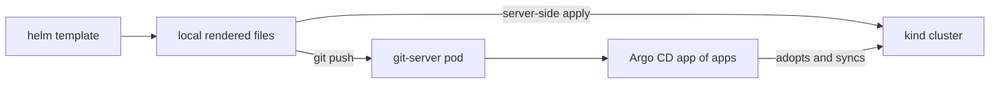

# Setup of the argocd-adopt experiment

Back to the [experiment summary](../argocd-adopt.md).

## Test bench



`kubectl apply` and Argo CD use the same rendered files.

- **Cluster:** kind, one node, `disableDefaultCNI: true`, `kubeProxyMode: none`. Cilium
  runs with `kubeProxyReplacement: true`.
- **Rendered manifests:** `helm template` for Cilium and Argo CD; the Gateway API
  `standard-install.yaml` as is. The render step adds the sync wave `-1` to every CRD,
  as `manifests:render` will. Layout:
  `gitops/clusters/exp-argocd-adopt/rendered/{gateway-api-crds,cilium,argocd,probe}/`.
- **Terraform mimic:** `kubectl apply --server-side --field-manager=argocd-controller`
  on the same rendered files, in the order the modules will use:
  1. Gateway API CRDs (and their `ValidatingAdmissionPolicy`), wait `Established`.
  2. Cilium, wait for the DaemonSet, the operator, the node `Ready` and CoreDNS.
  3. Argo CD: the Namespace and the CRDs, then all the other resources except the
     `argoproj.io` ones, wait for the rollouts.
  4. Hand-over: the `platform` AppProject and the `argocd` Application only. The
     `argocd` Application holds the other Applications (`gateway-api-crds`, `cilium`,
     `probe`, sync wave 1) and creates them. This is the homelab `bootstrap-argocd`
     design.
- **Git server: in-cluster `git daemon`.** A Deployment in the namespace `git-server`
  runs `git daemon --enable=receive-pack` on an `emptyDir`. It uses the Argo CD image,
  which already has `git` and `git-daemon`: no extra image. `run.sh` pushes through
  `kubectl port-forward` on a random local port. Argo CD reads
  `git://git-server.git-server.svc.cluster.local/infra.git`.
  - Why not `file://`: Argo CD would need a volume on `argocd-repo-server`. That changes
    the Argo CD manifests under test, and Argo CD would revert or fight it when it
    adopts itself.
  - Why not Gitea or similar: more memory and one more image, for no extra signal.
  - Limit: `git://` has no auth and no TLS. The real repoURL is
    `https://github.com/gsuquet/infra.git`; the protocol does not change the adoption
    behavior.
- **All Applications:** `automated: {prune: true, selfHeal: true}`, `syncOptions:
  [ServerSideApply=true]`. Argo CD has `controller.diff.server.side: true` and
  `application.resourceTrackingMethod: annotation` (the 3.x default, set to be visible).
- **Experiment-only settings, not for the component catalog:** the AppProject `platform`
  allows every destination namespace and every cluster-scoped kind
  (`clusterResourceWhitelist: */*`), Argo CD runs with `server.insecure: true`, and the
  git daemon has no auth and accepts pushes. Do not copy any of these into
  `gitops/components/argocd`: the real `platform` project needs its source repo,
  destinations and cluster resources scoped to the platform components.
- **Probe component:** two ConfigMaps with keys `a` and `b`. The bootstrap applies
  `probe-kubectl` with the field manager `kubectl` (the kubectl default) and
  `probe-argocd` with `argocd-controller`. A later commit removes `b` from both.

## Versions

All pinned in `experiments/argocd-adopt/` (`mise.toml` + `mise.lock`, `run.sh`).

| Item | Version | Pin |
| --- | --- | --- |
| kind | 0.33.0 | mise |
| kind node image | `kindest/node:v1.37.0` | `sha256:a1ed56cf…580ae5` |
| kubectl | 1.37.2 | mise |
| helm | 4.3.1 | mise |
| yq | 4.54.1 | mise |
| jq | 1.8.2 | root `.mise/config.toml` |
| Gateway API | v1.6.2 standard channel | file `sha256:faede450…ca40d9` |
| Cilium chart | 1.20.0 | tgz `sha256:c5f01391…d27883` |
| argo-cd chart (bootstrap) | 10.11.6 (Argo CD v3.5.6) | tgz `sha256:d8f096d8…d05` (argo-helm index digest) |
| argo-cd chart (upgrade) | 10.11.7 (Argo CD v3.5.7) | tgz `sha256:9f24a574…f04e` (argo-helm index digest) |
| git-server image | `quay.io/argoproj/argocd:v3.5.6` | `sha256:8e5cc5bb…5e4e5335` |

Argo CD itself: v3.5.6 after the bootstrap (controller log: `version=v3.5.6`,
`commit=c2b1e301`), v3.5.7 after the [chart upgrade](self-upgrade.md#chart-version). The
versions above are the ones the re-run printed (`kind v0.33.0`, `kubectl v1.37.2`, `helm
v4.3.1`, `yq v4.54.1`) and the SHA-256 of all four inputs matched.

Host: macOS arm64, Docker 26.1.1 with 4 CPUs and 7.7 GiB, next to another two-node kind
cluster (about 2 GiB in use). Run time of the re-run: 9.5 min (defaults), 15.5 min
(`REFRESH_SELF=false`: the `argocd` Application waits for its periodic reconcile), 9.3
min (`GENERATE_PATHS=true`).

## How to run

```sh
cd experiments/argocd-adopt
mise install
mise exec -- ./run.sh
```

Switches: `REFRESH_SELF=false` (no refresh annotation on the `argocd` Application
itself), `GENERATE_PATHS=true` (`argocd.argoproj.io/manifest-generate-paths: .` on every
Application) and `WATCH_SECONDS` (default 300). All three ran in the re-run:

```sh
mise exec -- ./run.sh
REFRESH_SELF=false mise exec -- ./run.sh
GENERATE_PATHS=true mise exec -- ./run.sh
```

`run.sh` fails if a cluster `exp-argocd-adopt` exists, and always deletes the cluster at
the end, also on failure (`trap … EXIT`). It writes everything to `$WORK/run.log` (a
`mktemp -d` folder, or `WORK=…`), plus `$WORK/apps-watch.json` (every update of every
Application from the hand-over on) and `$WORK/controller-phase5.log`. Optional inputs:
`GATEWAY_API_MANIFEST` and `CILIUM_CHART_TGZ` point to local copies; `run.sh` checks
their SHA-256 in all cases. Else it downloads them from GitHub releases and
`https://helm.cilium.io`.

## Checks by phase

| Phase that `run.sh` prints | Check |
|---|---|
| before phase 1 | [Render reproducibility](adoption.md#render-reproducibility) |
| phase 4 | [Adoption](adoption.md#adoption), [CRD tracking](crds.md#argo-cd-applies-crds-but-never-tracks-them) |
| phase 5, saves `controller-phase5.log` | [Field removal](field-managers.md#field-removal), [CRD change](crds.md#argo-cd-applies-crds-but-never-tracks-them), [self-sync](self-sync.md) |
| phase 5b | [CRD removed from Git](crds.md#a-crd-removed-from-git-is-orphaned) |
| phase 6 | [Value bump](self-upgrade.md#value-bump) |
| phase 7 | [Chart version](self-upgrade.md#chart-version) |
| phase 8 | [Stale re-apply](field-managers.md#stale-re-apply) |
