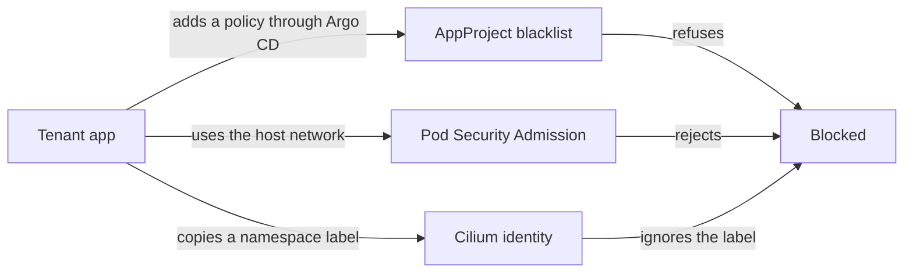

# Experiment: Cilium clusterwide default-deny

A label-selected `CiliumClusterwideNetworkPolicy` (CCNP), plus a per-component and a per-tenant allow profile, gave the
expected isolation for intra-namespace, Git, ACME, metrics, gateway and tenant flows on single-node kind. Run 4 (commit
`6e2ee96`, 2026-11-19) passed **42/42 checks, 0 mismatches** ([results](default-deny/results.md)).

Not shown: a kube-apiserver on another node, recovery after a recorded `ComparisonError`, and the
[flows not covered](default-deny/results.md#what-failed), GKE and DNS-01 included.

## What stops a tenant



Default deny alone does not hold: without the AppProject blacklist, a tenant policy opens world egress.

## Findings

| Finding | Evidence |
| --- | --- |
| Pods stay Ready while their traffic is denied | [Phase A](default-deny/results.md#webhooks-need-their-rule) |
| `fromEntities: kube-apiserver` on port 10250 is needed and enough for webhooks; on a node that runs kube-apiserver it equals `host` | [Webhooks](default-deny/results.md#webhooks-need-their-rule) |
| A tenant policy bypasses default deny; the AppProject stops it when Argo CD delivers it | [AppProject](default-deny/results.md#appproject-stops-a-tenant-policy) |
| A clusterwide `egressDeny` beat a tenant world allow; that it beats every allow is documented, not run | [Deny wins](default-deny/results.md#a-clusterwide-deny-wins) |
| Pod Security rejects host-network pods (run at `baseline`) | [Pod Security](default-deny/results.md#pod-security-rejects-host-network-pods) |
| A pod label cannot forge a namespace label (observed, not documented) | [Spoofing](default-deny/results.md#a-pod-label-cannot-forge-a-namespace-label) |

## What was run and what the platform uses

| Subject | Run 4 | Platform |
| --- | --- | --- |
| Policy label | `infra.gsuquet.com/network-policy: default-deny` | `network.infra.gsuquet.com/policy: default-deny` (RFC 0010 in [PR 18](https://github.com/gsuquet/infra/pull/18)) |
| Tenant Pod Security | `enforce: baseline`, `warn: restricted` | `enforce: restricted` ([ADR-0009](https://github.com/gsuquet/infra/blob/main/docs/adr/0009-tenant-onboarding-by-infra.md)) |
| Pod Security label set on | tenant namespaces | every labelled namespace ([ADR-0010](https://github.com/gsuquet/infra/blob/main/docs/adr/0010-cluster-owned-default-deny-network-policy.md)) |
| Policy owner | one file per component, applied by the script | `network-policy` component (RFC 0010 and RFC 0014 in [PR 18](https://github.com/gsuquet/infra/pull/18)) |
| AppProject blacklist | `NetworkPolicy`, `cilium.io/*` | `NetworkPolicy`, `CiliumNetworkPolicy` ([ADR-0009](https://github.com/gsuquet/infra/blob/main/docs/adr/0009-tenant-onboarding-by-infra.md)) |

The run did not test the platform column.

## Pages

| Page | Holds |
| --- | --- |
| [Setup](default-deny/setup.md) | goal, versions, host, phases |
| [Policies](default-deny/policies.md) | labels and allow profiles that ran |
| [Results](default-deny/results.md) | 42 checks, evidence, what failed |
| [Pitfalls](default-deny/pitfalls.md) | Cilium behavior to know |
| [Conclusions](default-deny/conclusions.md) | effect on the plan, proposed amendments, open questions |

## Reproduce

Not re-run for this page (untested). The script creates the kind cluster `exp-default-deny`, runs every check, writes
evidence to `experiments/default-deny/out/` (git-ignored) and always deletes the cluster.
[Scripts](../../../experiments/default-deny/).

```sh
mise trust experiments/default-deny/mise.toml
mise -C experiments/default-deny install
experiments/default-deny/run.sh
```
