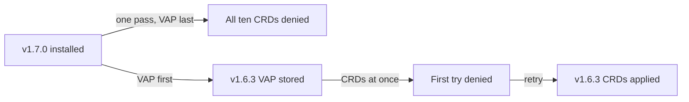

# Experiment: one Gateway API CRD owner, two implementations

**Passed on single-node kind, with kubectl.** Cilium 1.20.5 and agentgateway
v1.7.0 both accepted their GatewayClass and routed an HTTPRoute to the same
backend, with the Gateway API CRDs owned by one component. Both kept routing
through CRD bumps v1.5.1 -> v1.6.3 -> v1.7.0.

## Findings

| Finding | Evidence |
| --- | --- |
| Neither implementation bundles Gateway API CRDs | [Bundled CRDs](gateway-multi-evidence.md#bundled-crds-none-but-check-every-render) |
| v1.6 is the only Gateway API minor both projects support | [Compatibility](gateway-multi-evidence.md#version-and-channel-compatibility) |
| v1.7.0 was rolled back to v1.6.3 with kubectl; a rollback across a release that added CRDs has a [caveat](gateway-multi-evidence.md#rollback-across-a-release-that-added-crds) | [Re-run](gateway-multi-evidence.md#re-run-fresh-v163-and-vap-first-rollback) |
| Nothing on the cluster reports a CRD version mismatch | [CRD bumps](gateway-multi-evidence.md#crd-bumps-v151---v163---v170-earlier-runs) |
| Cilium detects optional CRDs only when its operator starts | [CRD bumps](gateway-multi-evidence.md#crd-bumps-v151---v163---v170-earlier-runs) |
| `gatewayClass.create: auto` drops Cilium's GatewayClass from a render | [Surprises](gateway-multi-evidence.md#what-failed-or-surprised) |

## Rollback order

VAP: the safe-upgrades ValidatingAdmissionPolicy of the CRD bundle.



In both re-runs, CRDs applied right after the VAP were denied once, then passed
on retry.

## Limits

- Argo CD, GKE and any route other than HTTPRoute were not tested: see
  [Unverified](gateway-multi-evidence.md#unverified).
- `run.sh` exits 0 even when a rollback is denied: see
  [What the runs prove](gateway-multi-evidence.md#what-the-runs-prove).

## Follow-ups

| Follow-up | Needs |
| --- | --- |
| [VAP in wave -2, plus sync retry](gateway-multi-catalog.md#proposal-vap-before-the-crds) | an RFC that amends [ADR-0005](https://github.com/gsuquet/infra/blob/main/docs/adr/0005-rendered-manifests-pattern.md) |
| TCPRoute and UDPRoute are standard at `v1` since v1.6; [ADR-0012](https://github.com/gsuquet/infra/blob/main/docs/adr/0012-gateway-api-crd-ownership.md) defers them as experimental | a note to amend ADR-0012 |
| [GKE owns the CRDs](gateway-multi-catalog.md#gke) | nothing: settled by ADR-0012 |
| Chart and image digests | pins: see [Setup](gateway-multi-evidence.md#setup) |

The pin and the other rules for the component catalog are in
[Catalog rules](gateway-multi-catalog.md).

## Run it

Scripts: [`experiments/gateway-multi/`](../../../experiments/gateway-multi/).
`run.sh` creates the kind cluster `exp-gateway-multi`, runs every step, writes
evidence to `$OUT` (default: a `mktemp` directory) and always deletes the
cluster (`KEEP=1` keeps it) (untested here).

```bash
experiments/gateway-multi/run.sh
```
