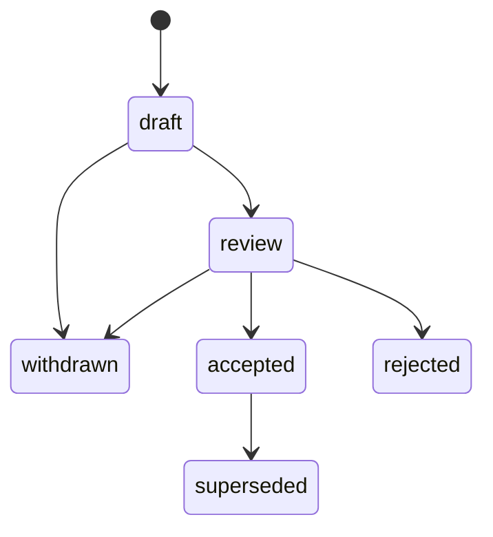

# RFC 0001: Record decisions as RFCs with generated ADRs

## Summary

Every structural decision of `infra` starts as an RFC in `docs/rfc/`, reviewed in a pull request. Once
accepted, its Decision section is copied into a generated ADR in `docs/adr/` with the same number. Humans
read the RFC; agents read the compact ADR.

## Context

- `infra` starts with structural decisions settled before any platform code exists.
- `homelab` kept each decision inside long explanation pages: decision, options and date were hard to find.
- The first records (ADRs 0001-0019, pull request #5) were hand-written MADR files: prose that mixes the
  debate with the outcome, read in full by agents before every structural change.
- MADR has no review state: studies open in parallel pull requests (#4, #6 to #11) need a numbered proposal
  before a decision exists, without colliding on numbers.

## Goals and non-goals

Goals:

- One file per decision gives its status, reason, options and review link.
- One generated ADR per accepted decision, holding only the Decision block.
- Parallel branches never pick the same number.

Non-goals:

- Human docs (how-to, tutorials, reference, concepts, runbooks): they follow their own templates.
- Changing the substance of ADRs 0001-0019 beyond the amendments recorded in RFCs 0003, 0010, 0013, 0014.

## Decision drivers

- A reader, human or agent, finds a decision, its status and its reason in one file.
- An agent reads a decision at the lowest token cost.
- A later decision supersedes an earlier one without rewriting history.
- Low ceremony: plain Markdown, reviewed in a pull request.

## Options considered

### RFC with a generated ADR

An RFC template with a lifecycle; the accepted Decision section is copied verbatim into the ADR.

- Good: one reviewed human record and one compact agent record per decision.
- Bad: two files per decision and a heavier template than MADR (low ceremony).

### Explanation pages, as in homelab

Decisions live in prose pages next to the current-state description.

- Good: the reasoning reads as prose.
- Bad: no status, no date, decision mixed with description (one file per decision).

### Decisions in pull request descriptions only

- Good: nothing extra to write (low ceremony).
- Bad: the decision is not in the repository and is lost for agents working offline.

### Do nothing

Keep hand-written MADR files in `docs/adr/`.

- Good: documented, stable format (MADR 4.0.0), already in place.
- Bad: no review state, and agents read the whole debate for each decision (token cost).

## Proposal

RFC lifecycle: only `accepted` generates an ADR; `superseded` marks both RFC and ADR.

| File | Reader | Content |
| --- | --- | --- |
| `docs/rfc/NNNN-slug.md` | humans | Context, options with Do nothing, proposal with diagrams, operational impact, Decision |
| `docs/adr/NNNN-slug.md` | agents | Generated: front matter, the Decision block, a link to the RFC. Never edited by hand |

Numbers are pre-assigned so parallel branches do not collide: 0020 secrets backend, 0021 Kargo tenant
promotion, 0022 IaC tool, 0023 Renovate with rendered manifests, 0024 GKE, 0025 Talos on Raspberry Pi,
0026 Cloudflare Tunnel.

## Operational impact

- Blast radius: documentation only (`docs/rfc/`, `docs/adr/`). ADR file names do not change, so links from READMEs keep working.
- Rollout: retro RFCs 0001-0019 and their regenerated ADRs land in one pull request; studies 0020-0026 move to the RFC template in their own pull requests.
- Rollback: revert the pull request; the MADR ADRs come back.
- Migration: the MADR prose of ADRs 0001-0019 moves into RFCs 0001-0019 with the same slugs; ADRs are regenerated in place. No state.
- Security: N/A: documentation only.
- Cost: N/A: no infrastructure.
- Observability: the RFC check fails when a section is missing or an ADR differs from its RFC's Decision section.

## Drawbacks and risks

- An RFC is heavier than a MADR file for a small decision -> lightweight track, and a two-way change with no wide blast radius needs only a pull request.
- An ADR edited by hand drifts from its RFC -> the RFC check compares them; fix the RFC and regenerate.
- READMEs and ADRs can drift -> READMEs describe the current state and link the ADR for the why.

## Open questions

None.

## Decision

- Status: accepted on 2026-11-19 by gsuquet
- Decision: In the context of recording the structural decisions of `infra`, facing hand-written MADR prose that mixes debate and outcome and has no review state, we decided for one RFC per decision in `docs/rfc/NNNN-slug.md` (lifecycle draft, review, accepted, rejected, withdrawn, superseded; reviewed in a pull request) whose accepted Decision section is copied verbatim into a generated ADR `docs/adr/NNNN-slug.md` with the same number, and against hand-written MADR, explanation pages and decisions kept only in pull request descriptions, to achieve a reviewed human record and a compact ADR that agents read, accepting two files per decision and a heavier template.
- Consequences:
  - Good: an ADR holds only the Decision block, the cheapest form for agents to read.
  - Good: each decision has a stable link, a status and its review pull request in front matter.
  - Good: numbers are pre-assigned (0020 secrets backend, 0021 Kargo tenant promotion, 0022 IaC tool, 0023 Renovate with rendered manifests, 0024 GKE, 0025 Talos on Raspberry Pi, 0026 Cloudflare Tunnel), so parallel branches do not collide.
  - Bad: an ADR is never edited by hand; an accepted RFC changes only through Implementation links or a new RFC that supersedes it.
  - Bad: READMEs and ADRs can drift: READMEs describe the current state and link the ADR for the why.
- Confidence: high, every MADR record moves into its retro RFC with no loss of substance.
- Confirmation: the RFC check passes on every file of `docs/rfc/` and fails when an ADR differs from its RFC's Decision section; every structural pull request links an RFC or adds one; `docs/rfc/README.md` and `docs/adr/README.md` list every file.
- Revisit when: a structural change merges without an RFC, or the RFC process costs more review time than the changes it records.

## Implementation

N/A: implemented by the pull request that backfills RFCs 0001-0019; its link is added once it merges.

## References

- [MADR](https://adr.github.io/madr/)
- [ADR GitHub organisation](https://adr.github.io/)

## Future work

- Run the RFC check in CI.
