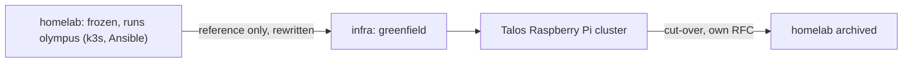

# RFC 0002: Build infra as a greenfield successor of homelab

## Summary

The new platform design is built in a new repository, `gsuquet/infra`. `gsuquet/homelab` is frozen: it keeps
running the production cluster `olympus` until a Talos Raspberry Pi cluster from `infra` replaces it, then it is
archived.

| Decision | Why | Cost | Reversible |
| --- | --- | --- | --- |
| Build the new design in a greenfield `gsuquet/infra` | `homelab` is coupled to the running production cluster | Two repositories during the transition; shared logic is rewritten | yes, before the cut-over, drop the Talos cluster and keep `olympus` |
| Freeze `gsuquet/homelab`, then archive it after the cut-over | `olympus` must keep running until a replacement exists | Fixes to `olympus` still happen in `homelab` | no, irreversible once `homelab` is archived |

## Context

- `gsuquet/homelab` provisions the production k3s cluster `olympus` on Raspberry Pis with Ansible.
- It was half way through a migration to a Terraform and GitOps design (`modules/`, `instances/`, `gitops/`).
- Legacy folders, heavy documentation rules and the running production cluster make each structural change
  slow and risky.
- The new design (Talos, rendered manifests, tenants, Gateway API) changes most of the tree.

## Goals and non-goals

Goals:

- Deliver the new design without any change to `olympus`.
- `infra` holds no Ansible code and no legacy folder.
- `homelab` is archived once its cluster is replaced.

Non-goals:

- The cut-over from `olympus` to the Talos cluster (data, DNS, tunnels): its own RFC.
- Fixes to `olympus`: they stay in `homelab` until the cut-over.

## Decision drivers

- `olympus` must keep running until a replacement exists.
- The new design changes most of the tree.
- Lessons from `homelab` (modules, policies, schemas, render tasks) are reused, not lost.

## Options considered

### Greenfield infra, homelab frozen as reference

New repository; `homelab` gets no new features and serves as a reference.

- Good: each decision is made without migration constraints (new design).
- Bad: shared logic (render, policies) is rewritten (reuse).

### Continue the in-place migration in homelab

- Good: one repository and one history (reuse).
- Bad: every change stays compatible with the running cluster and the legacy folders (production safety).

### Do nothing

`homelab` keeps its k3s and Ansible design.

- Good: no work, production untouched.
- Bad: none of the new design is delivered.

## Proposal

Transition: `homelab` stays the production source until the cut-over, then is archived.

| Repository | Rule |
| --- | --- |
| `homelab` | Frozen: no new features. Fixes to `olympus` only. Archived after the cut-over |
| `homelab` reference | `modules/`, `gitops/`, `policy/`, `schemas/`, `docs/` and `.mise` tasks are read, rewritten for `infra`, never copied blindly |
| `infra` | No Ansible, no `ansible/` folder, no legacy folder |

## Operational impact

- Blast radius: none on `olympus` while it runs from `homelab`; the cut-over is the risky step and has its own RFC.
- Rollout: 1. build `infra`; 2. create the Talos Raspberry Pi cluster; 3. cut over (own RFC); 4. archive `homelab`.
- Rollback: before step 3, drop the Talos cluster and keep `olympus`; irreversible after step 4.
- Migration: None until the cut-over: `olympus` data, DNS and tunnels move then, planned in the cut-over RFC.
- Security: N/A: no trust boundary changes before the cut-over; `infra` is public, so it holds no secret value.
- Cost: N/A: no new infrastructure until the Talos cluster exists.
- Observability: `olympus` keeps its `homelab` monitoring until the cut-over; `infra` clusters report through their Argo CD sync and health status.

## Drawbacks and risks

| Risk | Severity (proposed) | Mitigation |
| --- | --- | --- |
| Two repositories during the transition; fixes to `olympus` still happen in `homelab` | medium | `homelab` is frozen for features only. |
| Shared logic (render, policies) must be rewritten | medium | `homelab` stays readable as a reference implementation. |
| The history of reused ideas stays in `homelab` | low | RFCs and ADRs here record the decisions again. |

## Open questions

None.

## Decision

- Status: accepted on 2026-11-18 by gsuquet
- Context: delivering the new platform design (Talos, rendered manifests, tenants, Gateway API), facing a legacy repository coupled to the production k3s cluster `olympus`.
- Decision: we decided for a greenfield `gsuquet/infra` with `gsuquet/homelab` frozen (no new features; it runs `olympus` until a Talos Raspberry Pi cluster from `infra` replaces it, then it is archived; its `modules/`, `gitops/`, `policy/`, `schemas/`, `docs/` and `.mise` tasks are a reference, rewritten and never copied blindly), and against continuing the in-place migration in `homelab`, to achieve a clean tree with no Ansible that cannot break production, accepting two repositories during the transition.
- Consequences:
  - Good: `infra` starts clean, with no Ansible and no legacy folder.
  - Good: the production cluster is not touched by design experiments.
  - Bad: fixes to `olympus` still happen in `homelab` until the cut-over.
  - Bad: the history of reused ideas stays in `homelab`; the decisions are recorded again here.
  - Bad: shared logic (render, policies) is rewritten.
- Confidence: high, the coupling to the running cluster was the main cost of every change in `homelab`.
- Confirmation: `homelab` receives no feature pull request after 2026-11-18; `infra` contains no `ansible/` folder.
- Revisit when: the Talos Raspberry Pi cluster is ready to replace `olympus` (the cut-over RFC).

## Implementation

N/A: no cluster built yet.

## References

- RFC 0025: Talos on Raspberry Pi (study in review, https://github.com/gsuquet/infra/pull/9)

## Future work

- Cut-over plan from `olympus` to the Talos cluster (data, DNS, tunnels), in its own RFC.
