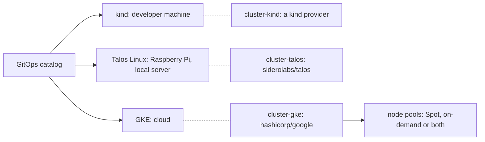

# RFC 0003: Use kind, Talos and GKE as distributions per target

## Summary

Each target gets one Kubernetes distribution and one child module: kind on developer machines, Talos Linux on
Raspberry Pis and local servers, GKE in the cloud. Everything is provisioned by IaC, with no Ansible. Amended
on 2026-11-19: `cluster-gke` takes Spot pools, on-demand pools or both, per cluster.

## Context

- The platform runs on three kinds of targets: developer machines, owned hardware (Raspberry Pis, local
  servers) and a cloud.
- `homelab` used k3s installed by Ansible: mutable, SSH-based, outside the IaC plan.
- The same GitOps catalog must run on every target.
- GKE Spot VMs cut the cloud bill but can be preempted or out of stock, which can leave a cluster with zero
  nodes, Argo CD included (GKE study, pull request #7).

## Goals and non-goals

Goals:

- One distribution and one `cluster-*` module per target.
- No Ansible and no SSH configuration anywhere.
- Each GKE cluster chooses its node pool mix (Spot, on-demand, both) by input.

Non-goals:

- Clouds other than GKE (AWS, Azure, ...).
- Hardware provisioning: flashing images and network boot.

## Decision drivers

- Everything is provisioned by IaC; no Ansible.
- The same GitOps catalog runs on every target.
- Owned hardware is immutable and API-driven.
- The cloud is managed: no control plane to operate.

## Options considered

### kind, Talos and GKE

kind on developer machines, Talos on hardware, GKE in the cloud.

- Good: the most operable option per target (immutable hardware, managed cloud).
- Bad: three code paths to maintain (same catalog everywhere).

### k3s everywhere, installed by Ansible

The `homelab` model.

- Good: one distribution (same catalog).
- Bad: mutable SSH configuration outside the IaC plan (no Ansible).

### kind, kubeadm and self-managed cloud VMs

- Good: upstream Kubernetes everywhere (same catalog).
- Bad: a full OS and control plane to patch on every node (managed cloud, immutable hardware).

### Do nothing

Keep `olympus` on k3s and Ansible, no cloud and no local cluster.

- Good: no work.
- Bad: no disposable local cluster and no cloud target.

## Proposal

One catalog, three targets, one child module each.

| Target | Distribution | Provider | Note |
| --- | --- | --- | --- |
| Developer machine | kind | a kind provider, chosen in `cluster-kind` | disposable |
| Raspberry Pi, local server | Talos Linux | `siderolabs/talos` | API only: machine configs rendered by IaC, no SSH |
| Cloud | GKE, managed | `hashicorp/google` | Dataplane V2; skips `cilium` and `gateway-api-crds` |

`cluster-gke` node pools come from an input list: each pool sets Spot or on-demand, so a cluster runs Spot
only, on-demand only, or both (for example one on-demand node for the baseline and a Spot pool for tenants).

## Operational impact

- Blast radius: every cluster: a distribution change rebuilds the cluster and moves its workloads.
- Rollout: kind first (disposable), then Talos, then GKE; each cluster root is created separately.
- Rollback: before a cluster holds data, destroy and recreate it; once it holds data, changing distribution needs a data migration and downtime.
- Migration: None: no cluster exists yet; `olympus` moves later through the cut-over RFC (RFC 0002).
- Security: Talos removes SSH from owned hardware; GKE credentials stay local to the cluster root, never in CI.
- Cost: kind and Talos run on owned hardware; GKE cost depends on the node pool mix, Spot being the cheapest (figures in RFC 0024).
- Observability: each cluster reports Argo CD sync and health; on GKE, node pool preemption shows as nodes leaving the cluster.

## Drawbacks and risks

- Three distributions differ in CNI, storage and load balancing -> the catalog handles the differences per cluster (RFC 0011).
- GKE owns its dataplane (RFC 0011) and, with its Gateway API enabled (always on Autopilot), the Gateway API CRDs (RFC 0012) -> the catalog skips `cilium` and `gateway-api-crds` on GKE.
- The `siderolabs/talos` provider does not manage the hardware -> flashing images and network boot stay manual steps.
- A Spot-only GKE cluster can lose every node at once, Argo CD included -> pick on-demand pools, or both, where outages are not accepted.

## Open questions

None.

## Decision

- Status: accepted on 2026-11-18 by gsuquet, amended on 2026-11-19
- Decision: In the context of running one GitOps catalog on developer machines, owned hardware and a cloud, facing different constraints per target, we decided for kind on developer machines (a kind provider chosen in `cluster-kind`), Talos Linux on Raspberry Pis and local servers (`siderolabs/talos` provider, API only, no SSH, no Ansible) and managed GKE in the cloud (`hashicorp/google`; `cluster-gke` takes Spot pools, on-demand pools or both, per cluster, by input), with exactly one `cluster-*` module per target, and against k3s installed by Ansible and kubeadm with self-managed cloud VMs, to achieve immutable API-driven hardware, no cloud control plane to operate and a disposable local copy of the catalog, accepting three code paths that differ in CNI, storage and load balancing.
- Consequences:
  - Good: Talos is configured only through its API: machine configs are rendered by IaC, no SSH, no Ansible.
  - Good: GKE removes control plane operations; kind gives a disposable cluster to test the same catalog.
  - Good: each GKE cluster trades cost (Spot) against availability (on-demand) by input, with no module change.
  - Bad: the catalog handles CNI, storage and load balancing differences per cluster.
  - Bad: GKE owns its dataplane and, with Gateway API enabled (always on Autopilot), the Gateway API CRDs: the catalog skips `cilium` and `gateway-api-crds` on GKE.
  - Bad: flashing images and network boot of Talos hardware stay manual: the provider does not manage hardware.
  - Bad: a Spot-only GKE pool can be preempted or out of stock and leave the cluster with zero nodes.
- Confidence: high, each distribution is the managed or immutable default of its target.
- Confirmation: `modules/` holds exactly one `cluster-*` module per target; `infra` contains no Ansible code; the `cluster-gke` node pool input accepts Spot and on-demand pools.
- Revisit when: a cloud other than GKE is needed, or Talos stops supporting the Raspberry Pi models in use.

## Implementation

N/A: no `cluster-*` module exists yet.

## References

- [Talos Terraform provider](https://registry.terraform.io/providers/siderolabs/talos/latest/docs)
- [Talos documentation](https://docs.siderolabs.com/)
- RFC 0022: IaC tool (https://github.com/gsuquet/infra/pull/11)
- RFC 0024: GKE (https://github.com/gsuquet/infra/pull/7)
- RFC 0025: Talos on Raspberry Pi (https://github.com/gsuquet/infra/pull/9)

## Future work

- Clouds other than GKE (AWS, Azure, ...): out of scope.
