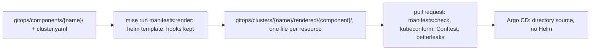

# RFC 0005: Commit rendered manifests and apply them with sync waves

## Summary

A render task turns every Helm source into plain YAML, committed to Git, one file per resource. Argo CD applies
those files as a directory source, ordered by sync waves. The same pattern holds for cluster components here
and for tenant manifests in `gsuquet/gitops`.

## Context

- Most components ship as Helm charts.
- Argo CD can render charts at sync time, or apply plain YAML that a task rendered and committed.
- Rendered at sync time, the applied resources are invisible in review and to static checks.
- The repositories are public: whatever is rendered is published.

## Goals and non-goals

Goals:

- A pull request shows the exact resources that change, per cluster.
- Static checks (kubeconform, Conftest) read the real output.
- Two renders of the same sources give byte-identical files.

Non-goals:

- How Renovate bumps produce the render commit: RFC 0023.
- Tenant release promotion: RFC 0008.

## Decision drivers

- A pull request shows the exact resources that change, per cluster.
- Static checks read the real output, not templates.
- A sync, including Argo CD repairing itself, does not depend on a reachable chart repository.
- CRDs apply before the resources that use them.

## Options considered

### Rendered manifests committed to Git

A task renders charts; Argo CD applies plain YAML.

- Good: Git is the full desired state; review and static checks see the real output.
- Bad: the repository grows with rendered YAML, and upgrades produce large diffs.

### Argo CD renders Helm charts at sync time

- Good: small diffs and no render step.
- Bad: applied resources are invisible in review and to static checks; syncs need the chart repository.

### Argo CD Config Management Plugin

Renders at sync time in a sidecar.

- Good: flexible rendering.
- Bad: custom sidecars in Argo CD, and the output is still not in Git.

### Do nothing

Apply charts by hand or by IaC.

- Good: no new tooling.
- Bad: no review of the applied resources and no continuous reconciliation.

## Proposal

From chart to cluster: the render output is what reviewers, checks and Argo CD all see.

| Sync wave | Resources |
| --- | --- |
| `-1` | `CustomResourceDefinition` |
| `0` (default) | ordinary resources |
| `1` and higher | child Argo CD `Application` resources |

| Rule | Detail |
| --- | --- |
| Deterministic | No chart generates values at template time (`genCA`, `genSelfSignedCert`, `randAlphaNum`, ...); component values set these options explicitly |
| Generated secrets | Certificates and keys from cert-manager or the chart's in-cluster generator (Cilium `certgen` job, not `hubble.tls.auto.method=helm`); credentials from the `secrets` store (RFC 0016) |
| Helm hooks | Rendered (no `--no-hooks`); Argo CD maps `helm.sh/hook` to its hooks (`PreSync`, `PostSync`, ...) |
| Unmappable hooks | Rollback, test or install-only hooks that break on every sync: disabled in the component's values or rendered with `--no-hooks`, recorded in the component's folder |
| Scope | Cluster components here and tenant manifests in `gsuquet/gitops` (RFC 0007) |

## Operational impact

- Blast radius: every cluster: a wrong render reaches every cluster that enables the component, after merge.
- Rollout: render and commit per pull request; Argo CD syncs after merge.
- Rollback: revert the commit; Argo CD syncs the previous files (one sync interval).
- Migration: None: no cluster renders at sync time today.
- Security: rendered output is public: secret material rendered at template time would be published; betterleaks and a Conftest rule on `Secret` `data`/`stringData` block it.
- Cost: N/A: CI and repository size only.
- Observability: `mise run manifests:check` fails a pull request whose committed files differ from a fresh render; Argo CD sync status per `Application`.

## Drawbacks and risks

- A chart that renders secret material at template time would publish it and make `manifests:check` fail on every run -> component values avoid template-time generation explicitly.
- A source change without a render leaves stale files -> `manifests:check` in CI fails on any difference (RFC 0019), so Renovate chart bumps need a render commit.
- Argo CD's hook mapping is annotation compatibility, not Helm's lifecycle: it cannot tell an install from an upgrade, so `pre-install` hooks run on every sync -> components disable such hooks or render with `--no-hooks`.
- Upgrades produce large diffs -> one file per resource keeps diffs readable.

## Open questions

None.

## Decision

- Status: accepted on 2026-11-18 by gsuquet
- Decision: In the context of delivering Helm-sourced components and tenant manifests through Argo CD, facing resources that are invisible in review when rendered at sync time, we decided for manifests rendered by `mise run manifests:render` into `gitops/clusters/<name>/rendered/<component>/` (one file per resource; deterministic: no template-time generated values, certificates from cert-manager or in-cluster generators, credentials from the `secrets` store; Helm hooks kept and mapped by Argo CD, unmappable hooks disabled or rendered with `--no-hooks` and recorded in the component) and applied by Argo CD as plain directory sources with sync waves (CRDs `-1`, ordinary resources `0`, child `Application` resources `1` or higher), everywhere including tenant manifests in `gsuquet/gitops`, and against Argo CD Helm sources and Config Management Plugins, to achieve reviewed and statically checked desired state with no chart repository needed at sync time, accepting large diffs and a render commit for every source change.
- Consequences:
  - Good: reviewers see every changed field of every cluster; Conftest and kubeconform check what reaches the cluster.
  - Good: the bootstrap applies the same `rendered/argocd/` files that Argo CD later adopts.
  - Bad: upgrades produce large diffs; Renovate chart bumps need a render commit.
  - Bad: output lands in public repositories: a chart rendering secret material at template time publishes it and breaks `manifests:check`.
  - Bad: Argo CD cannot tell a Helm install from an upgrade: `pre-install` hooks run on every sync.
- Confidence: high, the pattern ran in `homelab` and the tooling exists in `infra`.
- Confirmation: CI runs `mise run manifests:check` (two renders must match the committed files), betterleaks over `rendered/`, and the Conftest rule that fails any `Secret` with `data` or `stringData`; no Argo CD `Application` in `rendered/` has a `helm` source.
- Revisit when: rendered output makes the repository or pull request diffs too large to review, or Argo CD gains a reviewable render-at-sync mode.

## Implementation

- 2026-11-19 https://github.com/gsuquet/infra/pull/12

## References

- [Argo CD sync waves](https://argo-cd.readthedocs.io/en/stable/user-guide/sync-waves/)
- [Argo CD Helm hooks mapping](https://argo-cd.readthedocs.io/en/stable/user-guide/helm/#helm-hooks)
- `homelab` explanation page "Rendered manifests pattern" (reference implementation)
- RFC 0023: Renovate with rendered manifests (https://github.com/gsuquet/infra/pull/6)

## Future work

N/A: no follow-up raised.
