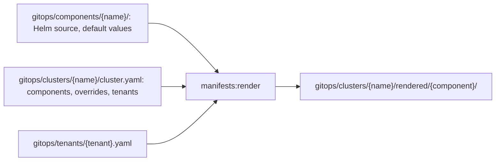

# RFC 0006: Define a component catalog and a cluster.yaml per cluster

## Summary

Each component is defined once in `gitops/components/<name>/`. Each cluster says what it runs, with which
overrides and which tenants, in one `gitops/clusters/<name>/cluster.yaml`. The render merges both.

| Decision | Why | Cost | Reversible |
| --- | --- | --- | --- |
| Define each component once in `gitops/components/<name>/` | Copies drift between clusters | Effective config split between catalog and cluster file | yes, revert the commit; the next render and sync restore the previous files |
| Describe each cluster in one `cluster.yaml`, merged by the render | One reviewable file tells what a cluster runs | A custom render task and a file format that is a contract | yes, revert the commit; the next render and sync restore the previous files |

## Context

- Several clusters run overlapping sets of components with small differences (CNI, storage, domains).
- A component needs one definition, and a cluster needs one place that tells what runs on it.
- Rendering stays out of sync time (RFC 0005).

## Goals and non-goals

Goals:

- One definition per component, reused by every cluster.
- One file per cluster that lists what runs on it.
- Overrides close to the cluster, visible in review.

Non-goals:

- Which components are mandatory: RFC 0014.
- Tenant onboarding content: RFC 0009.

## Decision drivers

- One definition per component, reused by every cluster.
- One file per cluster that tells what runs on it.
- Overrides close to the cluster, visible in review.

## Options considered

### Component catalog and a cluster.yaml per cluster

- Good: explicit and reviewable (one file per cluster).
- Bad: a custom render task to maintain.

### Per-cluster copies of each component

- Good: no indirection.
- Bad: copies drift and every upgrade touches every cluster by hand (one definition).

### Argo CD ApplicationSets with cluster generators

- Good: native Argo CD.
- Bad: rendering moves back to sync time, against RFC 0005.

### Do nothing

No structure: each cluster folder holds whatever it needs.

- Good: no design work.
- Bad: no reuse, no single view per cluster.

## Proposal

The render reads only the catalog, the cluster files and the tenant files.

| File | Holds |
| --- | --- |
| `gitops/components/<name>/` | Helm source (chart reference, pinned version) and default values |
| `gitops/clusters/<name>/cluster.yaml` | enabled components, per-component value overrides, the cluster's tenants (RFC 0009) |
| `gitops/clusters/<name>/rendered/<component>/` | defaults merged with overrides, rendered |

## Operational impact

- Blast radius: a catalog change renders into every cluster that enables the component.
- Rollout: one pull request per change, with its render commit.
- Rollback: revert the commit; the next render and sync restore the previous files.
- Migration: None: no cluster exists yet.
- Security: N/A: no trust boundary in the file layout itself; tenant isolation is RFC 0009.
- Cost: N/A: repository layout only.
- Observability: `mise run schemas:check` fails an invalid `cluster.yaml`; `manifests:check` fails a stale render.

## Drawbacks and risks

| Risk | Severity (proposed) | Mitigation |
| --- | --- | --- |
| The `cluster.yaml` format is a contract | medium | it has a JSON Schema and a check. |
| A component's effective config is split between the catalog and each `cluster.yaml` | low | the rendered output shows the merged result. |

## Open questions

None.

## Decision

- Status: accepted on 2026-11-18 by gsuquet
- Context: several clusters running overlapping components with small differences, facing drift between copies and the need for one view per cluster.
- Decision: we decided for a component catalog `gitops/components/<name>/` (Helm source with a pinned version and default values) and one `gitops/clusters/<name>/cluster.yaml` per cluster (enabled components, per-component value overrides, tenants), merged by the render into `gitops/clusters/<name>/rendered/<component>/`, and against per-cluster copies and Argo CD ApplicationSets with cluster generators, to achieve one definition per component and one reviewable file per cluster, accepting a custom render task and config split between catalog and cluster file.
- Consequences:
  - Good: adding a component to a cluster is one line plus optional overrides.
  - Good: a chart version bump lives in one place and renders into every cluster.
  - Bad: a component's effective config is split between the catalog and each `cluster.yaml`.
  - Bad: the `cluster.yaml` format is a contract that needs a JSON Schema and a check.
- Confidence: high, the same model ran in `homelab`.
- Confirmation: `mise run manifests:render` reads only `gitops/components/`, `gitops/clusters/*/cluster.yaml` and `gitops/tenants/`; a schema check validates every `cluster.yaml`.
- Revisit when: overrides in `cluster.yaml` grow larger than the catalog defaults they override.

## Implementation

- 2026-11-19 https://github.com/gsuquet/infra/pull/12

## References

N/A: no external reference.

## Future work

N/A: no follow-up raised.
