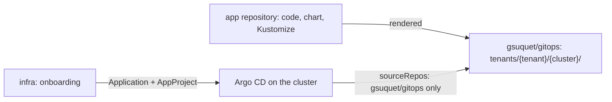

# RFC 0007: Keep tenant manifests in gsuquet/gitops, code in app repos

## Summary

Each tenant application keeps its code in its own repository. Rendered tenant manifests per cluster live in the
public repository `gsuquet/gitops`. `infra` only onboards tenants.

| Decision | Why | Cost | Reversible |
| --- | --- | --- | --- |
| Keep application code in its own repository and rendered tenant manifests in public `gsuquet/gitops` | Platform and release reviews stay separate | Three repositories in a first deploy | yes, revert the commit in `gsuquet/gitops`; Argo CD syncs the previous release |
| Limit `infra` to onboarding and each tenant `AppProject` to `gsuquet/gitops` | Tenant deploys cannot change cluster-scoped resources | Onboarding is a one-time step per tenant | not stated, see the [open point](https://github.com/gsuquet/infra/pull/18) |

## Context

- Applications (tenants) are developed independently of the platform.
- Their releases should not wait in the platform's review queue.
- Tenant deploys must not change cluster-scoped resources.

## Goals and non-goals

Goals:

- Platform changes and application releases have separate review queues.
- One place lists what every tenant runs on every cluster.

Non-goals:

- Promotion between clusters: RFC 0008.
- Onboarding content (namespaces, projects, quotas): RFC 0009.

## Decision drivers

- Platform changes and application releases do not share a review queue.
- Tenant deploys cannot change cluster-scoped resources.
- The same rendered manifests pattern as the platform (RFC 0005).

## Options considered

### App code in own repos, rendered manifests in gsuquet/gitops

- Good: clear ownership boundary (separate review queues).
- Bad: one more repository.

### Tenant manifests inside infra

- Good: one repository.
- Bad: every release is a platform pull request (review queues).

### Each app repo holds its own deploy manifests

- Good: self-contained apps.
- Bad: Argo CD trusts many repositories, and there is no single view per cluster.

### Do nothing

No tenant model: applications deploy however they like.

- Good: no design work.
- Bad: no isolation and no reviewable deploys.

## Proposal

Three repositories: the app produces, `gsuquet/gitops` holds, `infra` authorises.

| Repository | Holds |
| --- | --- |
| app repository | code, chart or Kustomize sources |
| `gsuquet/gitops` (public) | `tenants/<tenant>/<cluster>/` rendered manifests; `ExternalSecret` references only, no secret value |
| `infra` | tenant onboarding (RFC 0009); each tenant `AppProject` limited to `gsuquet/gitops` |

## Operational impact

- Blast radius: one tenant on one cluster per change in `tenants/<tenant>/<cluster>/`.
- Rollout: onboard the tenant in `infra`, then commit its rendered manifests in `gsuquet/gitops`.
- Rollback: revert the commit in `gsuquet/gitops`; Argo CD syncs the previous release.
- Migration: None: no tenant exists yet.
- Security: tenant `AppProject` limited to `gsuquet/gitops`; the repository is public, so it holds no secret value, only `ExternalSecret` references (RFC 0016).
- Cost: N/A: one more repository, no infrastructure.
- Observability: Argo CD sync and health of each tenant `Application`.

## Drawbacks and risks

| Risk | Severity (proposed) | Mitigation |
| --- | --- | --- |
| `gsuquet/gitops` is public | high | no secret values, only `ExternalSecret` references. |
| A first deploy involves three repositories (app, `gsuquet/gitops`, `infra` onboarding) | low | onboarding is a one-time step per tenant. |

## Open questions

None.

## Decision

- Status: accepted on 2026-11-18 by gsuquet
- Context: tenant applications developed independently of the platform, facing shared review queues and tenant access to cluster-scoped resources.
- Decision: we decided for application code in its own repositories and rendered tenant manifests in the public repository `gsuquet/gitops` under `tenants/<tenant>/<cluster>/` (no secret value, only `ExternalSecret` references), with `infra` only onboarding tenants and restricting each tenant `AppProject` to `gsuquet/gitops`, and against tenant manifests inside `infra` and manifests in each app repository, to achieve separate review queues and one view of every tenant per cluster, accepting three repositories in a first deploy.
- Consequences:
  - Good: the platform repository does not change on every release.
  - Good: one place lists what every tenant runs on every cluster.
  - Bad: three repositories are involved in a first deploy (app, `gsuquet/gitops`, `infra` onboarding).
  - Bad: `gsuquet/gitops` is public: it never holds a secret value.
- Confidence: high, the boundary matches the ownership of each repository.
- Confirmation: every tenant `AppProject` has `sourceRepos` limited to `gsuquet/gitops` (Conftest policy on `rendered/`).
- Revisit when: tenants need manifests that `gsuquet/gitops` cannot hold publicly.

## Implementation

- 2026-11-19 https://github.com/gsuquet/infra/pull/12

## References

N/A: no external reference.

## Future work

N/A: no follow-up raised.
