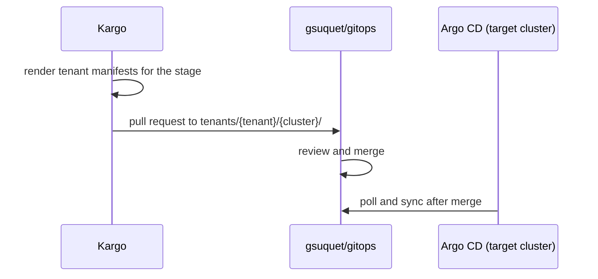

# RFC 0008: Promote tenant releases with Kargo git-only steps

## Summary

Kargo promotes tenant releases between stages by rendering manifests and opening a pull request to
`gsuquet/gitops`. It never drives Argo CD directly: Argo CD syncs from Git after the merge.

## Context

- A tenant release moves through stages, for example kind, then Talos, then GKE.
- Kargo promotes by writing to Git, or by driving Argo CD directly (`argocd-update` step).
- Git is the only source of desired state (RFC 0005).

## Goals and non-goals

Goals:

- Every promotion is a reviewable change in `gsuquet/gitops`.
- Kargo needs no write access to any Argo CD.

Non-goals:

- Where Kargo runs and its stage layout: RFC 0021.
- The `argocd-update` step.

## Decision drivers

- Git stays the only source of desired state; Argo CD syncs from Git without external triggers.
- Every promotion is a reviewable change in `gsuquet/gitops`.

## Options considered

### Kargo with git-only promotion steps

Render, then a pull request to `gsuquet/gitops`.

- Good: Git stays the only source of desired state, with an audit trail.
- Bad: slower feedback.

### Kargo with the argocd-update step

- Good: immediate sync and health feedback.
- Bad: Kargo needs Argo CD credentials on every cluster (Git as only source).

### Manual pull requests, no promotion tool

- Good: no tool.
- Bad: stage ordering and verification are manual.

### Do nothing

Tenants commit to every cluster folder at once.

- Good: nothing to run.
- Bad: no stages: a broken release reaches every cluster.

## Proposal

Git-only promotion: Kargo writes Git, Argo CD reads Git.

| Rule | Value |
| --- | --- |
| Steps | git steps only (clone, commit, push, open pull request); exact step names checked against the Kargo docs at implementation |
| Forbidden | `argocd-update` in any `Stage` |
| Kargo itself | opt-in component, not baseline (RFC 0014) |

## Operational impact

- Blast radius: one tenant stage per promotion.
- Rollout: enable Kargo where it runs, then define stages per tenant.
- Rollback: revert the promotion commit in `gsuquet/gitops`.
- Migration: None: no tenant exists yet.
- Security: Kargo holds Git write credentials for `gsuquet/gitops` only, no Argo CD credentials.
- Cost: N/A: Kargo runs on an existing cluster.
- Observability: Kargo promotion status and the Argo CD health of the target `Application`; health verification cannot use `argocd-update` feedback.

## Drawbacks and risks

- Promotion latency includes the pull request merge and the Argo CD sync interval -> acceptable for tenant releases.
- Kargo health verification cannot rely on the `argocd-update` step's feedback -> verify through Argo CD health status.
- Unverified: the exact names of the git promotion steps (`git-clone`, `git-commit`, `git-push`, `git-open-pr`, ...) -> check the Kargo documentation when implementing.

## Open questions

None.

## Decision

- Status: accepted on 2026-11-18 by gsuquet
- Decision: In the context of promoting tenant releases through stages (for example kind, then Talos, then GKE), facing Kargo's choice between Git writes and driving Argo CD, we decided for Kargo with git-only promotion steps (render the tenant manifests for the target stage, open a pull request to `gsuquet/gitops` under `tenants/<tenant>/<cluster>/`, Argo CD syncs after the merge; Kargo is an opt-in component), and against the `argocd-update` step and manual pull requests, to achieve Git as the only source of desired state with every promotion reviewable, accepting promotion latency of a merge plus a sync interval.
- Consequences:
  - Good: each promotion is a commit with a diff.
  - Good: Kargo needs no write access to any Argo CD.
  - Bad: promotion latency includes the pull request merge and the Argo CD sync interval.
  - Bad: Kargo health verification cannot rely on the `argocd-update` step's feedback.
  - Bad: the exact git step names are unverified until checked against the Kargo documentation at implementation.
  - Bad: deferred: where Kargo itself runs and the stage layout (RFC 0021).
- Confidence: medium, the git step names and the stage layout are not verified yet.
- Confirmation: no Kargo `Stage` in `infra` or `gsuquet/gitops` uses an `argocd-update` step.
- Revisit when: promotion latency blocks releases, or RFC 0021 (Kargo tenant promotion) is accepted.

## Implementation

N/A: Kargo is not deployed yet.

## References

- RFC 0021: Kargo tenant promotion (https://github.com/gsuquet/infra/pull/8)

## Future work

- The `argocd-update` step.
- Where Kargo itself runs.
