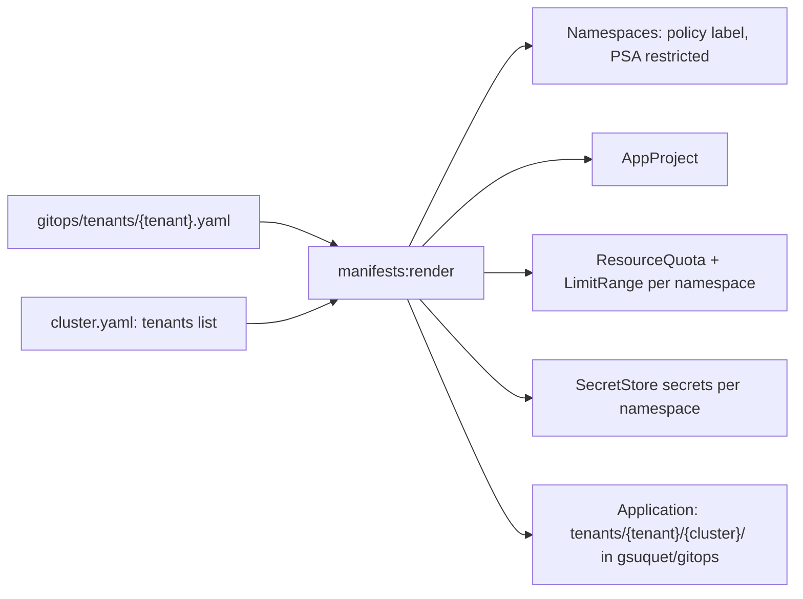

# RFC 0009: Onboard tenants from infra with tenant files

## Summary

A tenant is declared in `gitops/tenants/<tenant>.yaml` and listed in each `cluster.yaml` where it runs. The render
produces its namespaces, Argo CD project, quotas, secret store and `Application`. Tenants own only their
workloads.

## Context

- A tenant needs namespaces, permissions, quotas and an Argo CD `Application` on each cluster where it runs.
- Tenant workloads share hardware, including Raspberry Pis.
- A tenant that can create cluster-scoped resources or network policies can escape isolation.

## Goals and non-goals

Goals:

- Declarative, reviewed onboarding from one template.
- A tenant cannot escape its namespaces or open network paths.

Non-goals:

- The format of tenant network allow rules (not designed yet).
- Self-service onboarding.

## Decision drivers

- The platform owns cluster-scoped resources and isolation; tenants own only their workloads.
- Onboarding is declarative and reviewed.

## Options considered

### Tenant file plus a tenant list in cluster.yaml, rendered by infra

- Good: every isolation rule comes from one template.
- Bad: the platform owner is in the loop for every tenant change.

### Tenants create their own namespaces and projects

- Good: fast.
- Bad: tenants need cluster-scoped permissions (platform owns isolation).

### A self-service operator

- Good: scales.
- Bad: one more controller to build and run for few tenants.

### Do nothing

Namespaces created by hand per tenant.

- Good: no tooling.
- Bad: not declarative, not reviewed, isolation by memory.

## Proposal

Per tenant listed by a cluster, the render produces five kinds of resources.

| Resource | Rule |
| --- | --- |
| `Namespace` | network policy label (RFC 0010); `pod-security.kubernetes.io/enforce: restricted` |
| `AppProject` | `sourceRepos` only `gsuquet/gitops`; destinations only the tenant namespaces; empty `clusterResourceWhitelist`; `namespaceResourceBlacklist`: `NetworkPolicy`, `CiliumNetworkPolicy` |
| `ResourceQuota`, `LimitRange` | one each per namespace |
| `SecretStore` `secrets` | one per namespace (RFC 0016) |
| `Application` | `tenants/<tenant>/<cluster>/` in `gsuquet/gitops` |

Pod Security: a tenant file may lower its namespaces to `baseline` only through an `infra` pull request, never to
`privileged`.

## Operational impact

- Blast radius: one tenant per tenant file; a template change reaches every tenant on every cluster.
- Rollout: tenant file, then the tenant in each `cluster.yaml`, then render.
- Rollback: revert the commit; Argo CD restores the previous onboarding (pruning a namespace deletes its workloads).
- Migration: None: no tenant exists yet.
- Security: RBAC boundary: tenants get no cluster-scoped resources and no network policies; `restricted` rejects privileged, `hostNetwork`, `hostPID` and `hostPath` pods.
- Cost: N/A: quotas bound tenant usage on existing nodes.
- Observability: Conftest on `rendered/` fails a non-compliant `AppProject` or `Namespace`; quota usage per namespace.

## Drawbacks and risks

- Tenants cannot add their own network allows: any allow (ingress from a Gateway, egress to a database) is declared by the platform, likely in the tenant file -> the format is future work.
- `restricted` rejects images that run as root or need extra capabilities -> tenants build for it; `baseline` only through an `infra` pull request.
- Every new tenant or quota change is an `infra` pull request -> acceptable for few tenants.
- The blacklist does not list `SecretStore`: a tenant could ship its own store named `secrets` and fight the platform one (RFC 0016) -> adding `SecretStore` to the blacklist waits for the owner's decision, because it extends the settled blacklist.

## Open questions

None.

## Decision

- Status: accepted on 2026-11-18 by gsuquet
- Decision: In the context of onboarding tenants onto shared clusters, facing tenants escaping their namespaces or opening network paths, we decided for `gitops/tenants/<tenant>.yaml` plus a tenant list in each `cluster.yaml`, rendered by `infra` into, per tenant: namespaces with the network policy label and `pod-security.kubernetes.io/enforce: restricted` (lowered to `baseline` only through an `infra` pull request, never `privileged`); an `AppProject` with `sourceRepos` only `gsuquet/gitops`, destinations only the tenant namespaces, an empty `clusterResourceWhitelist` and `NetworkPolicy` and `CiliumNetworkPolicy` in `namespaceResourceBlacklist`; a `ResourceQuota` and a `LimitRange` per namespace; the `SecretStore` `secrets` per namespace; and an `Application` on `tenants/<tenant>/<cluster>/` in `gsuquet/gitops`, and against tenant-created namespaces and a self-service operator, to achieve isolation from one reviewed template, accepting an `infra` pull request for every tenant change.
- Consequences:
  - Good: a tenant cannot create cluster-scoped resources or network policies, and `restricted` rejects privileged, `hostNetwork`, `hostPID` and `hostPath` pods that would reach the node or sit outside the endpoint default deny.
  - Good: quotas protect shared hardware such as Raspberry Pis.
  - Bad: `restricted` rejects images that run as root or need extra capabilities: tenants build for it.
  - Bad: tenants cannot add network allows: the platform declares them, likely in the tenant file, in a format not designed yet.
  - Bad: every new tenant or quota change is an `infra` pull request.
  - Bad: `SecretStore` is not in the blacklist: a tenant could ship a store named `secrets` and fight the platform one; the fix waits for the owner's decision.
- Confidence: high, isolation relies on Argo CD project limits and Pod Security Admission, both enforced by the cluster.
- Confirmation: Conftest policies on `rendered/` check each tenant `AppProject` for the source, destination and blacklist rules (on `main`); still to add: a rule that fails any `Namespace` without a `pod-security.kubernetes.io/enforce` label (except `kube-system`) or any tenant namespace at `privileged`.
- Revisit when: the number of tenants makes `infra` pull requests a bottleneck, or a tenant needs its own network allows.

## Implementation

- 2026-11-19 https://github.com/gsuquet/infra/pull/12

## References

- [Argo CD projects](https://argo-cd.readthedocs.io/en/stable/user-guide/projects/)

## Future work

- Tenant network allow rule format (ingress from a Gateway, egress to external services).
- `SecretStore` in the tenant `namespaceResourceBlacklist`, pending the owner's decision.
- The Conftest rule for the Pod Security label.
