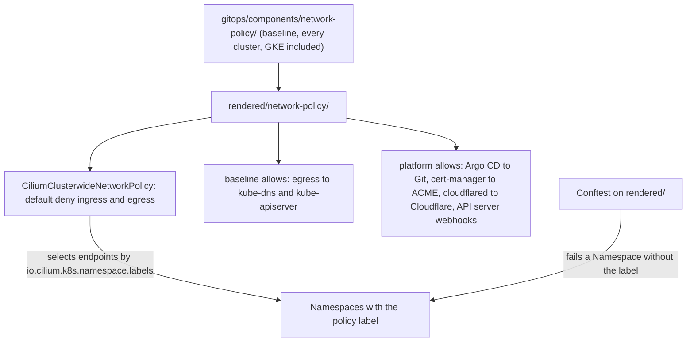

# RFC 0010: Enforce a label-selected default deny network policy

## Summary

One `CiliumClusterwideNetworkPolicy` denies ingress and egress by default for every endpoint in a namespace that
carries the policy label, and Conftest fails any rendered namespace without that label. Amended on 2026-11-19:
the default deny and the platform network policies live in a baseline catalog component, `network-policy`, on
every cluster including GKE, instead of a render-emitted policy layer.

## Context

- Namespaces are created by the platform and by tenant onboarding (RFC 0009).
- Without a policy, every pod reaches every other pod.
- Isolation cannot depend on each chart or tenant shipping its own policy.
- The first version had the render emit the policy into a non-component cluster layer, `rendered/platform/`.
  A catalog component gets the same pinned source, render, schema and review path as every other component.

## Goals and non-goals

Goals:

- Default deny for platform and tenant namespaces alike, on every cluster.
- A namespace that escapes the policy fails CI.
- One component owns the default deny and the platform network policies.

Non-goals:

- The tenant allow rule format.
- A runtime admission check for namespaces created outside Git.

## Decision drivers

- Default deny, for platform and tenant namespaces alike.
- Isolation does not depend on each chart or tenant shipping its own policy.
- A namespace that escapes the policy fails CI, not later.

## Options considered

### Cluster-wide Cilium policy selected by a namespace label, in a baseline component

One `CiliumClusterwideNetworkPolicy`, rendered by the `network-policy` component, checked by Conftest.

- Good: one object enforced by the CNI covers every labelled namespace, present and future.
- Bad: Cilium-specific; GKE support needs checking.

### Kubernetes NetworkPolicy default deny rendered into each namespace

- Good: portable across CNIs, including GKE.
- Bad: one copy per namespace, and the rendered set must stay complete.

### Policies owned by each component or tenant

- Good: the owner knows the flows.
- Bad: default deny depends on every owner remembering it.

### Do nothing

No network policy.

- Good: nothing breaks on missing allow rules.
- Bad: every pod reaches every other pod.

## Proposal

The component owns every platform policy; the label decides what is covered.

| Rule | Value |
| --- | --- |
| Policy label | `network.infra.gsuquet.com/policy: default-deny` on every rendered `Namespace`, platform and tenant |
| Exempt | `kube-system`: no label |
| Pod Security | every labelled namespace also carries `pod-security.kubernetes.io/enforce`: `restricted` for tenants (RFC 0009), `baseline` by default for platform namespaces, `privileged` only by explicit opt-down for host access (for example Cilium outside `kube-system`) |
| Namespaces | exist as rendered `Namespace` manifests; components that create namespaces at runtime are configured not to, or their namespaces are pre-rendered with the label |
| Tenants | cannot create `NetworkPolicy` or `CiliumNetworkPolicy` (RFC 0009) |
| Render cluster layer | `rendered/platform/` keeps platform `Namespace` manifests and tenant onboarding, no network policy |

## Operational impact

- Blast radius: every cluster: a missing allow rule blocks a platform component or tenant flow cluster-wide.
- Rollout: kind first, with each platform component's allow rules, then Talos, then GKE.
- Rollback: revert the `network-policy` change; removing the default deny opens all traffic, so prefer adding the missing allow.
- Migration: None: no cluster runs the policy layer yet; the move from `rendered/platform/` to `rendered/network-policy/` happens before any cluster exists.
- Security: network trust boundary: default deny for every labelled namespace; `hostNetwork` pods share the node identity and are not covered.
- Cost: N/A: policy objects only.
- Observability: Conftest fails a rendered `Namespace` without the label; Cilium policy verdicts (Hubble drops) show denied flows.

## Drawbacks and risks

- Every platform component needs explicit allow rules (Argo CD to Git, cert-manager to ACME, cloudflared to Cloudflare, webhooks from the API server) -> written in the `network-policy` component.
- The label selector fails open: a namespace created at runtime (Argo CD `CreateNamespace=true`, a chart or operator, Kargo `Project` namespaces) skips Conftest and has no default deny -> namespaces are rendered manifests; a runtime admission check is future work.
- Endpoint policies do not cover `hostNetwork` pods -> Pod Security labels keep tenants off the host network; platform components that need it (Cilium) are reviewed per component.
- Unverified: GKE Dataplane V2 support for `CiliumClusterwideNetworkPolicy` with namespace-label selectors (the GKE study, pull request #7, reports it as opt-in with limits: no L7, no node selectors) -> if unsupported, `network-policy` renders a Kubernetes `NetworkPolicy` default deny per labelled namespace on GKE, decided in its own RFC.

## Open questions

None.

## Decision

- Status: accepted on 2026-11-18 by gsuquet, amended on 2026-11-19
- Decision: In the context of isolating platform and tenant namespaces on every cluster, facing isolation that depends on each chart or tenant shipping a policy, we decided for a baseline catalog component `network-policy` on every cluster, GKE included, that renders one `CiliumClusterwideNetworkPolicy` denying ingress and egress for every endpoint in a namespace labelled `network.infra.gsuquet.com/policy: default-deny` (selected through `io.cilium.k8s.namespace.labels`), the baseline allows (egress to kube-dns and to the `kube-apiserver` entity) and the allow rules of platform components, with Conftest failing any rendered `Namespace` without the label except `kube-system`, and against a render-emitted policy layer, a Kubernetes `NetworkPolicy` per namespace and policies owned by each component or tenant, to achieve default deny that a missing namespace label turns into a CI failure, accepting explicit allow rules for every platform flow and a Cilium-specific policy.
- Consequences:
  - Good: one policy covers every labelled namespace, present and future; the label check turns a missing policy into a CI failure.
  - Good: the default deny and the platform policies are versioned, rendered and reviewed like any catalog component.
  - Bad: every platform flow (Argo CD to Git, cert-manager to ACME, cloudflared to Cloudflare, API server webhooks) needs an allow rule in `network-policy`.
  - Bad: the label selector fails open for namespaces created at runtime (Argo CD `CreateNamespace=true`, charts, operators, Kargo `Project` namespaces): every namespace must be a rendered `Namespace` with the label.
  - Bad: `hostNetwork` pods share the node identity and escape endpoint policies; Pod Security keeps tenants off the host network.
  - Bad: GKE Dataplane V2 support for this policy is unverified; the fallback is a Kubernetes `NetworkPolicy` default deny per labelled namespace, in its own RFC.
- Confidence: medium, the GKE support of `CiliumClusterwideNetworkPolicy` with namespace-label selectors is not verified.
- Confirmation: Conftest on `gitops/clusters/*/rendered/**`: each `Namespace` except `kube-system` has the policy label and a Pod Security label; every cluster, GKE included, renders the default deny in `rendered/network-policy/`; a baseline check fails a `cluster.yaml` without `network-policy`.
- Revisit when: GKE Dataplane V2 rejects the policy, or Kubernetes `ClusterNetworkPolicy` becomes available on every target.

## Implementation

- 2026-11-19 https://github.com/gsuquet/infra/pull/12

## References

- [Cilium policy language](https://docs.cilium.io/en/stable/security/policy/language/)
- RFC 0024: GKE (https://github.com/gsuquet/infra/pull/7)

## Future work

- A runtime admission check (a `ValidatingAdmissionPolicy` rejecting any `Namespace` created without the policy and Pod Security labels) to close the fail-open gap.
- The allow rule format for tenants (ingress from a Gateway, egress to external services).
