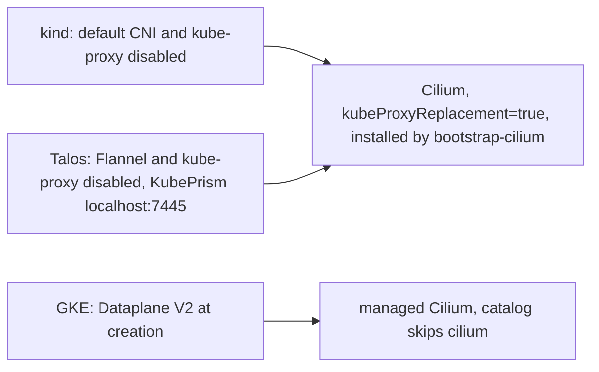

# RFC 0011: Use Cilium on kind and Talos, Dataplane V2 on GKE

## Summary

kind and Talos clusters run Cilium with kube-proxy replacement, installed by the bootstrap. GKE clusters run GKE
Dataplane V2, its managed Cilium, and the catalog skips `cilium` there.

## Context

- Each distribution ships a default CNI: kindnet on kind, Flannel on Talos, GKE's own dataplane.
- The network policy model (RFC 0010) and Gateway API (RFC 0012) need a capable dataplane.
- Local tests on kind should match the hardware clusters.

## Goals and non-goals

Goals:

- Same CNI and policy semantics on kind and Talos.
- No kube-proxy: eBPF kube-proxy replacement.
- No CNI to operate on the managed cloud.

Non-goals:

- Load balancer IP allocation for Gateways: decided in the `cilium` component (RFC 0012).

## Decision drivers

- Same CNI and policy semantics on kind and Talos, so local tests match the hardware clusters.
- No CNI to operate on the managed cloud.
- eBPF kube-proxy replacement to drop kube-proxy.

## Options considered

### Cilium on kind and Talos, Dataplane V2 on GKE

- Good: best fit per target (same semantics on kind and Talos, managed on GKE).
- Bad: two dataplanes to reason about.

### Cilium everywhere, including a self-installed Cilium on GKE

- Good: one dataplane.
- Bad: unsupported by Google and maintained here (no CNI to operate on cloud).

### Distribution default CNIs

- Good: nothing to install.
- Bad: no `CiliumClusterwideNetworkPolicy`, no kube-proxy replacement, and kindnet differs from Talos.

### Do nothing

Same as distribution defaults: the cluster comes up with its default CNI.

- Good: no work.
- Bad: the policy model of RFC 0010 cannot run.

## Proposal

Two dataplanes: Cilium where the repository installs it, Dataplane V2 where Google runs it.

| Target | Settings |
| --- | --- |
| kind | default CNI and kube-proxy disabled in the kind config; Cilium installed by the bootstrap |
| Talos | Flannel and kube-proxy disabled in the machine config; Cilium `kubeProxyReplacement=true`, API server at KubePrism `localhost:7445`, Talos-specific cgroup settings |
| Talos before 1.14 | `cluster.network.cni.name: none` and `cluster.proxy.disabled: true` |
| Talos 1.14 and later | separate config documents |
| GKE | Dataplane V2 enabled at cluster creation; `cilium` absent from `cluster.yaml` |

## Operational impact

- Blast radius: every kind and Talos cluster: a node stays `NotReady` until Cilium runs.
- Rollout: Cilium installed by IaC before Argo CD (RFC 0015), then adopted by Argo CD.
- Rollback: revert the Cilium version in the catalog; changing CNI on a running cluster needs a rebuild and downtime.
- Migration: None: no cluster exists yet; a later CNI change means rebuilding the cluster.
- Security: Cilium enforces the network trust boundary (RFC 0010); on GKE Google runs the dataplane.
- Cost: N/A: no extra nodes; Dataplane V2 has no separate charge here.
- Observability: Cilium agent health and Hubble flows on kind and Talos; GKE dataplane metrics on GKE.

## Drawbacks and risks

- A Talos or kind node stays `NotReady` until Cilium runs -> Cilium is installed by IaC before Argo CD (RFC 0015).
- Dataplane V2 is a managed Cilium with a restricted feature set: Cilium-specific features, possibly `CiliumClusterwideNetworkPolicy` (RFC 0010), may differ on GKE; not verified -> checked in RFC 0024.
- The Talos machine config patch differs by Talos version -> the `cluster-talos` module handles both forms.

## Open questions

None.

## Decision

- Status: accepted on 2026-11-18 by gsuquet
- Decision: In the context of choosing a CNI per target for the network policy model and Gateway API, facing different default CNIs per distribution, we decided for Cilium with `kubeProxyReplacement=true` on kind (default CNI and kube-proxy disabled in the kind config) and Talos (Flannel and kube-proxy disabled in the machine config: `cluster.network.cni.name: none` and `cluster.proxy.disabled: true` before Talos 1.14, separate config documents from 1.14; API server at KubePrism `localhost:7445`; Talos cgroup settings), installed by IaC before Argo CD, and for GKE Dataplane V2 enabled at creation with `cilium` skipped on GKE, and against a self-installed Cilium on GKE and the distribution default CNIs, to achieve the same dataplane on kind and Talos and no CNI to operate in the cloud, accepting two dataplanes to reason about.
- Consequences:
  - Good: kind reproduces the Talos dataplane.
  - Good: GKE needs no CNI upgrades from this repository.
  - Bad: a Talos or kind node stays `NotReady` until Cilium runs: Cilium is installed by IaC before Argo CD.
  - Bad: Dataplane V2 has a restricted Cilium feature set; Cilium-specific features, possibly `CiliumClusterwideNetworkPolicy`, may differ on GKE (unverified).
  - Bad: the Talos machine config patch differs by Talos version.
- Confidence: medium, Dataplane V2 feature parity with Cilium is not verified.
- Confirmation: `cluster.yaml` of every GKE cluster omits `cilium`; every kind and Talos cluster lists it; a schema or policy check enforces it once `cluster.yaml` has a distribution field.
- Revisit when: Dataplane V2 lacks a feature the catalog needs, or Talos changes its CNI configuration again.

## Implementation

N/A: the `cilium` component does not exist yet.

## References

- [Deploying Cilium on Talos](https://docs.siderolabs.com/kubernetes-guides/cni/deploying-cilium)
- [Cilium kube-proxy replacement](https://docs.cilium.io/en/stable/network/kubernetes/kubeproxy-free/)
- RFC 0024: GKE (https://github.com/gsuquet/infra/pull/7)

## Future work

N/A: no follow-up raised.
