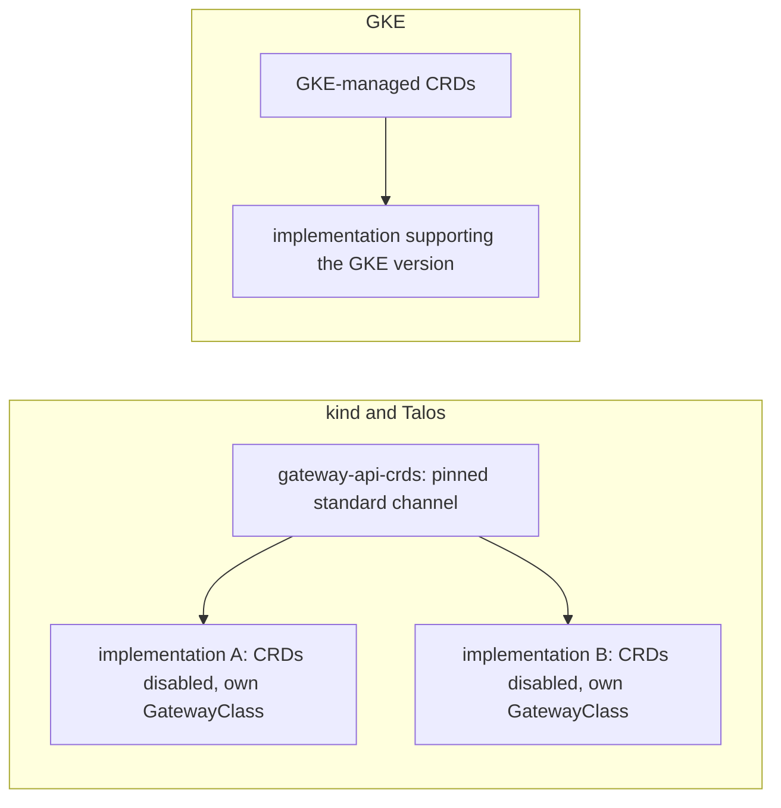

# RFC 0012: Give Gateway API CRDs one owner per cluster

<!-- readability: allow-code L2 -->

## Summary

North-south traffic uses Gateway API. A dedicated `gateway-api-crds` component owns the CRDs on kind and Talos,
GKE owns them on GKE, and every implementation is installed without its bundled CRDs and owns one
`GatewayClass`, so implementations can be swapped or combined per cluster.

| Decision | Why | Cost | Reversible |
| --- | --- | --- | --- |
| Give the CRDs one owner on kind and Talos: the baseline `gateway-api-crds` component at one pinned version | Charts that bundle the CRDs fight on version and sync | A version check per implementation on every CRD upgrade | no, never remove the CRDs while routes exist (deleting them is irreversible for the routes) |
| Let GKE own the CRDs on GKE | GKE installs and manages them itself | The CRD version follows Google's schedule, not the pin | not stated, see the [open point](https://github.com/gsuquet/infra/pull/18) |
| Install each implementation without CRDs, with exactly one `GatewayClass` | Implementations can be swapped or combined | Each chart needs an option to disable bundled CRDs | yes, switching implementation keeps CRDs and routes |

## Context

- Several Gateway API implementations exist (Cilium, Envoy Gateway, agentgateway, ...).
- Many charts bundle their own copy of the Gateway API CRDs; two owners of the same CRDs fight on version and
  on Argo CD sync.
- Cilium's Gateway API support needs the CRDs before the Cilium operator starts.
- GKE installs and manages standard-channel Gateway API CRDs itself when its Gateway API is enabled, always on
  Autopilot.

## Goals and non-goals

Goals:

- One owner and one version of each CRD per cluster.
- Replace or add an implementation without touching the CRDs.

Non-goals:

- The default implementation per cluster.
- Experimental-channel CRDs (`TCPRoute`, `UDPRoute`, ...).

## Decision drivers

- One owner and one version of each CRD per cluster.
- An implementation can be replaced or added without touching the CRDs.
- Cilium's Gateway API support needs the CRDs before the Cilium operator starts.

## Options considered

### Dedicated gateway-api-crds component

Implementations installed without bundled CRDs, one `GatewayClass` each.

- Good: single ownership; swapping implementations keeps CRDs and routes.
- Bad: each implementation's chart needs an option to disable bundled CRDs.

### Let the chosen implementation install the CRDs

- Good: simplest for one implementation.
- Bad: two implementations conflict (one owner).

### Ingress API instead of Gateway API

- Good: universal.
- Bad: frozen API with annotation-based extensions.

### Do nothing

Each chart installs whatever CRDs it bundles.

- Good: no work.
- Bad: CRD version fights between charts and on Argo CD sync.

## Proposal

One CRD owner per cluster; implementations only consume the CRDs.

| Rule | Value |
| --- | --- |
| CRD owner, kind and Talos | `gateway-api-crds`, baseline, one pinned upstream version, installed by `bootstrap-gateway-api` before Cilium (RFC 0015), then adopted by Argo CD |
| Required CRDs | every CRD the enabled implementations need; Cilium needs `GatewayClass`, `Gateway`, `HTTPRoute`, `GRPCRoute`, `BackendTLSPolicy`, `ReferenceGrant`, `TLSRoute` (standard channel) |
| CRD owner, GKE | GKE; `gateway-api-crds` skipped and `bootstrap-gateway-api` not called; implementations support the GKE-installed version |
| Implementations | CRD installation disabled; exactly one `GatewayClass` each; chosen per cluster in `cluster.yaml`; several may coexist |
| Load balancers | Cilium creates a `LoadBalancer` `Service` per `Gateway`; kind and Talos have no provider: Cilium LB-IPAM with L2 announcements (LAN addresses) or Gateway API host network mode, chosen in the `cilium` component |
| Public traffic | only through Cloudflare Tunnel (RFC 0013) |

## Operational impact

- Blast radius: every route of a cluster: deleting the CRDs deletes every `Gateway` and route.
- Rollout: bump the pinned CRD version in one pull request after checking each enabled implementation supports it.
- Rollback: revert the version bump; never remove the CRDs while routes exist (deleting them is irreversible for the routes).
- Migration: None: no cluster exists yet; switching implementation keeps CRDs and routes.
- Security: N/A: CRD ownership changes no trust boundary; exposure rules are RFC 0013.
- Cost: N/A: no infrastructure.
- Observability: Conftest fails Gateway API CRDs rendered outside `rendered/gateway-api-crds/`; `Gateway` and route status conditions show an unsupported version.

## Drawbacks and risks

| Risk | Severity (proposed) | Mitigation |
| --- | --- | --- |
| Each implementation's supported Gateway API version must be checked against the pinned CRDs on upgrade | medium | one CRD bump pull request per upgrade. |
| On GKE the CRD version follows Google's schedule, not the pin | medium | GKE implementations must support it. |
| kind and Talos have no load balancer provider for the per-`Gateway` `LoadBalancer` `Service` | medium | LB-IPAM with L2 announcements or host network mode, chosen in the `cilium` component. |
| The CRDs are installed by IaC at bootstrap, then adopted by Argo CD | low | same rendered files (RFC 0015). |

## Open questions

None.

## Decision

- Status: accepted on 2026-11-18 by gsuquet
- Context: Gateway API for north-south traffic with several possible implementations, facing charts that bundle and fight over the same CRDs.
- Decision: we decided for one CRD owner per cluster: the baseline `gateway-api-crds` component on kind and Talos (upstream standard-channel CRDs at one pinned version, including every CRD the enabled implementations need, for Cilium `GatewayClass`, `Gateway`, `HTTPRoute`, `GRPCRoute`, `BackendTLSPolicy`, `ReferenceGrant` and `TLSRoute`) and GKE itself on GKE (`gateway-api-crds` skipped, `bootstrap-gateway-api` not called), with every implementation installed with CRD installation disabled, owning exactly one `GatewayClass`, chosen per cluster in `cluster.yaml` and allowed to coexist, and against implementation-installed CRDs and the Ingress API, to achieve one CRD version per cluster and swappable implementations, accepting a version check per implementation on every CRD upgrade.
- Consequences:
  - Good: CRD upgrades are one explicit pull request; switching implementation keeps the CRDs and the routes.
  - Bad: each implementation's supported Gateway API version is checked against the pinned CRDs on upgrade.
  - Bad: the CRDs are installed by IaC at bootstrap before Cilium, then adopted by Argo CD.
  - Bad: on GKE the CRD version follows Google's schedule, not the pin.
  - Bad: deferred: the default implementation per cluster, and experimental-channel CRDs (`TCPRoute`, `UDPRoute`).
  - Bad: Cilium creates a `LoadBalancer` `Service` per `Gateway` and kind and Talos have no provider: Cilium LB-IPAM with L2 announcements (LAN addresses) or Gateway API host network mode, chosen in the `cilium` component; public traffic still enters only through Cloudflare Tunnel.
- Confidence: high, single CRD ownership is the documented way to run several implementations.
- Confirmation: a Conftest policy fails any Gateway API `CustomResourceDefinition` rendered outside `rendered/gateway-api-crds/`, and any GKE cluster that renders `gateway-api-crds`.
- Revisit when: an implementation needs experimental-channel CRDs, or GKE stops managing the CRDs.

## Implementation

- 2026-11-19 https://github.com/gsuquet/infra/pull/12

## References

- [Gateway API](https://gateway-api.sigs.k8s.io/)
- [Deploying Gateways on GKE](https://docs.cloud.google.com/kubernetes-engine/docs/how-to/deploying-gateways)
- [Cilium Gateway API support](https://docs.cilium.io/en/stable/network/servicemesh/gateway-api/gateway-api/)

## Future work

- The default implementation per cluster.
- Experimental-channel CRDs (`TCPRoute`, `UDPRoute`).
