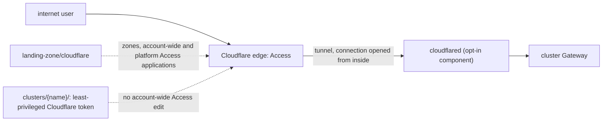

# RFC 0013: Expose public services through Cloudflare Tunnel

## Summary

Public services reach the internet only through Cloudflare Tunnel: an opt-in `cloudflared` component connects
outbound to Cloudflare and forwards to the cluster's Gateway. Amended on 2026-11-19: a cluster root's Cloudflare
token is least-privileged, and account-wide and platform Access applications stay in `landing-zone/cloudflare`.

| Decision | Why | Cost | Reversible |
| --- | --- | --- | --- |
| Expose public services only through Cloudflare Tunnel, with an opt-in `cloudflared` component | No inbound port, and one model for every target | Cloudflare is the only public edge | yes, disable `cloudflared` in `cluster.yaml`; services stay reachable on the LAN |
| Give a cluster root a least-privileged Cloudflare token, with no account-wide Access edit | A leaked token cannot change account-wide Access | not stated, see the [open point](https://github.com/gsuquet/infra/pull/18) | not stated, see the [open point](https://github.com/gsuquet/infra/pull/18) |
| Keep account-wide and platform Access applications in `landing-zone/cloudflare` | Domains and Access policies are already managed there | not stated, see the [open point](https://github.com/gsuquet/infra/pull/18) | not stated, see the [open point](https://github.com/gsuquet/infra/pull/18) |

## Context

- Raspberry Pis and local servers sit behind a home connection with no stable public IP and no inbound port.
- Domains are already on Cloudflare, managed by `landing-zone/cloudflare`, with Access policies.
- One exposure model should cover every target.
- A cluster root holding an account-wide Cloudflare token could edit every Access application of the account.

## Goals and non-goals

Goals:

- No inbound port on the home network.
- One exposure model for every target.
- Cloudflare Access in front of private applications.
- A leaked cluster-root token cannot change account-wide Access.

Non-goals:

- Tunnel and DNS record layout and token delivery details: RFC 0026.
- Network allow rules for `cloudflared` egress: RFC 0010.

## Decision drivers

- No inbound port on the home network.
- One exposure model for every target.
- Access policies in front of private applications.

## Options considered

### Cloudflare Tunnel via a cloudflared component

- Good: no inbound port, works behind NAT and CGNAT, same model on every target.
- Bad: vendor lock-in for the public edge.

### Public load balancer per cluster (cloud) and port forwarding (home)

- Good: no third party.
- Bad: exposes the home IP and differs per target.

### A VPN or overlay network only

- Good: private by default.
- Bad: not public.

### Do nothing

No public exposure.

- Good: no attack surface.
- Bad: no public service.

## Proposal

Only outbound connections; Access ownership stays in the landing zone.

| Rule | Value |
| --- | --- |
| Public entry | only `cloudflared`; no `Service` or `Gateway` on a public IP without an RFC |
| Private addresses | `LoadBalancer` Services on LAN addresses (Cilium LB-IPAM, RFC 0012) allowed |
| Tunnel token | secret, delivered through the `secrets` store (RFC 0016), never committed |
| Cluster root token | least-privileged: no account-wide Access edit |
| Access applications | account-wide and platform Access applications stay in `landing-zone/cloudflare` |

## Operational impact

- Blast radius: public traffic of one cluster per tunnel; a Cloudflare outage stops all public traffic.
- Rollout: enable `cloudflared` per cluster, deliver its token through the `secrets` store, route to the Gateway.
- Rollback: disable `cloudflared` in `cluster.yaml`; services stay reachable on the LAN.
- Migration: None: no cluster exposes services yet; `olympus` moves with the cut-over RFC.
- Security: no inbound port; the tunnel token is a secret in the backend; the cluster root token cannot edit account-wide Access.
- Cost: N/A: Cloudflare Tunnel on the existing account.
- Observability: `cloudflared` connection metrics and the tunnel health in Cloudflare.

## Drawbacks and risks

| Risk | Severity (proposed) | Mitigation |
| --- | --- | --- |
| An account-wide token in a cluster root would widen the blast radius of a leak to every Access application | high | least-privileged cluster-root token; Access applications stay in the landing zone. |
| Public traffic depends on Cloudflare | medium | accepted for the public edge. |
| The tunnel token is a secret | medium | delivered through the `secrets` store (RFC 0016), never committed. |

## Open questions

None.

## Decision

- Status: accepted on 2026-11-18 by gsuquet
- Context: exposing services from clusters behind a home connection with no public IP and from the cloud, facing inbound ports and one model per target.
- Decision: we decided for Cloudflare Tunnel through an opt-in `cloudflared` component that connects outbound to Cloudflare and forwards to the cluster's Gateway (tunnel token delivered through the `secrets` store, never committed; a cluster root's Cloudflare token least-privileged, with no account-wide Access edit; account-wide and platform Access applications kept in `landing-zone/cloudflare`), and against a public load balancer with port forwarding and a VPN only, to achieve public services with no inbound port behind Access, accepting Cloudflare as the only public edge.
- Consequences:
  - Good: no inbound port and no public IP needed.
  - Good: Access applications and policies from the landing zone apply in front of the tunnel.
  - Good: amended 2026-11-19: a cluster root's Cloudflare token is least-privileged, so a leaked one cannot change account-wide Access; account-wide and platform Access applications stay in `landing-zone/cloudflare`.
  - Bad: public traffic depends on Cloudflare.
  - Bad: the tunnel token is a secret to deliver through the `secrets` store.
  - Bad: deferred: whether tunnels and DNS records come from a per-cluster IaC root or the tenant layer (RFC 0026), and the `cloudflared` egress allow rules (RFC 0010).
- Confidence: high, the tunnel model already runs for `olympus` in `homelab`.
- Confirmation: no cluster exposes a `Service` or `Gateway` on a public IP without an RFC; `LoadBalancer` Services with private addresses (Cilium LB-IPAM on the LAN) are allowed; no cluster root token has account-wide Access edit permission.
- Revisit when: Cloudflare pricing or terms change for tunnels, or a service needs a non-HTTP public protocol the tunnel does not carry.

## Implementation

N/A: the `cloudflared` component does not exist yet.

## References

- RFC 0026: Cloudflare Tunnel (https://github.com/gsuquet/infra/pull/10)

## Future work

- Whether tunnels and DNS records are created by a per-cluster IaC root or by the tenant layer (RFC 0026).
- Network allow rules for `cloudflared` egress (RFC 0010).
