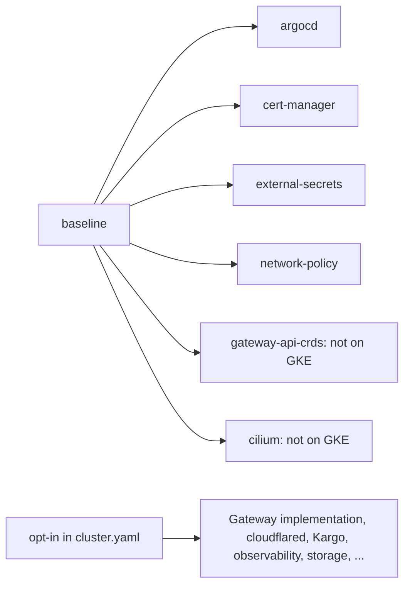

# RFC 0014: Install a fixed baseline of components on every cluster

## Summary

Every cluster runs a small fixed set of catalog components; everything else is opt-in in `cluster.yaml`. Amended on
2026-11-19: `network-policy` joins the baseline on every cluster, GKE included.

| Decision | Why | Cost | Reversible |
| --- | --- | --- | --- |
| Install `argocd`, `cert-manager`, `external-secrets` and `network-policy` on every cluster, GKE included, and `gateway-api-crds` and `cilium` except on GKE | Other components and tenants rely on baseline APIs and default deny | The list is a rule the render or a schema must enforce | yes, revert the component version; a baseline component cannot be removed from a cluster |
| Make every other component opt-in in `cluster.yaml` | Small clusters run only what they need | A cluster serves no route until it enables a Gateway implementation | not stated, see the [open point](https://github.com/gsuquet/infra/pull/18) |

## Context

- The catalog (RFC 0006) can hold many components.
- Some are needed by everything else: CRDs, CNI, GitOps, certificates, secrets, network isolation.
- Small clusters (Raspberry Pis) should run only what they need.

## Goals and non-goals

Goals:

- Platform and tenant manifests can always rely on baseline APIs (`Gateway`, `Certificate`, `ExternalSecret`)
  and on default deny.
- Small clusters stay small.

Non-goals:

- The default Gateway implementation per cluster (RFC 0012).

## Decision drivers

- Other components and tenants rely on baseline APIs.
- Small clusters run only what they need.

## Options considered

### Small fixed baseline, everything else opt-in

- Good: predictable and light.
- Bad: useful defaults (metrics) are enabled per cluster.

### Large baseline on every cluster

Observability, ingress, policy engine, ...

- Good: uniform clusters.
- Bad: too heavy for Raspberry Pis.

### No baseline: each cluster lists everything

- Good: full freedom.
- Bad: nothing can be assumed by tenants.

### Do nothing

Same as no baseline.

- Good: no rule to enforce.
- Bad: tenants cannot rely on any API.

## Proposal

Baseline versus opt-in; GKE owns its CRDs and dataplane.

| Component | Every cluster | Source |
| --- | --- | --- |
| `gateway-api-crds` | yes, except GKE (GKE owns the CRDs) | RFC 0012 |
| `cilium` | yes, except GKE | RFC 0011 |
| `argocd` | yes | RFC 0004 |
| `cert-manager` | yes | |
| `external-secrets` | yes | RFC 0016 |
| `network-policy` | yes, GKE included | RFC 0010 |

Tenant onboarding and platform `Namespace` manifests: decided on 2026-11-18 as a render-emitted `rendered/platform/`
layer, not a catalog component (RFC 0010); unresolved, since the render on `main` passes `gitops.tenants` to a
`tenant` component instead.

## Operational impact

- Blast radius: every cluster: a broken baseline component affects every tenant on it.
- Rollout: baseline components are enabled at cluster creation; opt-in ones per pull request.
- Rollback: revert the component version; a baseline component cannot be removed from a cluster.
- Migration: None: no cluster exists yet.
- Security: `network-policy` and `external-secrets` are baseline, so default deny and the `secrets` store exist on every cluster.
- Cost: baseline footprint on every cluster, kept small for Raspberry Pis.
- Observability: the baseline check fails a `cluster.yaml` missing a baseline component; Argo CD health per component.

## Drawbacks and risks

| Risk | Severity (proposed) | Mitigation |
| --- | --- | --- |
| A Gateway implementation is opt-in: a cluster with Gateway API CRDs and no implementation serves no route | medium | enable one per cluster that serves traffic. |
| The baseline list is a rule the render or a schema must enforce | medium | schema or render check. |

## Open questions

None.

## Decision

- Status: accepted on 2026-11-18 by gsuquet
- Context: a component catalog shared by clusters of very different sizes, facing tenants that need guaranteed APIs and Raspberry Pis that need a small footprint.
- Decision: we decided for a small fixed baseline on every cluster: `argocd`, `cert-manager`, `external-secrets` and `network-policy` everywhere, GKE included, plus `gateway-api-crds` and `cilium` everywhere except GKE (GKE owns its Gateway API CRDs and dataplane), with every other component (Gateway implementation, `cloudflared`, Kargo, observability, storage, ...) opt-in in `cluster.yaml`, and against a large baseline and no baseline, to achieve APIs and default deny that platform and tenant manifests can always assume, accepting that a cluster serves no route until it enables a Gateway implementation.
- Consequences:
  - Good: platform and tenant manifests can always assume `Gateway` CRDs, `Certificate`, `ExternalSecret`, the `secrets` store and default deny.
  - Good: small clusters stay small.
  - Good: amended 2026-11-19: `network-policy` joins the baseline on every cluster, GKE included, so default deny is a component like the others.
  - Bad: a Gateway implementation is opt-in: a cluster with Gateway API CRDs and no implementation serves no route.
  - Bad: the baseline list is a rule the render or a schema must enforce.
  - Bad: unresolved: tenant onboarding and platform `Namespace` manifests were decided on 2026-11-18 as a render-emitted `rendered/platform/` layer, but the render on `main` has no such layer and passes `gitops.tenants` to a `tenant` component; the owner decides which one renders them.
- Confidence: high, each baseline component is a dependency of other components or of tenants.
- Confirmation: the render, or a schema check on `cluster.yaml`, fails when a baseline component is missing, with the GKE exceptions for `cilium` and `gateway-api-crds`.
- Revisit when: a component becomes a dependency of most tenants (for example metrics), or the baseline no longer fits a Raspberry Pi cluster.

## Implementation

- 2026-11-19 https://github.com/gsuquet/infra/pull/12

## References

N/A: no external reference.

## Future work

- Settle where tenant onboarding and platform `Namespace` manifests render (owner decision).
