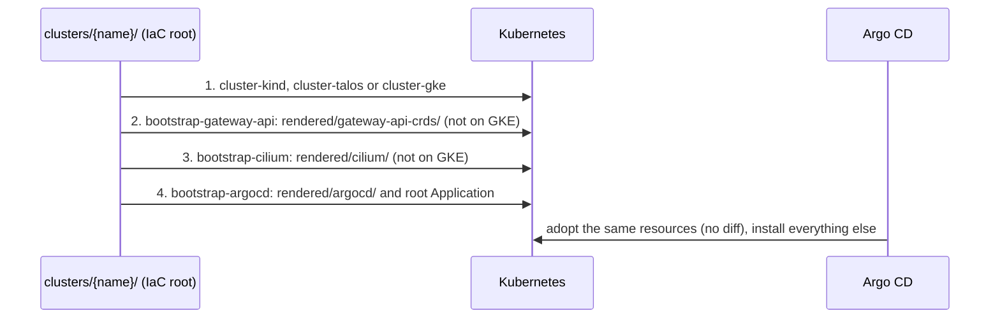

# RFC 0015: Limit bootstrap to cluster, Gateway CRDs, Cilium, Argo CD

## Summary

The IaC root of a cluster creates the cluster and installs only the Gateway API CRDs, Cilium and Argo CD, from
the same rendered manifests Argo CD later applies. Argo CD then adopts them and installs everything else.

| Decision | Why | Cost | Reversible |
| --- | --- | --- | --- |
| Limit a cluster root to the cluster, the Gateway API CRDs, Cilium and Argo CD | A node needs a CNI before any pod can run | Adoption needs care while IaC and Argo CD both know the resources | yes, destroy and recreate the cluster root (disposable before it holds data) |
| Let Argo CD adopt these resources and install everything else | IaC state must not fight Argo CD | Bootstrap modules must not revert Argo CD's later changes | yes, destroy and recreate the cluster root (disposable before it holds data) |

## Context

- A new cluster has no CNI and no GitOps controller.
- A node needs a CNI before any pod, Argo CD included, can run.
- Cilium's Gateway API support needs the CRDs at start.
- IaC state that owns in-cluster resources Argo CD also manages leads to two owners fighting.

## Goals and non-goals

Goals:

- The smallest IaC footprint inside the cluster.
- The first install and later syncs use the same manifests.
- Argo CD is the single long-term owner of every in-cluster resource.

Non-goals:

- The exact mechanism that stops the bootstrap reverting Argo CD changes: an implementation choice of the
  `bootstrap-*` modules.

## Decision drivers

- IaC state does not own in-cluster resources that Argo CD also manages.
- A node needs a CNI before any pod, Argo CD included, can run.
- The first install and later syncs use the same manifests.

## Options considered

### IaC installs the minimum from rendered manifests; Argo CD adopts them

- Good: one source of truth for manifests.
- Bad: adoption needs care (two owners briefly).

### IaC installs every component with helm_release

- Good: one tool.
- Bad: no continuous reconciliation and a huge state.

### IaC installs only the cluster; Argo CD installed by hand

- Good: simple.
- Bad: not reproducible.

### Do nothing

No bootstrap: clusters configured by hand.

- Good: no code.
- Bad: no reproducible cluster.

## Proposal

Four steps, then Argo CD owns the cluster's content.

| Rule | Value |
| --- | --- |
| Modules a cluster root calls | only `cluster-*` and `bootstrap-*` |
| Source | the reviewed `rendered/` files: no second set of values |
| After adoption | bootstrap modules apply once, or ignore changes after creation: they never revert Argo CD |
| Teardown | `cluster:down` documents an order that does not depend on in-cluster resources Argo CD created (cloud load balancers) |

## Operational impact

- Blast radius: one cluster per root; a broken bootstrap leaves that cluster without CNI or GitOps.
- Rollout: per cluster, steps 1 to 4 in order; Argo CD then syncs the rest.
- Rollback: destroy and recreate the cluster root (disposable before it holds data); a broken Argo CD is repaired by re-applying `rendered/argocd/`.
- Migration: None: no cluster exists yet.
- Security: the IaC root holds cluster admin credentials only during bootstrap and teardown; never in CI (RFC 0019).
- Cost: N/A: no extra resources.
- Observability: the root `Application` reaches Synced and Healthy with no diff on the adopted resources.

## Drawbacks and risks

| Risk | Severity (proposed) | Mitigation |
| --- | --- | --- |
| IaC and Argo CD briefly both know these resources | medium | bootstrap modules apply once or ignore changes after creation. |
| Destroying the cluster root can hang on in-cluster resources Argo CD created (cloud load balancers) | medium | `cluster:down` documents the order. |

## Open questions

None.

## Decision

- Status: accepted on 2026-11-18 by gsuquet
- Context: bringing a new cluster from nothing to GitOps, facing a node that needs a CNI before any pod and IaC state that would fight Argo CD.
- Decision: we decided for a cluster root `clusters/<name>/` that calls only `cluster-*` and `bootstrap-*` modules, in order: the cluster (`cluster-kind`, `cluster-talos` or `cluster-gke`), `bootstrap-gateway-api` from `rendered/gateway-api-crds/`, `bootstrap-cilium` from `rendered/cilium/` (both skipped on GKE), `bootstrap-argocd` from `rendered/argocd/` with its root `Application`, after which Argo CD adopts the same resources with no diff and installs everything else, and against every component in IaC with `helm_release` and a hand-installed Argo CD, to achieve one set of reviewed manifests and Argo CD as the single long-term owner, accepting a short period where IaC and Argo CD both know these resources.
- Consequences:
  - Good: the bootstrap reuses the reviewed rendered files: no second set of values.
  - Good: Argo CD is the single long-term owner of every in-cluster resource.
  - Bad: bootstrap modules must not revert Argo CD's later changes (apply once, or ignore changes after creation); the mechanism is an implementation choice of the modules.
  - Bad: destroying a cluster root must not depend on in-cluster resources Argo CD created (for example cloud load balancers); `cluster:down` documents the order.
- Confidence: high, the bootstrap applies the same files Argo CD manages, so adoption produces no diff.
- Confirmation: `clusters/<name>/` calls only `cluster-*` and `bootstrap-*` modules; no other in-cluster resource is in the IaC state.
- Revisit when: a component other than these three must exist before Argo CD runs.

## Implementation

N/A: no `bootstrap-*` module exists yet.

## References

- RFC 0022: IaC tool (https://github.com/gsuquet/infra/pull/11)

## Future work

N/A: no follow-up raised.
