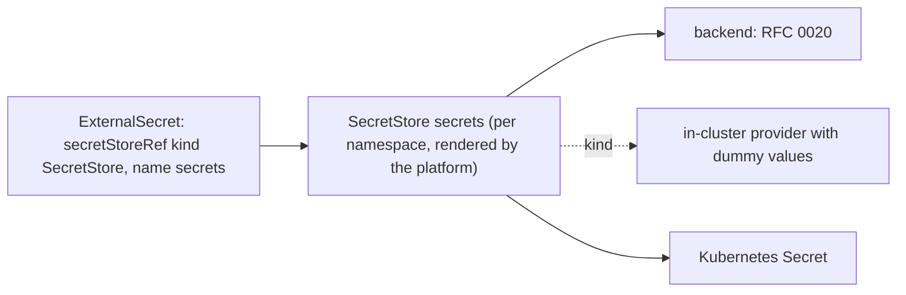

# RFC 0016: Read secrets through an ESO store named secrets

## Summary

Every namespace gets a namespaced External Secrets `SecretStore` named `secrets`, rendered by the platform. Every
consumer references that store, so the backend can change without touching consumers.

## Context

- The secrets backend (cloud secret manager, password manager, in-cluster vault, ...) is still under study
  (RFC 0020).
- Platform components and tenants need a stable way to request secrets now.
- The repositories are public: no secret value in Git, ever.
- kind clusters must work without any real credential.

## Goals and non-goals

Goals:

- Manifests do not change when the backend changes.
- No secret value in Git.
- kind runs the full catalog with dummy values.

Non-goals:

- The backend itself: RFC 0020.
- The kind in-cluster provider (ESO `fake` or `kubernetes`).

## Decision drivers

- Manifests do not change when the backend changes.
- Public repositories: no secret value in Git, ever.
- kind clusters work without any real credential.

## Options considered

### External Secrets Operator with a store named secrets in every namespace

- Good: backend-agnostic consumers.
- Bad: one more indirection.

### Backend-specific store names in each manifest

- Good: explicit.
- Bad: a backend change edits every consumer.

### SOPS-encrypted secrets in Git

- Good: no runtime dependency.
- Bad: encrypted secrets in public repositories and key management per cluster.

### Do nothing

Secrets created by hand in each cluster.

- Good: no tooling.
- Bad: not reproducible, not reviewed.

## Proposal

Consumers see one name; only the rendered store knows the backend.

| Rule | Value |
| --- | --- |
| Store | namespaced `SecretStore` named `secrets`, never a `ClusterSecretStore` |
| Consumer | every `ExternalSecret` sets `secretStoreRef: {kind: SecretStore, name: secrets}` |
| Rendered by | the platform, per namespace; tenant namespaces through onboarding (RFC 0009) |
| kind | in-cluster backend with dummy values |
| Git | no `Secret` with `data` or `stringData` |

## Operational impact

- Blast radius: every namespace: a broken store blocks secret sync for that namespace's consumers.
- Rollout: `external-secrets` baseline component, then the store rendered per namespace.
- Rollback: revert the store change; existing `Secret` objects stay until ESO refreshes them.
- Migration: None: a backend change re-renders the stores only; consumers keep their manifests.
- Security: one backend credential or identity binding per namespace, rendered by the platform; no secret value in Git.
- Cost: N/A: backend cost belongs to RFC 0020.
- Observability: `ExternalSecret` `Ready` condition and ESO sync error metrics.

## Drawbacks and risks

- All consumers get the same interface, even where a backend offers richer features -> accepted for portability.
- One store per namespace means one backend credential or identity binding per namespace -> rendered by the platform.
- A tenant could ship its own `SecretStore` named `secrets` and fight the platform one -> adding `SecretStore` to the tenant `namespaceResourceBlacklist` waits for the owner's decision (RFC 0009).

## Open questions

None.

## Decision

- Status: accepted on 2026-11-18 by gsuquet
- Decision: In the context of platform components and tenants that need secrets before the backend is chosen, facing public repositories and kind clusters with no credentials, we decided for the External Secrets Operator with a namespaced `SecretStore` named `secrets` in every namespace, rendered by the platform (tenant namespaces through onboarding), never a `ClusterSecretStore`, with every `ExternalSecret` setting `secretStoreRef: {kind: SecretStore, name: secrets}` and kind using an in-cluster backend with dummy values, and against backend-specific store names and SOPS-encrypted secrets in Git, to achieve consumers that never change when the backend changes, accepting one indirection and one backend credential or identity binding per namespace.
- Consequences:
  - Good: changing the backend changes only the rendered stores, not consumers.
  - Good: kind runs the full catalog with no credentials.
  - Bad: all consumers get the same interface, even where a backend offers richer features.
  - Bad: one store per namespace means one backend credential or identity binding per namespace, rendered by the platform.
  - Bad: a tenant could ship its own `SecretStore` named `secrets` and fight the platform one until `SecretStore` is in the tenant blacklist (pending the owner's decision).
- Confidence: high, the store name is backend-agnostic by construction.
- Confirmation: a Conftest policy fails any `ExternalSecret` whose `secretStoreRef` is not `kind: SecretStore`, `name: secrets`, any `ClusterSecretStore`, and any `Secret` with `data` or `stringData` in rendered manifests.
- Revisit when: the backend chosen in RFC 0020 cannot serve a namespaced store per namespace.

## Implementation

N/A: the `external-secrets` component does not exist yet.

## References

- [External Secrets Operator](https://external-secrets.io/)
- RFC 0020: secrets backend (https://github.com/gsuquet/infra/pull/4)

## Future work

- The backend itself (RFC 0020).
- The kind in-cluster provider: ESO `fake` or `kubernetes` provider.
