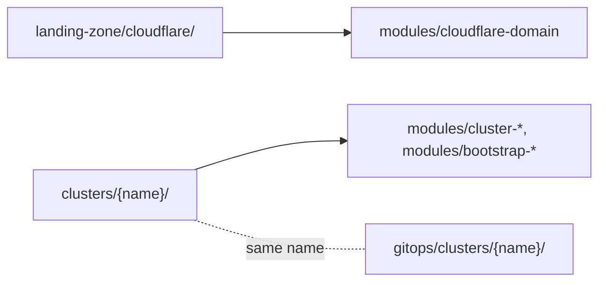

# RFC 0017: Organise infra by landing zones, modules, clusters, gitops

## Summary

`infra` has four top-level areas: `landing-zone/` for account foundations, `modules/` for every child module,
`clusters/` for one IaC root per cluster, and `gitops/` for the catalog, cluster files and tenants.

| Decision | Why | Cost | Reversible |
| --- | --- | --- | --- |
| Organise `infra` in `landing-zone/`, `modules/`, `clusters/` and `gitops/` | Each new file needs one obvious place | A module used by one root lives away from it | yes, move the folders back; no state changes when a child module moves within the same root's calls |
| Name a cluster the same in `clusters/<name>/` and `gitops/clusters/<name>/` | All files of one cluster are found by its name | not stated, see the [open point](https://github.com/gsuquet/infra/pull/18) | not stated, see the [open point](https://github.com/gsuquet/infra/pull/18) |

## Context

- `infra` holds IaC for account-level foundations, IaC for clusters, and GitOps sources.
- Each new file needs one obvious place.
- The Cloudflare `domain` module was nested inside its root (`landing-zone/cloudflare/modules/domain`).

## Goals and non-goals

Goals:

- Root modules (with state) separated from child modules (without state).
- Every file of one cluster found by its name.

Non-goals:

- The content of `landing-zone/gcp/` (projects, IAM, network for GKE).

## Decision drivers

- Root modules (with state) are separated from child modules (without state).
- All files of one cluster are found by its name.
- The HashiCorp standard module structure.

## Options considered

### Four top-level areas

`landing-zone/`, `modules/`, `clusters/`, `gitops/`.

- Good: one place per kind of file.
- Bad: more top-level folders.

### Child modules nested inside their root

- Good: locality.
- Bad: reuse across roots needs relative paths across trees.

### One root module for everything

- Good: simple.
- Bad: one state and one blast radius for everything.

### Do nothing

- Good: no move.
- Bad: no rule for where a new file goes.

## Proposal

| Path | Holds |
| --- | --- |
| `landing-zone/{cloudflare,gcp}/` | IaC roots for account foundations |
| `modules/` | every child module: `cluster-*`, `bootstrap-*`, `cloudflare-domain`, ... |
| `clusters/<name>/` | one IaC root per cluster |
| `gitops/components/<name>/` | catalog: Helm source and default values |
| `gitops/clusters/<name>/` | `cluster.yaml` and `rendered/<component>/` |
| `gitops/tenants/<tenant>.yaml` | tenant onboarding |
| `docs/rfc/`, `docs/adr/` | decisions |

Roots call child modules in `modules/`; a cluster's two folders share its name.

## Operational impact

- Blast radius: repository layout only; one state per root limits each apply to its root.
- Rollout: move nested child modules to `modules/` (the Cloudflare `domain` module to `modules/cloudflare-domain`).
- Rollback: move the folders back; no state changes when a child module moves within the same root's calls.
- Migration: None: child modules hold no state; root module state keys do not change.
- Security: N/A: folder layout only.
- Cost: N/A: no infrastructure.
- Observability: N/A: no runtime component.

## Drawbacks and risks

| Risk | Severity (proposed) | Mitigation |
| --- | --- | --- |
| A module used by one root still lives away from it | low | accepted: reuse by any root outweighs locality. |

## Open questions

None.

## Decision

- Status: accepted on 2026-11-18 by gsuquet
- Context: one repository holding account foundations, cluster IaC and GitOps sources, facing files with no obvious place.
- Decision: we decided for four top-level areas: `landing-zone/{cloudflare,gcp}/` (account foundation roots), `modules/` (every child module: `cluster-*`, `bootstrap-*`, `cloudflare-domain`, ...), `clusters/<name>/` (one IaC root per cluster) and `gitops/` (`components/<name>/`, `clusters/<name>/` with `cluster.yaml` and `rendered/`, `tenants/<tenant>.yaml`), with a cluster named the same in `clusters/<name>/` and `gitops/clusters/<name>/`, and against child modules nested in their root and one root for everything, to achieve one obvious place per file and reusable child modules, accepting that a module used by one root lives away from it.
- Consequences:
  - Good: removing a cluster removes two folders with the same name.
  - Good: every child module is reusable by any root.
  - Bad: a module used by one root still lives away from it.
  - Bad: deferred: the content of `landing-zone/gcp/` (projects, IAM and network for GKE, RFC 0024).
- Confidence: high, it follows the HashiCorp standard module structure.
- Confirmation: no `modules/` folder below a root module; each folder has a README describing what belongs there.
- Revisit when: a root needs a child module that no other root can reuse and the indirection costs more than it saves.

## Implementation

- 2026-11-19 https://github.com/gsuquet/infra/pull/3

## References

- [Standard module structure](https://developer.hashicorp.com/terraform/language/modules/develop/structure)

## Future work

- `landing-zone/gcp/` content: projects, IAM and network for GKE (RFC 0024).
