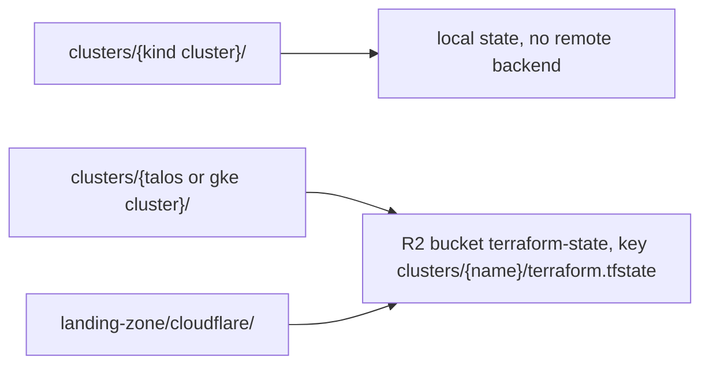

# RFC 0018: Keep kind state local and other cluster states in R2

<!-- readability: allow-code R2 -->

## Summary

kind cluster roots keep their state on the local machine. Talos and GKE cluster roots store their state in the
existing R2 bucket `terraform-state`, one key per cluster.

| Decision | Why | Cost | Reversible |
| --- | --- | --- | --- |
| Keep kind state on the local machine | A disposable cluster needs no credential | kind state is lost with the machine | not stated, see the [open point](https://github.com/gsuquet/infra/pull/18) |
| Keep every other cluster state in the R2 bucket `terraform-state`, one locked key per cluster | Long-lived state survives a lost laptop and supports locking | R2 has no object versioning | no, moving a state to another backend is a state migration; irreversible without one |

## Context

- Each cluster root (`clusters/<name>/`) has IaC state.
- kind clusters are disposable and per machine; Talos and GKE clusters are long-lived.
- The Cloudflare landing zone already stores its state in the R2 bucket `terraform-state`.

## Goals and non-goals

Goals:

- Long-lived state survives a lost laptop and supports locking.
- Disposable clusters need no credentials.
- One backend for all long-lived state.

Non-goals:

- The IaC tool (RFC 0022).
- State backup outside R2.

## Decision drivers

- Long-lived state survives a lost laptop and supports locking.
- Disposable clusters need no credentials.
- Reuse the existing R2 bucket from the Cloudflare landing zone.

## Options considered

### kind local, others in R2

- Good: matches each cluster's lifetime.
- Bad: two backend styles.

### R2 for every cluster, kind included

- Good: uniform.
- Bad: a dev cluster needs Cloudflare credentials.

### GCS for GKE, R2 for Talos

- Good: versioning and locality.
- Bad: a second backend and a bootstrap bucket.

### Do nothing

Local state everywhere.

- Good: no backend.
- Bad: long-lived state lost with a laptop, no locking.

## Proposal

State lives where the cluster's lifetime needs it.

| Setting | Value (non-kind roots) |
| --- | --- |
| Backend | S3 backend against R2 |
| Bucket | `terraform-state` (existing) |
| Key | `clusters/<name>/terraform.tfstate` |
| Locking | `use_lockfile = true` |
| Compatibility | the same R2 flags as `landing-zone/cloudflare/backend.tf` |

## Operational impact

- Blast radius: one cluster's state per key; a lost or corrupted key orphans that cluster's resources.
- Rollout: each non-kind root declares the backend when it is created.
- Rollback: moving a state to another backend is a state migration; irreversible without one.
- Migration: None now: no cluster state exists; later backend changes need a state migration per cluster.
- Security: R2 credentials needed for non-kind roots only, never in CI (RFC 0019); kind needs none.
- Cost: N/A: state files are small in the existing bucket.
- Observability: `init` and lock errors at plan time; the lock file shows a held lock.

## Drawbacks and risks

| Risk | Severity (proposed) | Mitigation |
| --- | --- | --- |
| R2 has no object versioning: a corrupted state cannot be restored from the bucket | high | accepted; backup outside R2 is future work. |
| GKE state lives on Cloudflare, outside Google Cloud | low | one backend for all long-lived state outweighs locality. |
| kind state is lost with the machine | low | acceptable for a disposable cluster. |

## Open questions

None.

## Decision

- Status: accepted on 2026-11-18 by gsuquet
- Context: state for cluster roots with very different lifetimes, facing disposable kind clusters and long-lived Talos and GKE clusters.
- Decision: we decided for local state on kind roots (no remote backend) and, on every other root, the S3 backend against the existing R2 bucket `terraform-state` with key `clusters/<name>/terraform.tfstate`, `use_lockfile = true` and the R2 compatibility flags of `landing-zone/cloudflare/backend.tf`, and against R2 for every cluster and GCS for GKE, to achieve offline credential-free kind clusters and one locked backend for all long-lived state, accepting no object versioning on R2.
- Consequences:
  - Good: `cluster:up` on kind works offline and without secrets.
  - Good: one backend for all long-lived state.
  - Bad: R2 has no object versioning: a corrupted state cannot be restored from the bucket.
  - Bad: GKE state lives on Cloudflare, outside Google Cloud.
  - Bad: kind state is lost with the machine; acceptable for a disposable cluster.
- Confidence: high, the landing zone already runs on the same backend.
- Confirmation: every `clusters/<name>/backend.tf` of a non-kind cluster uses key `clusters/<name>/terraform.tfstate`; kind roots declare no remote backend.
- Revisit when: a state is lost or corrupted in R2, or R2 gains object versioning.

## Implementation

N/A: no cluster root exists yet.

## References

- RFC 0022: IaC tool (https://github.com/gsuquet/infra/pull/11)

## Future work

- State backup outside R2, to cover the missing object versioning.
