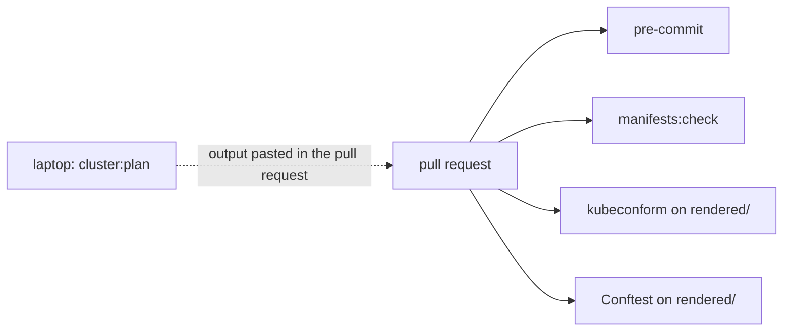

# RFC 0019: Drive lifecycles with mise tasks and keep CI static

## Summary

Operators, agents and CI use the same mise tasks to create, plan and destroy clusters and render manifests. CI
on pull requests runs only static checks, with no credential; plans stay local.

| Decision | Why | Cost | Reversible |
| --- | --- | --- | --- |
| Use mise tasks as the only entry points | Operators, agents and CI run the same commands | not stated, see the [open point](https://github.com/gsuquet/infra/pull/18) | yes, revert the task change |
| Limit pull request CI to static checks with no credential; run plans locally | CI of a public repository must hold no secret | IaC changes and runtime regressions are checked only locally | yes, revert the workflow change |

## Context

- Operators and agents need the same commands for cluster lifecycles and manifest rendering.
- CI must catch errors on pull requests of a public repository without cloud credentials.
- No bootstrap exists yet to run an end-to-end test.

## Goals and non-goals

Goals:

- One entry point per action, the same on a laptop and in CI.
- No credential in CI.
- Fast pull request feedback.

Non-goals:

- A kind end-to-end CI job (create, bootstrap, wait for Argo CD healthy).

## Decision drivers

- One entry point per action, the same on a laptop and in CI.
- No credential in CI for this public repository.
- Fast pull request feedback.

## Options considered

### mise tasks and static CI

pre-commit, `manifests:check`, kubeconform and Conftest.

- Good: simple, safe, fast.
- Bad: runtime regressions are found only locally.

### Makefile and CI with plan

- Good: plan visible in review.
- Bad: credentials in a public repository's CI.

### Full kind end-to-end CI per pull request

- Good: catches runtime errors.
- Bad: slow, and the bootstrap does not exist yet.

### Do nothing

Ad hoc commands and no CI.

- Good: no setup.
- Bad: nothing gates a pull request.

## Proposal

| Task | Action |
| --- | --- |
| `mise run cluster:up <name>` | init and apply `clusters/<name>/` |
| `mise run cluster:plan <name>` | plan `clusters/<name>/` |
| `mise run cluster:down <name>` | destroy `clusters/<name>/` |
| `mise run manifests:render` | render every enabled component of every cluster |
| `mise run manifests:check` | render and fail on any difference with Git |

CI runs static checks only; plans stay on the author's machine.

## Operational impact

- Blast radius: CI only: a broken task blocks pull requests, never a cluster.
- Rollout: tasks under `.mise/tasks/`, tool versions pinned in `.mise/config.toml` with a lockfile, CI calling the tasks.
- Rollback: revert the task or workflow change.
- Migration: None: no state involved.
- Security: CI holds no secret and cannot touch remote state.
- Cost: N/A: free CI minutes of a public repository.
- Observability: CI job status per pull request.

## Drawbacks and risks

| Risk | Severity (proposed) | Mitigation |
| --- | --- | --- |
| IaC changes are not planned in CI | medium | the author runs `cluster:plan` locally and pastes the relevant output in the pull request. |
| Runtime regressions are found only locally | medium | a kind end-to-end job is future work. |

## Open questions

None.

## Decision

- Status: accepted on 2026-11-18 by gsuquet
- Context: lifecycle commands shared by operators, agents and CI in a public repository, facing CI that must stay free of credentials.
- Decision: we decided for mise tasks as the only entry points (`cluster:up|plan|down <name>` to init and apply, plan or destroy `clusters/<name>/`; `manifests:render` and `manifests:check`) and a pull request CI limited to static checks (pre-commit, `manifests:check`, kubeconform and Conftest on `rendered/`), with plans run locally, and against a Makefile with a CI plan and a kind end-to-end job per pull request, to achieve the same commands everywhere and a CI with no secret, accepting that IaC changes and runtime regressions are checked only locally.
- Consequences:
  - Good: CI needs no secret and cannot touch remote state.
  - Good: every tool version is pinned in `.mise/config.toml` with a lockfile.
  - Bad: IaC changes are not planned in CI: the author runs `cluster:plan` locally and pastes the relevant output in the pull request.
  - Bad: runtime regressions are found only locally until a kind end-to-end job exists.
- Confidence: high, static checks cover the rendered output that reaches clusters.
- Confirmation: the CI workflow calls only mise tasks and pre-commit; no workflow references IaC or cloud credentials.
- Revisit when: the bootstrap exists and a kind end-to-end job fits in pull request time.

## Implementation

- 2026-11-19 https://github.com/gsuquet/infra/pull/12

## References

- [mise tasks](https://mise.jdx.dev/tasks/)

## Future work

- A kind end-to-end CI job (create cluster, bootstrap, wait for Argo CD healthy).
